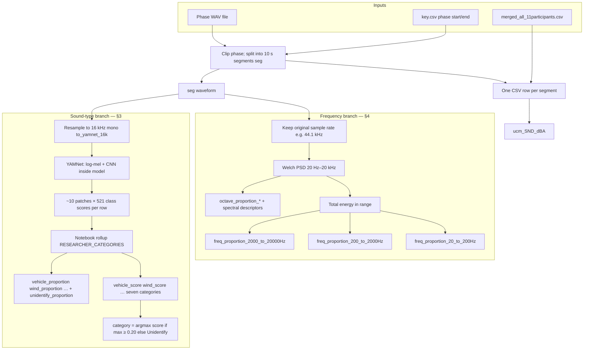
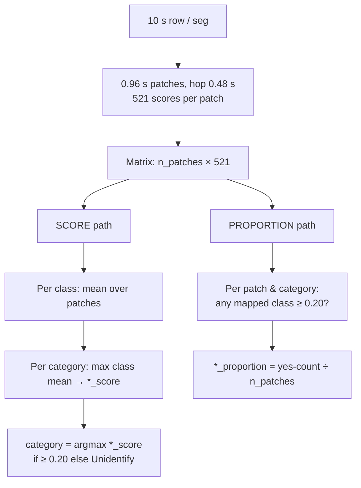
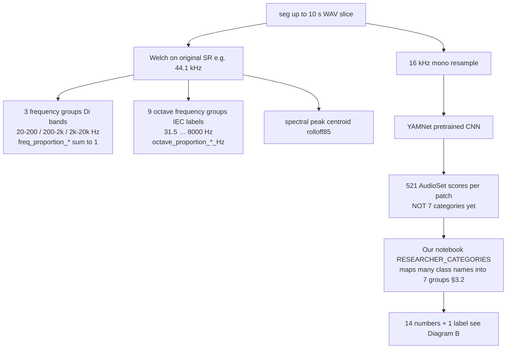
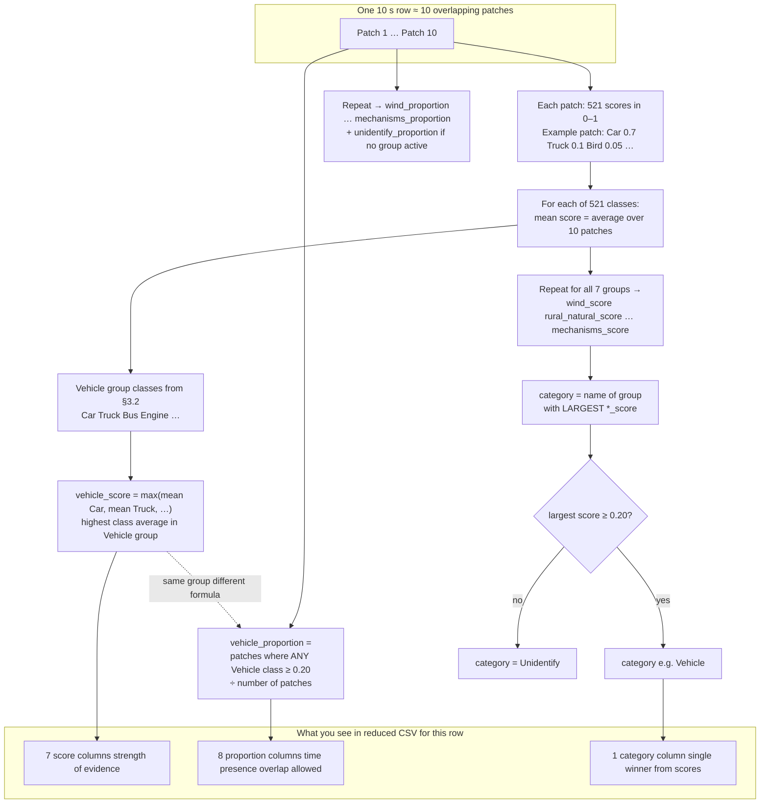
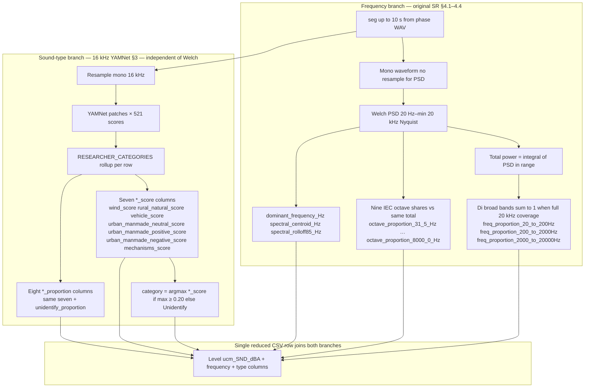
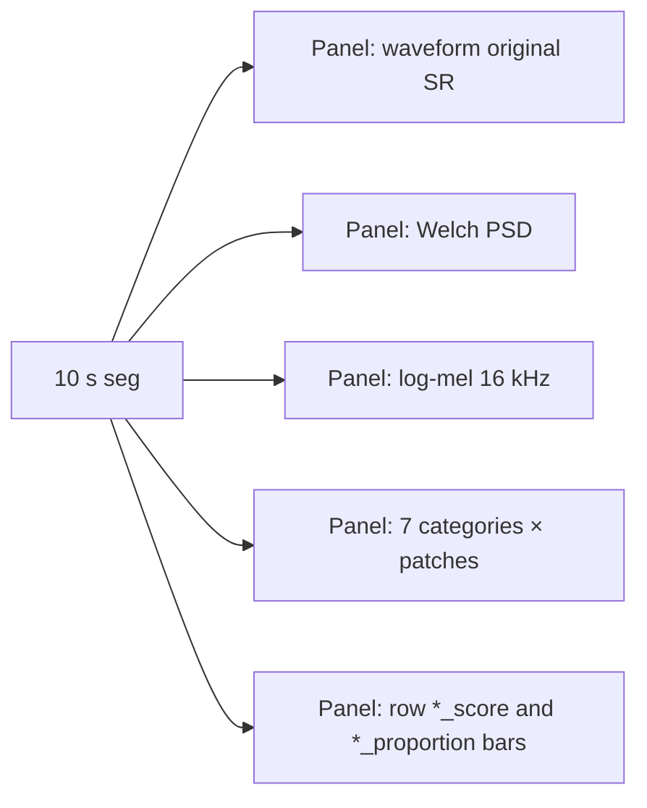

# Sound level, sound type and frequency content in the Paper 3 field experiment

This note explains how environmental sound is summarised for each **10-second window** in the Brussels field campaign. It is written for colleagues who need to read the exported CSVs without opening the notebook. The statistical **primary sound exposure** remains the uCM A-weighted level `ucm_SND_dBA`. YAMNet categories and frequency descriptors are **supplementary** descriptors of *type* and *frequency*, not replacements for calibrated loudness (Hamida et al. 2024).

---

## 1. What problem we are solving

Sound in the field is not only “how loud” but also **what kind of sound** and **where energy sits in frequency**. Following Hamida et al. (2024), the pipeline keeps three aspects separate:

| Aspect        | Question                                                | Main outputs in the reduced CSV                                                                                      |
| ------------- | ------------------------------------------------------- | -------------------------------------------------------------------------------------------------------------------- |
| **Level**     | How loud?                                               | `ucm_SND_dBA` (from uCM backpack, joined from `merged_all_11participants.csv`)                                       |
| **Type**      | Which sound source category dominates this 10 s window? | `category`, `*_score`, `*_proportion`                                                                                |
| **Frequency** | Where is spectral energy (Hz)?                          | `freq_proportion_`*,* `octave_proportion_`, `dominant_frequency_Hz`, `spectral_centroid_Hz`, `spectral_rolloff85_Hz` |

**Cohort:** participants P4, P8–P17 (11 retained). **Phases:** BikeG, BikeU, WalkG, WalkU, Tram. **One WAV file** per participant–phase; windows are anchored to the timestamp in the WAV file name and clipped to phase start/end in `output/key.csv`.

**Outputs (default):**

- Per phase: `output/Sound_ucm/{Participant}_{Phase}_sound_analysis.csv` (38 columns in reduced export)
- Combined: `output/Sound_ucm/all_participants_sound_analysis.csv`
- Matched 8 min: `output/Sound_ucm/all_participants_sound_analysis_matched_8min.csv`

---

## 2. End-to-end flow (audio → CSV columns)

Each **row** in the sound CSV is one **10-second segment** (`seg`) cut from the participant–phase WAV between `key.csv` start and end. From that same segment the notebook writes **level** (joined uCM), **type** (YAMNet), and **frequency** (Welch) in parallel. **Type is not computed from the three** `freq_proportion_`* **bands.**

---

## 3. Sound type (YAMNet): columns and meaning

### 3.1 Seven researcher categories

YAMNet ([TensorFlow Hub YAMNet](https://tfhub.dev/google/yamnet/1); Gemmeke et al. 2017; Hershey et al. 2017) outputs **521 AudioSet class scores** per short frame (~0.96 s, overlapping patches inside the 10 s window). Official class names are mapped into **seven researcher categories** (Wind; Rural/Natural; Vehicle; Urban/Manmade neutral/positive/negative; Mechanisms). The mapping is defined in the notebook as `RESEARCHER_CATEGORIES` (exact AudioSet label strings).

### 3.2 Every category has its own score and proportion columns

For each of the seven categories there is a **pair** of columns (Unidentify has proportion only). The fourth column lists **official YAMNet / AudioSet display names** summed or pooled into that category (`RESEARCHER_CATEGORIES` in the notebook). Strings must match the class map exactly; labels absent from YAMNet are excluded at load time with a console notice. **Some labels appear in more than one category** (e.g. Siren, Hammering); shared membership is intentional in the code.

| Category | Score column | Proportion column | Mapped YAMNet / AudioSet classes |
|----------|--------------|-------------------|----------------------------------|
| Wind | `wind_score` | `wind_proportion` | Wind; Wind noise (microphone); Howl; Whoosh, swoosh, swish; Gust of wind; Blowing (wind); Storm; Hurricane; Tornado |
| Rural/Natural | `rural_natural_score` | `rural_natural_proportion` | Outside, rural or natural; Forest; Bird; Bird vocalization, bird call, bird song; Chirp, tweet; Coo; Crow; Insect; Cricket; Bee, wasp, etc.; Frog; Nature sounds; Stream; Water; Rain; Thunderstorm; Thunder; Ocean; Waves, surf; Animal; Livestock, farm animals, working animals; Horse; Cattle, bovinae; Sheep; Goat; Pig; Chicken, rooster; Dog; Cat; Wild animals; Wolf; Bird flight, flapping wings |
| Vehicle | `vehicle_score` | `vehicle_proportion` | Vehicle; Motor vehicle (road); Car; Car passing by; Truck; Bus; Motorcycle; Emergency vehicle; Siren; Police car (siren); Ambulance (siren); Fire engine, fire truck (siren); Aircraft; Airplane; Helicopter; Train; Rail transport; Train horn; Subway, metro, underground; Boat, Water vehicle; Ship; Motorboat, speedboat; Engine; Engine starting; Idling; Accelerating, revving, vroom; Car alarm; Vehicle horn, car horn, honking |
| Urban/Manmade (neutral) | `urban_manmade_neutral_score` | `urban_manmade_neutral_proportion` | Outside, urban or manmade; City; Urban; Footsteps; Walking; Running; Skateboard; Bicycle |
| Urban/Manmade (positive) | `urban_manmade_positive_score` | `urban_manmade_positive_proportion` | Crowd; Cheering; Applause; Chatter; Conversation; Speech; Human voice; Street music; Busker; Music |
| Urban/Manmade (negative) | `urban_manmade_negative_score` | `urban_manmade_negative_proportion` | Traffic noise, roadway noise; Construction site; Jackhammer; Bulldozer; Excavator; Drilling; Hammering; Sawing; Power tool; Chainsaw; Siren; Emergency vehicle; Industrial noise; Factory; Machinery; Air conditioning |
| Mechanisms | `mechanisms_score` | `mechanisms_proportion` | Mechanisms; Tools; Hammer; Hammering; Wood; Sawing; Filing (rasp); Sanding; Power tool; Drill; Jackhammer; Chainsaw; Medium engine (mid frequency); Light engine (high frequency); Heavy engine (low frequency); Engine knocking; Engine starting; Idling; Accelerating, revving, vroom; Door; Sliding door; Slam; Knock; Tap; Squeak; Creak; Ratchet, pawl; Clock; Tick; Ticking; Mechanical fan; Air conditioning; Microwave oven; Blender; Water tap, faucet; Flush; Zipper (clothing); Keys jangling; Coin (dropping); Scissors; Electric shaver, electric razor; Lawn mower; Printing; Typewriter; Keyboard (typing) |
| Unidentify | *(none)* | `unidentify_proportion` | *(none — not a mapped class group; used when no category wins on score or max score below 0.20)* |

**Scores and proportions answer different questions.** They are computed from the same YAMNet frame scores and the same **0.20** frame threshold, but summarise different things.

**Flowchart — same patches, two outputs (score vs proportion)**

Regenerate PNG: `python scripts/make_yamnet_score_proportion_flowchart.py`.

### 3.3 What the code does for each 10-second row (sound type only)

**Starting point:** one **10-second slice** of the phase WAV (`seg`), cut from the full recording using `key.csv` bounds. We do **not** drop most of the route: every non-silent slice in the phase is processed. The **last** slice can be shorter than 10 s if the recording ends early; it is still analysed for type/frequency on the **real samples present** (no silence padding for YAMNet), flagged `is_complete_10s_window=False`, and excluded from the matched 8-minute export.

Google’s YAMNet checkpoint was **trained on features computed after resampling all audio to 16 kHz mono** (mel front-end 125–7500 Hz, 0.96 s patches; `sample_rate = 16000` in the training hyperparameters) ([TensorFlow Models YAMNet README](https://github.com/tensorflow/models/blob/master/research/audioset/yamnet/README.md); [YAMNet](https://github.com/tensorflow/models/blob/master/research/audioset/yamnet/params.py) `params.py`; [TensorFlow Hub YAMNet/1](https://tfhub.dev/google/yamnet/1)). The 521-class head uses the AudioSet ontology (Gemmeke et al. 2017, [doi:10.1109/ICASSP.2017.7952261](https://doi.org/10.1109/ICASSP.2017.7952261)) and a MobileNet-style CNN stack (Hershey et al. 2017, [doi:10.1109/ICASSP.2017.7952132](https://doi.org/10.1109/ICASSP.2017.7952132)). For **classification only**, the same 10 s slice is converted to mono and **resampled** to 16 kHz in this pipeline (`to_yamnet_16k`) — this changes **samples per second**. A full 10 s window becomes ~160 000 samples at 16 kHz. **Frequency columns** (`freq_proportion_`*, octaves, centroid, etc.) are computed separately on the **original-rate** `seg` (e.g. 44.1 kHz).

**Same** `seg`**, two unrelated column families**

| Branch | Question | Column groups (one CSV row) | Comes from YAMNet? |
|--------|----------|----------------------------|--------------------|
| **Frequency (Welch)** | Where is **energy** in Hz? | **3 broad bands:** `freq_proportion_20_to_200Hz`, `_200_to_2000Hz`, `_2000_to_20000Hz` (sum to 1). **9 octave bands:** `octave_proportion_31_5_Hz` … `octave_proportion_8000_0_Hz` (shares of total 20–20 kHz; need not sum to 1). Plus peak / centroid / rolloff. | **No** — §4 |
| **Sound type (YAMNet + mapping)** | What **event label** fits the sound? | **7×** `*_score`, **8×** `*_proportion`, **1×** `category` | **Yes** — below |

The **frequency groups are not inputs** to the seven categories. The CNN does **not** output Vehicle or Wind directly.

---

**Diagram A — From audio to both column families (one 10 s row)**

---

**Diagram B — The confusing part: 521 classes → 7 groups → score vs proportion vs** `category`

The **CNN head has 521 outputs** (Car, Bird, Wind, …). We **manually assign** each name to zero or one of **seven researcher groups** (plus **Unidentify**, which is not a YAMNet group — it is a fallback label).

**Plain-language summary**

1. **CNN (YAMNet)** = pretrained network; each patch → **521** confidences. It is **not** trained on our seven groups.
2. **Seven categories** = **our** buckets of AudioSet names (§3.2 table, column 4). We **rollup** the 521 streams into **seven** `*_score` and **eight** `*_proportion` columns (different formulas; §3.4).
3. `*_score` (per group) = the **highest** patch-averaged class mean among classes mapped to that group.
4. `*_proportion` (per group) = how **much of the window** that group was “on” (any of its classes ≥ 0.20 on a patch).
5. `category` = the group with the largest `*_score`, or Unidentify if that score is below 0.20. An equal score keeps the earlier group in the category list.

The **0.20** cutoffs are pipeline choices. YAMNet outputs are model confidences, not calibrated probabilities.

### 3.4 Worked example: P4 BikeG, first 10 s

Data are stored at a 10 s interval. YAMNet processes each row as 0.96 s patches with a hop of 0.48 s. In this saved row that is 20 patches. The model has 521 classes, and for each patch it outputs a class score. A higher score means higher model confidence. Each class is averaged across the patches. Scores below 0.2 stay in that average. The 0.2 threshold is not applied here.

There are then 7 categories, and each category includes multiple classes. The category score is the maximum of those class averages inside the category. These are `wind_score`, `rural_natural_score`, `vehicle_score`, `urban_manmade_neutral_score`, `urban_manmade_positive_score`, `urban_manmade_negative_score`, and `mechanisms_score`.

The dominant category, reported in `category`, must pass two criteria: (1) its category score in the 10 s window is ≥ 0.2, and (2) it has the highest category score. Otherwise the label is Unidentify. In the figure, Wind is the dominant category because its score is the highest (0.30).

Proportion is the fraction of patches in the 10 s window where that category is detected. If any class inside the category has score ≥ 0.2 on a patch, that patch is counted. These are `wind_proportion`, `rural_natural_proportion`, `vehicle_proportion`, `urban_manmade_neutral_proportion`, `urban_manmade_positive_proportion`, `urban_manmade_negative_proportion`, `mechanisms_proportion`, and `unidentify_proportion`. In the figure, Wind proportion is 9/20 = 0.45. Vehicle is 10/20 = 0.50. A category score below 0.2 does not force the proportion to zero: Mechanisms is 0.02 because that is an average over all 20 patches, while one patch still reached ≥ 0.2, so its proportion is 1/20 = 0.05.

**Left:** each cell is one mapped class. The red border marks the highest class average in that row, which is the category score printed on the right. **Right:** filled blocks are the patch count for that category. The order of those blocks in time was not saved, so a filled block is a count, not the clock time of the detection. The numbers on the right are the saved row. The other heatmap colours are illustrative class cells; only the red-bordered value and the proportion counts are taken from `output/Sound_ucm/P4_BikeG_sound_analysis.csv`, segment 1.

**Literature:** AudioSet ontology and labels (Gemmeke et al. 2017, [doi:10.1109/ICASSP.2017.7952261](https://doi.org/10.1109/ICASSP.2017.7952261)); CNN embedding / large-scale audio classification (Hershey et al. 2017, [doi:10.1109/ICASSP.2017.7952132](https://doi.org/10.1109/ICASSP.2017.7952132)). Framing of level vs type vs frequency (Hamida et al. 2024, [doi:10.1016/j.indenv.2024.100066](https://doi.org/10.1016/j.indenv.2024.100066)).

---

## 4. Frequency content: a separate path (Welch PSD)

Frequency variables do **not** come from YAMNet and do **not** use the seven category scores. They are computed from the **original sample-rate WAV** (typically 44.1 kHz), in the **same 10 s** `seg`, with **no amplitude normalisation**. YAMNet type columns on that row are computed **in parallel** on a **16 kHz** resample of the same `seg` (§3). One CSV row therefore carries **both** families; they answer different questions and must not be read as cause and effect.

**Diagram C — One 10 s row: Welch (Hz energy) and seven categories (type) side by side**

| Branch | Question | Example columns (same row) | Uses Welch PSD? | Uses 521 YAMNet classes? |
|--------|----------|----------------------------|-----------------|---------------------------|
| **Frequency** | Where is **energy** in Hz? | `freq_proportion_`*, `octave_proportion_*`, spectral peaks | **Yes** | No |
| **Type** | What **source category** fits the sound? | `wind_score` / `wind_proportion`, … (×7), `unidentify_proportion`, `category` | **No** | **Yes** → mapped to 7 groups |

**Visual figure (optional):** `scripts/Sound_yamnet_seven_category_figure.py` plots the same segment in tutorial style — waveform, **Welch PSD**, YAMNet log-mel, patch × **seven category** heatmap, plus **bar summaries** of the row-level `*_score` and `*_proportion` values (same formulas as the notebook). Default PNG: `output/Sound_ucm/Paper3_sound_segment_welch_and_categories.png`.

### 4.1 Welch settings (as implemented)

- Method: `scipy.signal.welch`, Hann window, segment length = max(1024 samples, 1 s), 50% overlap, constant detrend, density scaling.
- Analyse frequencies **20 Hz – min(20 000 Hz, Nyquist)**.
- **Total energy** = integral of PSD over that range.

### 4.2 Broad bands (Di et al. 2018)

Three bands partition 20–20 000 Hz; **proportions sum to 1** when full 20 kHz coverage applies:

| Column | Band (Hz) | Formula |
|--------|-----------|---------|
| `freq_proportion_20_to_200Hz` | 20–200 | band energy / total 20–20 000 Hz |
| `freq_proportion_200_to_2000Hz` | 200–2000 | same |
| `freq_proportion_2000_to_20000Hz` | 2000–20 000 | same |

**Example:** if values are 0.15, 0.55, 0.30, most energy is in the mid band (200–2000 Hz). This describes **spectrum shape**, not “traffic vs birds.”

**Literature:** Di et al. (2018, Eq. 8), [doi:10.3390/ijerph15030474](https://doi.org/10.3390/ijerph15030474), following Landström et al. (1995); low-frequency environmental context (Leventhall 2004); frequency-resolved assessment (ISO 1996-2:2017).

### 4.3 Octave bands (IEC base-2 definition)

Nine bands with exact centres \(f_m = 1000 \times 2^n\) Hz (\(n = -5 \ldots 3\)), edges \(f_m/\sqrt{2}\) to \(f_m\sqrt{2}\). Column names use **IEC nominal** mid labels (31.5 … 8000 Hz). Each `octave_proportion_*_Hz` = energy in that band / **same total 20–20 000 Hz**.

- The **16 kHz** octave is **not** computed (upper edge would exceed 22.05 kHz Nyquist).
- Octave shares **need not sum to 1** (energy above ~11.3 kHz is not assigned to an octave column).
- Values are **relative Welch energy**, not IEC-certified octave SPL (see thesis §5.2.5).

**Literature:** IEC 61260-1:2014 ([doi:10.31030/2231136](https://doi.org/10.31030/2231136)); octave-band exposure example (Chang et al. 2020); Welch (1967, [doi:10.1109/TAU.1967.1161901](https://doi.org/10.1109/TAU.1967.1161901)).

### 4.4 Other spectral columns

| Column | Meaning |
|--------|---------|
| `dominant_frequency_Hz` | Frequency bin with maximum PSD |
| `spectral_centroid_Hz` | Power-weighted mean frequency |
| `spectral_rolloff85_Hz` | Frequency below which 85% of analysed power lies |

---

## 5. Source register

| Item | Location |
|------|----------|
| Implementation | `Paper3_Final/scripts/Updated_JOS_Environmental_sound_classification_with_YAMNet_yenshuo.ipynb` |
| Segment figure (Welch + 7 categories) | `Paper3_Final/scripts/Sound_yamnet_seven_category_figure.py` |
| Phase key | `Paper3_Final/output/key.csv` |
| uCM dBA join | `Paper3_Final/output/merged_all_11participants.csv` |
| Sound exports | `Paper3_Final/output/Sound_ucm/` |
| Thesis methods text | `Pranav PhD Thesis Draft.md` §5.2.5 |
| YAMNet model | https://tfhub.dev/google/yamnet/1 |

---
