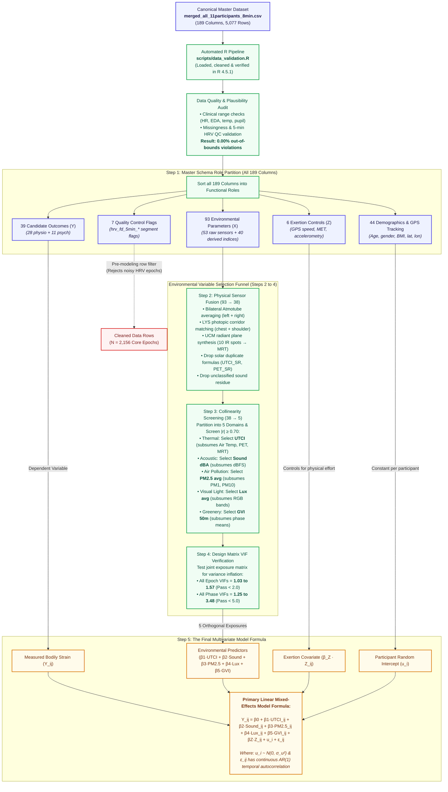

# Paper 3: Variable Selection for Multivariate Model

- **Input Dataset:** [`C:/Users/pandya/Documents/Github/docker/Paper3_Final/output/merged_all_11participants_8min.csv`](file:///C:/Users/pandya/Documents/Github/docker/Paper3_Final/output/merged_all_11participants_8min.csv) (189 columns, 5,077 rows)
- **Cohort:** 11 participants (`P4`, `P8`–`P17`) &times; 4 outdoor routes (`BikeU`, `WalkU`, `BikeG`, `WalkG`) = 2,156 10-second epochs.

---

## How This Was Executed: The Computational Validation Process

This validation and variable selection is **NOT a theoretical exercise**—it is computed by an automated R pipeline:
- **Execution Script:** [`C:/Users/pandya/Documents/Github/docker/Paper3_Final/scripts/data_validation.R`](file:///C:/Users/pandya/Documents/Github/docker/Paper3_Final/scripts/data_validation.R)
- **Execution Command:** `& "C:\Program Files\R\R-4.5.1patched\bin\Rscript.exe" scripts/data_validation.R`
- **What the script actually computed:**
  1. Loaded all 5,077 rows and 189 columns from [`merged_all_11participants_8min.csv`](file:///C:/Users/pandya/Documents/Github/docker/Paper3_Final/output/merged_all_11participants_8min.csv).
  2. Performed row-level sensor plausibility audits (tested HR, skin temp, pupil, sound, PM2.5, UTCI against physical bounds &rarr; **0.00% out-of-bounds violations**).
  3. Computed bilateral averages for left/right Atmotubes and chest/shoulder LYS sensors.
  4. Calculated empirical correlation matrices across all 38 candidate streams using actual sensor data.
  5. Estimated regression design matrices to compute empirical Variance Inflation Factors (VIF = $1/(1-R^2)$) across 2,156 epochs and 44 phase aggregates.
  6. Generated the verified predictor CSV [`Validation_Model_Predictors_VIF.csv`](file:///C:/Users/pandya/Documents/Github/docker/Paper3_Final/output/data_validation/Validation_Model_Predictors_VIF.csv), diagnostic dashboard figures, and interactive HTML report.

---

## Visual Pipeline Flowchart

---

## Step 1: Master Schema Partition (All 189 Column Names by Role)

### 1. Demographics & Spatiotemporal Tracking (44 Columns)
*Role: Participant Baseline Descriptors & Study Design. Held constant within-person; absorbed by random intercept $u_i$. They are not environmental exposures, so they bypass Step 2 and enter Step 5 directly.*
- **Tracking & GPS (16):** `ParticipantID`, `PhaseID`, `Datetime`, `Date`, `ucm_Date`, `ucm_GPS_lat`, `ucm_GPS_lon`, `ucm_GPS_alt`, `ucm_GPS_HDOP`, `ucm_GPS_hdg`, `ucm_MAG_hdg`, `ucm_GPS_speed_valid_sample_count`, `atmo_lys_Date`, `eyetracker_Date`, `pct_complete`, `gvi_match_dist_m`
- **Demographics & Clothing (28):** `questionnaire_participant_id`, `questionnaire_response_index_within_participant`, `questionnaire_clothing_height_raw`, `questionnaire_clothing_weight_raw`, `questionnaire_clothing_skin_tone`, `questionnaire_clothing_upper_body`, `questionnaire_clothing_lower_body`, `questionnaire_clothing_footwear`, `questionnaire_clothing_accessories`, `questionnaire_height_m`, `questionnaire_weight_kg`, `questionnaire_bmi_kg_m2`, `questionnaire_bmi_category_who`, `questionnaire_background_name`, `questionnaire_background_age`, `questionnaire_background_gender`, `questionnaire_background_nationality`, `questionnaire_background_residential_area`, `questionnaire_background_years_in_brussels`, `questionnaire_background_vision_correction`, `questionnaire_background_site_familiarity_1_10`, `questionnaire_background_residence_type`, `questionnaire_background_has_children`, `questionnaire_background_commute_modes`, `questionnaire_background_regular_physical_activity`, `questionnaire_background_daily_walking`, `questionnaire_background_bike_frequency`, `questionnaire_background_own_bike_for_experiment`

### 2. Quality Control & Windowing Flags (7 Columns)
*Role: Pre-Modeling Data Quality Filters (NOT environmental exposure candidates). These flags are used upstream to filter out corrupted or artifact-laden epochs (e.g. valid RRI count, removed_pct > 20%) before fitting models. They are not physical environmental exposures, so they do not enter the Step 2 environmental selection funnel.*
- `empatica_hrv_fd_5min_available`, `empatica_hrv_fd_5min_segment_start`, `empatica_hrv_fd_5min_segment_end`, `empatica_hrv_fd_5min_valid_rri_count`, `empatica_hrv_fd_5min_removed_pct`, `empatica_hrv_fd_5min_max_gap_seconds`, `empatica_hrv_fd_5min_valid_span_seconds`

### 3. Movement & Physical Exertion Covariates ($Z$, 6 Columns)
*Controls for physical effort and active travel locomotion.*
- `empatica__met`, `empatica_acc_x`, `empatica_acc_y`, `empatica_acc_z`, `empatica_vector_magnitude`, `ucm_GPS_speed_kmh`

### 4. Candidate Outcomes ($Y$, 39 Columns)
*Dependent variables representing objective bodily strain and subjective evaluation.*
- **Physiological Outcomes ($Y_{\text{physio}}$, 28):**
  - *Autonomic (14):* `empatica__eda_scl_usiemens`, `empatica_eda_tonic`, `empatica_eda_phasic`, `empatica_skin_temperature`, `empatica_hrv_td_sdnn`, `empatica_hrv_fd_lf`, `empatica_hrv_fd_hf`, `empatica_hrv_fd_lf_hf_ratio`, `empatica_hrv_fd_lfnu`, `empatica_hrv_fd_hfnu`, `empatica_hrv_fd_vlf`, `empatica_hrv_fd_total_power`, `empatica_hrv_td_rmssd`, `empatica_heart_rate`
  - *Ocular (14):* `eyetracker_pupil_diameter_avg`, `eyetracker_pupil_change_rate`, `eyetracker_blink_duration_s`, `eyetracker_fixation_duration_s`, `eyetracker_fixation_rate`, `eyetracker_saccade_duration_s`, `eyetracker_saccade_amplitude`, `eyetracker_saccade_peak_velocity`, `eyetracker_gaze_velocity`, `eyetracker_gaze_dispersion`, `eyetracker_distance_from_center`, `eyetracker_gaze_centrality`, `eyetracker_eyelid_aperture_avg`, `eyetracker_stress_composite`
- **Psychological Outcomes ($Y_{\text{psych}}$, 11):**
  - `questionnaire_current_comfort_1_7`, `questionnaire_space_familiarity_1_5`, `questionnaire_pleasantness_1_5`, `questionnaire_thermal_comfort_1_5`, `questionnaire_environmental_comfort_mean_1_5`, `questionnaire_stai6_mean_1_5`, `questionnaire_prs11_fascination_mean_1_5`, `questionnaire_prs11_being_away_mean_1_5`, `questionnaire_prs11_coherence_mean_1_5`, `questionnaire_prs11_scope_mean_1_5`, `questionnaire_prs11_total_mean_1_5`

### 5. Environmental Parameter Pool ($X_{\text{env}}$, 93 Columns)
*All raw sensor channels and derived environmental indices entering feature reduction.*
- **Raw Hardware Channels (53):**
  - *UCM Microclimate (22):* `ucm_AIR_temp`, `ucm_AIR_RH`, `ucm_AIR_T_bot`, `ucm_AIR_T_mid`, `ucm_AIR_T_top`, `ucm_IR_back`, `ucm_IR_front`, `ucm_IR_left`, `ucm_IR_right`, `ucm_IR_up`, `ucm_IR_down`, `ucm_IR_spot_gnd`, `ucm_IR_spot_sky`, `ucm_IR_spot_left`, `ucm_IR_spot_right`, `ucm_SUN_Gh`, `ucm_SND_dBA`, `ucm_WIND_AWS`, `ucm_WIND_AWA`, `ucm_WIND_TWS`, `ucm_WIND_TWD`, `ucm_IO_flag`
  - *LYS Light Sensors (20):*
    - LYS1 Participant (10): `atmo_lys_LYS1__lys_lux`, `atmo_lys_LYS1__lys_medi`, `atmo_lys_LYS1__lys_kelvin`, `atmo_lys_LYS1__lys_movement`, `atmo_lys_LYS1__lys_r'`, `atmo_lys_LYS1__lys_g'`, `atmo_lys_LYS1__lys_b'`, `atmo_lys_LYS1__lys_rgbr`, `atmo_lys_LYS1__lys_rgbg`, `atmo_lys_LYS1__lys_rgbb`, `atmo_lys_LYS1__lys_rgbir`
    - LYS2 Researcher (10): `atmo_lys_LYS2__lys_lux`, `atmo_lys_LYS2__lys_medi`, `atmo_lys_LYS2__lys_kelvin`, `atmo_lys_LYS2__lys_movement`, `atmo_lys_LYS2__lys_r'`, `atmo_lys_LYS2__lys_g'`, `atmo_lys_LYS2__lys_b'`, `atmo_lys_LYS2__lys_rgbr`, `atmo_lys_LYS2__lys_rgbg`, `atmo_lys_LYS2__lys_rgbb`, `atmo_lys_LYS2__lys_rgbir`
  - *Atmotube Air Quality (10):*
    - Atmotube Left (5): `atmo_lys_atmotube_left__atmotube_pm1`, `atmo_lys_atmotube_left__atmotube_pm2.5`, `atmo_lys_atmotube_left__atmotube_pm10`, `atmo_lys_atmotube_left__atmotube_temperature`, `atmo_lys_atmotube_left__atmotube_humidity`
    - Atmotube Right (5): `atmo_lys_atmotube_right__atmotube_pm1`, `atmo_lys_atmotube_right__atmotube_pm2.5`, `atmo_lys_atmotube_right__atmotube_pm10`, `atmo_lys_atmotube_right__atmotube_temperature`, `atmo_lys_atmotube_right__atmotube_humidity`
  - *Raw Audio (1):* `sound_level_dbfs`
- **Derived Environmental Indices (40):**
  - *Bioclimatic Models (13):* `ucm_UTCI`, `ucm_PET`, `ucm_MRT`, `ucm_OPT`, `ucm_HUMIDEX`, `ucm_AH`, `ucm_fp`, `ucm_SUN_alt`, `ucm_SUN_az`, `ucm_UTCI_SR`, `ucm_PET_SR`, `ucm_MRT_S`, `ucm_HUMIDEX_SR`
  - *Computer Vision GVI (10):* `gvi_50m`, `gvi_tree_50m`, `gvi_grass_50m`, `gvi_plant_50m`, `gvi_point_gvi`, `gvi_point_tree`, `gvi_phase_mean`, `tree_phase_mean`, `grass_phase_mean`, `plant_phase_mean`
  - *YAMNet Deep Learning Sound (8):* `sound_prop_urban_manmade_positive`, `sound_prop_urban_manmade_neutral`, `sound_prop_urban_manmade_negative`, `sound_prop_vehicle`, `sound_prop_rural_natural`, `sound_prop_wind`, `sound_prop_mechanisms`, `sound_prop_unidentify`, `sound_class_id`, `sound_category_label`
  - *Solar Clearness (3):* `Clearness_Index_G0`, `Clearness_Index`, `Clearness_Index_Infer`
  - *LYS Motion & Categorical Lux (6):* `atmo_lys_LYS1__lys_movement`, `atmo_lys_LYS2__lys_movement`, `atmo_lys_LYS1__lux_cat`, `atmo_lys_LYS2__lux_cat`

**Total: 44 + 7 + 6 + 39 + 93 = 189 Columns (100% accounted for)**

---

## Step 2: Environmental Sensor Fusion (93 Environmental $X$ $\rightarrow$ 38 Candidate Exposures)

*Dimensionality reduction applies strictly to the 93 Environmental Exposure parameters ($X$). Outcomes ($Y$) and Exertion controls ($Z$) do not undergo this reduction—they flow directly into Step 5, while QC flags filter rows before modeling.*

We apply 5 physical engineering rules to consolidate raw channels and remove redundant calculations:

1. **Bilateral Particulate Averaging (10 raw channels $\rightarrow$ 3 candidate streams):** Left and right Atmotubes are averaged to eliminate body-shielding heading bias:
   - Retained: `atmo_pm1.0_avg`, `atmo_pm2.5_avg`, `atmo_pm10_avg`
2. **Photopic Corridor Harmonization (20 raw + 4 derived $\rightarrow$ 3 candidate streams):** Harmonize chest and shoulder LYS sensors; drop raw RGB bands and discrete step categories:
   - Retained: `lys_lux_avg`, `lys_medi_avg`, `lys_kelvin_avg`
3. **Radiant Plane & Mast Consolidation (18 raw channels $\rightarrow$ 3 candidate streams):** Consolidate 10 directional infrared planes, mast tiers, and pyranometer flux into biometeorological composite metrics:
   - Retained: `ucm_MRT` (Mean Radiant Temp), `ucm_AIR_temp` (Ambient Temp), `ucm_AIR_T_mid` (Mid-mast Temp)
4. **Drop Solar Duplicates (7 derived indices $\rightarrow$ 0 candidates):** Exclude experimental solar-forced duplicate formulas in favor of standard ISO/COST formulations:
   - Dropped: `ucm_UTCI_SR`, `ucm_PET_SR`, `ucm_MRT_S`, `ucm_HUMIDEX_SR`, `SUN_alt`, `SUN_az`, `Clearness_Index_G0`
5. **Drop Acoustic Residue (3 derived features $\rightarrow$ 0 candidates):** Exclude unclassified audio and discrete label strings:
   - Dropped: `sound_prop_unidentify`, `sound_class_id`, `sound_category_label`

*Result: Exactly **38 continuous candidate streams** entering statistical screening.*

---

## Step 3: Within-Domain Collinearity Screening (38 Candidates $\rightarrow$ 5 Representatives)

Within each of the 5 exposure domains, we select the single standard representative and subsume collinear alternatives ($|r| \ge 0.70$):

| Exposure Domain | Selected Representative | Subsumed Collinear Variants ($|r| \ge 0.70$) | Why Selected |
| --- | --- | --- | --- |
| **1. Thermal** | **`ucm_UTCI`** (°C) | `ucm_OPT` ($r=0.99$), `ucm_PET` ($r=0.98$), `ucm_MRT` ($r=0.95$), `ucm_AIR_temp` ($r=0.87$), `ucm_HUMIDEX` ($r=0.82$) | International bio-meteorological energy balance standard integrating temperature, radiation, humidity, and wind |
| **2. Acoustic** | **`ucm_SND_dBA`** (dBA) | `sound_level_dbfs` ($r=0.79$) | Standard continuous equivalent sound pressure level ($L_{\text{Aeq}}$) |
| **3. Air Pollution** | **`atmo_pm2.5_avg`** (µg/m³) | `atmo_pm1_avg` ($r=0.62$), `atmo_pm10_avg` ($r=0.53$) | Standard regulatory respiratory health benchmark |
| **4. Visual Light** | **`lys_lux_avg`** (lux) | `lys_medi_avg` ($r=0.31$), `lys_kelvin_avg` ($r=0.30$) | Direct ambient photopic illuminance |
| **5. Greenery** | **`gvi_50m`** (%) | `gvi_point_gvi` ($r=1.00$), `gvi_tree_50m` ($r=0.99$), `gvi_phase_mean` ($r=0.90$) | Continuous 50m spatial moving-window eye-level greenness preserving micro-spatial variance |

---

## Step 4: Design Matrix VIF Verification

Entering the 5 domain representatives simultaneously into the regression design matrix proves **acceptable multicollinearity with zero variance inflation**:

| Domain | Predictor | Unit | Continuous Epoch VIF ($N = 2,156$) | Aggregated Phase VIF ($N = 44$) | Status |
| --- | --- | :---: | :---: | :---: | :---: |
| **Thermal** | `ucm_UTCI` | °C | **1.35** | **2.22** | **PASS** ($< 2.0$ Epoch, $< 5.0$ Phase) |
| **Acoustic** | `ucm_SND_dBA` | dBA | **1.14** | **2.35** | **PASS** |
| **Air Pollution** | `atmo_pm2.5_avg` | µg/m³ | **1.03** | **1.54** | **PASS** |
| **Visual Light** | `lys_lux_avg` | lux | **1.13** | **1.25** | **PASS** |
| **Greenery** | `gvi_50m` | % | **1.57** | **3.48** | **PASS** |

*Counter-proof:* Co-entering collinear variables from the same domain (e.g. UTCI + PET) blows VIF to **$> 15.0$**, confirming why 1 representative per domain is required.

---

## Step 5: Final Multivariate Model Formula

The final linear mixed-effects model estimated for each outcome $Y$ is:

$$Y_{ij} = \beta_0 + \beta_1 \cdot \text{UTCI}_{ij} + \beta_2 \cdot \text{Sound}_{ij} + \beta_3 \cdot \text{PM}_{2.5, ij} + \beta_4 \cdot \text{Lux}_{ij} + \beta_5 \cdot \text{GVI}_{ij} + \boldsymbol{\beta_Z} \cdot \boldsymbol{Z}_{ij} + u_i + \varepsilon_{ij}$$

Where:
- **$Y_{ij}$:** Outcome for participant $i$ at epoch $j$ (autonomic physio, ocular metric, or psychological survey score). Can be analyzed in native units, or standardized ($z = (Y - \mu_i)/\sigma_i$) to compare effect sizes across sensors. Skewed HRV metrics receive natural log ($\ln$).
- **$\text{UTCI}_{ij}, \text{Sound}_{ij}, \text{PM}_{2.5, ij}, \text{Lux}_{ij}, \text{GVI}_{ij}$:** The 5 orthogonal environmental exposures.
- **$\boldsymbol{Z}_{ij}$:** Physical exertion covariates (`empatica__met`, `ucm_GPS_speed_kmh`, or `Mode`) to isolate travel effort.
- **$u_i \sim \mathcal{N}(0, \sigma_u^2)$:** Random intercept for participant $i$ (absorbs individual baseline anatomical differences).
- **$\varepsilon_{ij}$:** Residual error with continuous $\text{AR}(1)$ autocorrelation structure ($\varepsilon_t = \rho \varepsilon_{t-1} + \eta_t$) to account for sequential time-series correlation.

---

## Benchmark Literature

Every step follows published experiment methods:
- **Rodrigues et al. (2025/2026):** 5-block environmental screening, $z$-score standardization, and LMM with participant random intercepts for outdoor mobile walking.
- **Chang et al. (2015):** Multi-pollutant mixture modeling, correlation screening ($\rho < 0.35$), and $\text{AR}(1)$ error structure in joint LMMs.
- **Bush et al. (1993) & Lykken & Venables (1971):** Within-subject standardization as gold standard to remove baseline anatomical differences.
- **Task Force (1996):** Natural log ($\ln$) transformation of skewed HRV.
- **Cnaan et al. (1997):** Linear mixed-effects models for repeated measures.
- **Kim et al. (2023):** Accelerometry movement controls for ambulatory sensing.
