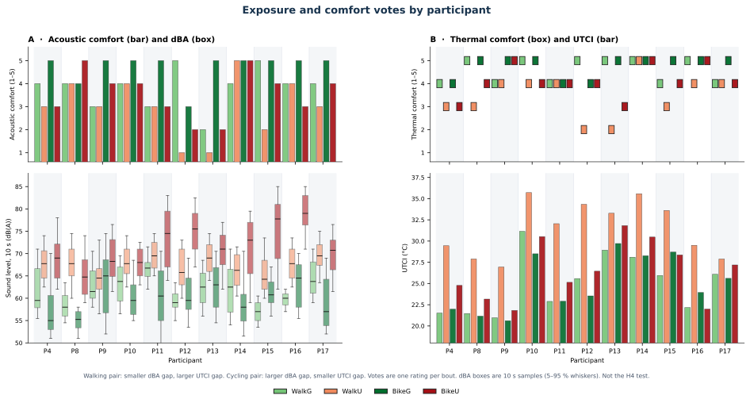

# H4 report

The Brussels study followed 11 participants through four eight-minute bouts each, with one post-bout questionnaire per bout. H4 uses the 22 walking bouts. Cycling is not an H4 extension. Tram is not in H4. Nominal *p* < 0.05.

> **Old H4:** The presence of noise will amplify thermal discomfort.

> **Updated H4:** The presence of noise will increase thermal discomfort.

| Family | Equation | Result | Citations |
| --- | --- | --- | --- |
| Spearman | Spearman ρ (TSV, SPL) at the questionnaire | Brussels: thermal rating vs energy-mean dBA. ρ = −0.62, *p* = 0.002 | Zhen 2025 |
| LMM (one predictor) | Source mixed-linear `TSV ~ LAeq` (five separate one-predictor models; equations not printed in the ICUC-12 abstract) | Brussels: `thermal_comfort ~ dBA_z + (1 \| participant)`. *p* = 0.0037 | Peng 2025 |
| LMM (product) | this study only: `thermal_comfort ~ dBA_z * UTCI_z + (1 \| participant)` | *p* = 0.37; LRT vs add *p* = 0.31. Quiet–hot and loud–cool cells missing. | this study |

A main effect needs noise to vary and a thermal rating on the same bouts. Both exist. An interaction needs four cells; this campaign has two. No screened thermal-vote source estimated `Y ~ dBA_z + UTCI_z + (1 | participant)` (Peng: separate one-predictor models; Rodrigues: separate blocks). That joint model is not the H4 formula. Coupled votes are context. Cureau predicts overall comfort from ratings, not from measured noise.

Unless a row says otherwise, bout sound is the energy-mean of the 10 s `ucm_SND_dBA` samples:

`dBA = 10 log10( mean( 10^(ucm_SND_dBA / 10) ) )`

`UTCI` = bout-mean `ucm_UTCI`; `Ta` = bout-mean `ucm_AIR_temp`; `PET` = bout-mean `ucm_PET`. Subscript z is a z-score across the 22 walking bouts.

---

**How to read the formula citations.** Each section is one table of unique Brussels specifications. A formula is written once; citations stack when more than one source used it. §1 and §2 numbers are different papers. Highlighted pages document the source method or the relevant equation where printed. A highlight does not verify an exact formula when the citation says the specification is unverified. PDF page numbers are counted from the first page of the highlighted copy.

## 1. Old approach — old hypothesis (outside Europe)

Old H4 is **amplification**: a published product, 2×2 heat×noise arms, or LAeq×UTCI ANOVA. Eleven papers do that.

Five others were in the thermal–acoustic screen (both domains measured) and got a Brussels product analogue anyway. That analogue is not their test. Mohammadzadeh, Gao and Wang stay out. Zhen and Tang are not old H4; their **source** tests are in §2. Lab/occupational arms are not available here, so those rows use a median-split or continuous product on the 22 walking bouts. Place is the study city and its Köppen–Geiger class (Beck et al., 2018); chamber rows use the host-city class. Jin, Wu and Xu splits were empty or rank-deficient, so those citations use the continuous product. Ports follow the source noise definition (LAeq, SPL, or assigned lab arms).

| Family | Equation | Result | Citations |
| --- | --- | --- | --- |
| Spearman | `(TSV, SPL)` | no product; §2 | Zhen 2025 |
| Kruskal–Wallis | physio ~ soundscape within PET | no PET × dBA; §2 | Tang 2026 |
| LMM (product) | `Y ~ UTCI_z * dBA_z + (1 \| participant)` | thermal *p* = 0.373; acoustic 0.581; overall 0.580 | Jin 2020; Chen 2023; Li 2025; Wu 2025 |
| LMM (product) | `Y ~ Ta_z * dBA_z + (1 \| participant)` | thermal 0.671; acoustic 0.370; HR **+4.80 (*p* = 0.040)** | Xu 2026; Bhattacharya 1991; Abbasi 2020; Tohidi 2025; Molaeifar 2020 |
| LMM (median split) | `Y ~ I(UTCI ≥ median) * I(dBA ≥ median) + (1 \| participant)` | thermal 0.244; acoustic 0.817; overall 0.654; HR **+23.3 (*p* = 0.0030)** | Yousefinezhad 2026; Dehghan 2017 |
| not run | acoustic ~ PET / UTCI | thermal → acoustic | Mohammadzadeh 2023 |
| not run | ROS ~ UTCI / LAeq class | restoration, not discomfort | Gao & Zhu 2025 |
| not run | paired tests within 26 / 28 / 32 °C | nature audio | Wang, Li & Shi 2026 |

**Sources (old H4).** [1] Jin, Jin & Kang 2020, Harbin (Dwa). {LAeq × UTCI ANOVA. Formula not verified in the local PDF. [UCL accepted manuscript, DOI 10.1016/j.buildenv.2019.106517](https://discovery.ucl.ac.uk/id/eprint/10087342/1/Yumeng%20Jin2019_BAE_Whiterose.pdf).} [2] Chen et al. 2023, Fuzhou (Cfa). {PDF pp. 7–8, [Chen2023](C:/Users/sanga/Desktop/Pranav Paper3_Final/Experiment papers/H4 highlighted sources/02 Chen2023 - highlighted.pdf). RM-ANOVA UTCI × LAeq verified.} [3] Li, Li & Wang 2025, Beijing (Dwa). {SPL × UTCI on TSV/TCV. Formula not verified in the available PDF.} [6] Wu et al. 2025, Zhangjiakou (BSk). {PDF pp. 5, 10–11, 13, [Wu2025](C:/Users/sanga/Desktop/Pranav Paper3_Final/Experiment papers/H4 highlighted sources/06 Wu2025 - highlighted.pdf). LAeq≥60 × UTCI; Brussels used the continuous fallback.} [7] Xu et al. 2026, Xi’an (Cwa). {PDF pp. 9, 17, [Xu2026](C:/Users/sanga/Desktop/Pranav Paper3_Final/Experiment papers/H4 highlighted sources/07 Xu2026 - highlighted.pdf). Ta>32 × SPL>65; Brussels used continuous `Ta * dBA`.} [10] Yousefinezhad et al. 2026, Sari lab (Cfa). {PDF pp. 5–6, [Yousefinezhad2026](C:/Users/sanga/Desktop/Pranav Paper3_Final/Experiment papers/H4 highlighted sources/10 Yousefinezhad2026 - highlighted.pdf). Four arms including combined heat+noise.} [11] Bhattacharya et al. 1991, Ahmedabad (BSh). {2×2 noise × heat on HR. [Publisher PDF](https://www.jstage.jst.go.jp/article/indhealth1963/29/4/29_4_129/_pdf).} [12] Abbasi 2020, Hamadan lab (Dsa). {Temperature × dBA chamber. Formula not verified in the available PDF.} [13] Tohidi 2025, Ilam lab (Csa). {PDF pp. 3, 5, [Tohidi2025](C:/Users/sanga/Desktop/Pranav Paper3_Final/Experiment papers/H4 highlighted sources/13 Tohidi2025 - highlighted.pdf). Three-way ANOVA sound × level × temperature on HR.} [14] Dehghan 2017, Isfahan lab (BWk). {Heat × noise arms. Formula not verified in the available PDF.} [15] Molaeifar 2020, Shiraz lab (BSk). {PDF pp. 4–5, [Molaeifar2020](C:/Users/sanga/Desktop/Pranav Paper3_Final/Experiment papers/H4 highlighted sources/15 Molaeifar2020 - highlighted.pdf). Sound × heat × workload; quoted product unverified.}

---

## 2. Updated hypothesis

Walking bouts only. Köppen–Geiger classes follow Beck et al. (2018). Rodrigues retains *p* < 0.05 and |β| > 0.1. Newcastle 2020 and Zouad & Baron 2026 are not ported. [8] Zhen and [9] Tang are from the thermal–acoustic screen, not Europe: Zhen is the TSV–SPL Spearman; Tang is physiology inside a thermal band, not `thermal_comfort ~ noise`. Tang’s source is seated playbacks, not a walk.

Equation = the **source** test. Result = the Brussels analogue (not a reprint). H4 close is Zhen Spearman TSV vs SPL and Peng TSV ~ LAeq. Grapas Brussels (delay ~ exposure) is not in the table.

| Family | Equation | Result | Citations |
| --- | --- | --- | --- |
| Spearman | `ρ_S (TSV, SPL)` at the questionnaire (TES-1350A) | thermal rating vs energy-mean dBA. ρ = **−0.620 (*p* = 0.002)** | Zhen 2025 |
| Wilcoxon | Mann–Whitney U (`LAeq_urban`, `LAeq_park`); independent parks | paired Wilcoxon energy-mean dBA, WalkU − WalkG. **p = 0.000977** | Cureau 2022 (Pisello) |
| Wilcoxon | Mann–Whitney U on park vs urban comfort votes | paired Wilcoxon. thermal **0.0156**; acoustic 0.156 | Cureau 2022 (Pisello) |
| Fisher | Fisher exact, thermal vote × acoustic-quality vote, per park | thermal × `acoustic_comfort`. green 0.524; urban 0.061 | Cureau 2022 (Pisello) |
| Kruskal–Wallis | ANOVA / Kruskal–Wallis of HR, SDNN, RMSSD across soundscape-diversity cells **within** a PET/TSV stratum | dBA quartiles within median PET (playbacks not available). HR cool/warm 0.428 / 0.311; SDNN 0.118 / 0.242; RMSSD 0.145 / 0.623. Min cell = 1. | Tang 2026 |
| LMM (one predictor) | `TSV ~ LAeq` (mixed-linear; one of five separate models; equation not printed) | `thermal_comfort ~ dBA_z + (1 \| participant)`. **p = 0.0037** | Peng 2025 |
| LMM (one predictor) | `TSV ~ ASV` (mixed-linear; equation not printed) | `thermal_comfort ~ acoustic_comfort + (1 \| participant)`. **0.00212** | Peng 2025 |
| LMM (one predictor) | `ASV ~ LAeq` (mixed-linear; equation not printed) | `acoustic_comfort ~ dBA_z + (1 \| participant)`. **0.0206** | Peng 2025 |
| LMM | `Y_ij = b0 + b1 z(NOISE_max_ij) + b2 z(NOISE_sd_ij) + u_i + e_ij` (noise block; temperature in a separate model) | 10 s dBA max/sd, z across 22 walks. skin, Noise_max **0.000173**; Noise_sd 0.476; HR 0.920 / 0.151; EDA 0.293 / 0.633; SDNN 0.967 / 0.204; RMSSD 0.201 / 0.112 | Rodrigues 2026 |

**Spectrum.** Same **source** equations as the family table; measured sound (SPL / LAeq / NOISE_max) is **replaced**. Vote-only rows have no sound term and are not repeated. Share = bout-mean proportion of energy in a frequency band (loudness stripped). Band level = sound-pressure level in that band (loudness kept). L90 of the bout is the 10th percentile of its 10 s `ucm_SND_dBA` samples (the A-weighted level exceeded for 90% of those samples). L90-excess is `10 log10( mean( max( 10^(dBA/10) − 10^(L90/10) , 0 ) ) )`. Low-frequency band level (31.5–250 Hz) vs dBA *r* = 0.987. Vehicle-class share WalkG 0.093 vs WalkU 0.066. Rural/natural-class Peng *p* = 0.019 is the wrong sign and is not H4.

| Family | Equation | Result | Citations |
| --- | --- | --- | --- |
| Spearman | `ρ_S (TSV, SPL)` (SPL replaced) | low-frequency share (31.5–250 Hz) 0.74; 20–200 Hz share 0.94; 63 Hz share 0.85; low-frequency band level (31.5–250 Hz) **0.006**; 20–200 Hz band level **0.009**; 63 Hz band level **0.003**; L90-excess **0.0015** | Zhen 2025 |
| Wilcoxon | Mann–Whitney U (`LAeq_urban`, `LAeq_park`) (LAeq replaced) | low-frequency share (31.5–250 Hz) 0.042; mid-frequency share (500–2000 Hz) 0.083; high-frequency share (4000–8000 Hz) 0.014; low-frequency / 20–200 Hz / 63 Hz band level and L90-excess **0.000977** | Cureau 2022 (Pisello) |
| Kruskal–Wallis | ANOVA / Kruskal–Wallis of HR, SDNN, RMSSD across soundscape cells within a PET/TSV stratum (soundscape replaced) | low-frequency share (31.5–250 Hz) HR 0.232 / 0.290; low-frequency and 20–200 Hz band level and L90-excess same as dBA (0.428 / 0.311); 63 Hz band level 0.361 / 0.311 | Tang 2026 |
| LMM (one predictor) | `TSV ~ LAeq` (LAeq replaced; equation not printed) | low-frequency share (31.5–250 Hz) 0.957; 20–200 Hz share 0.989; 63 Hz share 0.962; low-frequency band level **0.006**; 20–200 Hz band level **0.0063**; 63 Hz band level **0.0087**; L90-excess **0.0069** | Peng 2025 |
| LMM (one predictor) | `ASV ~ LAeq` (LAeq replaced; equation not printed) | low-frequency share (31.5–250 Hz) 0.770; 20–200 Hz share 0.661; 63 Hz share 0.766; low-frequency band level **0.022**; 20–200 Hz band level **0.023**; 63 Hz band level **0.014**; L90-excess **0.022** | Peng 2025 |
| LMM | `Y_ij = b0 + b1 z(NOISE_max_ij) + b2 z(NOISE_sd_ij) + u_i + e_ij` (NOISE replaced) | share has no 10 s max/sd, not run; low-frequency band level, skin Noise_max **0.00074** | Rodrigues 2026 |

**Sources.** [2] Cureau, Pigliautile, Kousis & Pisello, A. L. (Anna Laura) 2022, Perugia parks (Csa). {PDF pp. 5, 8, [Cureau2022](C:/Users/sanga/Desktop/Pranav Paper3_Final/Experiment papers/H4 highlighted sources/19 Cureau2022 - highlighted.pdf). Mann–Whitney, Fisher and multinomial verified; Brussels uses paired Wilcoxon.} [3] Rodrigues 2026, Lisbon (Csa). {PDF pp. 5, 7, [Rodrigues2026](C:/Users/sanga/Desktop/Pranav Paper3_Final/Experiment papers/H4 highlighted sources/20 Rodrigues2026 - highlighted.pdf). Participant-intercept models verified. Author code specifies max/mean temperature; Brussels uses local summaries and t-reference inference.} [4] Peng 2025, Schiphol (Cfb). {PDF pp. 4, [Peng2025](C:/Users/sanga/Desktop/Pranav Paper3_Final/Experiment papers/H4 highlighted sources/21 Peng2025 - highlighted.pdf). Abstract confirms five mixed-model hypotheses; it does not print the five exact equations.} [8] Zhen et al. 2025, Datang (Dwa). {PDF pp. 9, [Zhen2025](C:/Users/sanga/Desktop/Pranav Paper3_Final/Experiment papers/H4 highlighted sources/08 Zhen2025 - highlighted.pdf). Source Spearman TSV vs SPL; TSV~UTCI by sound-type. Brussels is Spearman thermal vs dBA on 22 cells, not a product.} [9] Tang et al. 2026, Xi’an (Cwa). {PDF pp. 5, 11, [Tang2026](C:/Users/sanga/Desktop/Pranav Paper3_Final/Experiment papers/H4 highlighted sources/09 Tang2026 - highlighted.pdf). Source ANOVA/Kruskal–Wallis of physiology inside a thermal stratum. Brussels uses dBA quartiles within median PET; playbacks and EEG not available.} Grapas Brussels [1] measured LAeq and UTCI but the test is delay ~ exposure, not thermal + noise. Grapas Rome 2026 is out: HR/EDA vs environment, not thermal-vote H4. Chiucchiù 2026 (NEXT.ROOM indoor chamber; hand search) is out: indoor, not outdoor walking H4. Baquero 2019 (stay counts) is out: occupancy, not thermal + noise. Heat-only physiology, PM2.5, pleasantness and overall-from-votes stay out. Mohammadzadeh, Gao and Wang stay out of both tables.

---

## 3. Conclusion

This study asked whether noise increases thermal discomfort during outdoor walking in Brussels. Eleven adults completed paired eight-minute walks in a green park and on an impervious street; thermal comfort was rated once at the end of each bout; cycling and tram bouts were not used. The noise term is the energy-mean A-weighted sound level of the bout. The thermal comfort vote declined as that level increased: rank correlation ρ = −0.62 (*p* = 0.002); Peng mixed-linear `thermal_comfort ~ dBA_z + (1 | participant)` *p* = 0.0037. Replacing the noise term with low-frequency band level (31.5–250 Hz) gave rank correlation *p* = 0.006 and mixed-linear *p* = 0.006; 20–200 Hz *p* = 0.009 and *p* = 0.0063; 63 Hz *p* = 0.003 and *p* = 0.0087; L90-excess (energy-mean A-weighted level after subtracting that bout’s L90 in linear units) *p* = 0.0015 and *p* = 0.0069. These results support H4. The share of energy in those bands, with loudness stripped, was unrelated to the rating (*p* ≥ 0.74). Park-versus-street sound (Wilcoxon *p* = 0.00098) and thermal vote (Wilcoxon *p* = 0.016), the thermal vote on the acoustic vote (*p* = 0.0021), the acoustic vote on dBA (*p* = 0.021), and skin temperature on peak dBA (*p* = 0.00017) are significant but are not the H4 test. The urban walk is both louder and hotter than the green walk (median bout UTCI 25.6 °C versus 32.0 °C; median energy-mean level 65.3 versus 69.4 dB(A); paired *t* on the thermal vote *p* = 0.0098). The two walks are the closer loudness pair: the person-median WalkU−WalkG gap is 4.2 dB(A) (Wilcoxon *p* = 0.00098). BikeU−BikeG is 9.2 dB(A) (64.0 versus 73.0 dB(A); Wilcoxon *p* = 0.00098); 9 of 11 people had a smaller walking than cycling gap. WalkU sits between WalkG and BikeU and is not closer to one than the other (6 of 11 closer to WalkG, 5 of 11 closer to BikeU). WalkG and BikeG do not differ in level (Wilcoxon *p* = 0.32). The seated tram sits between the two walks (median 66.7 dB(A); closer to WalkG than to WalkU). Heat is the opposite pattern: WalkU−WalkG median UTCI gap 7.3 °C; BikeU−BikeG 2.0 °C (26.5 versus 23.9 °C). That split looks useful: cycling changes loudness more while heat stays closer, so a thermal-vote ~ dBA link on the bike bouts would be less mixed with UTCI. It does not help. The same Spearman and Peng mixed-linear tests on the 22 cycling bouts are ρ = −0.35 (*p* = 0.11) and *p* = 0.096; leftover dBA after an urban dummy is *p* = 0.37. Cycling and tram remain exposure context, not H4 tests (Figure `H4_participant_exposure_votes`). Once an urban-versus-green indicator is included on the walks, leftover variation in A-weighted level no longer predicts the thermal rating (*p* = 0.47). The supported claim is that the thermal comfort vote tracks sound level across the two walking environments, not that sound still explains the rating after route is held constant.

