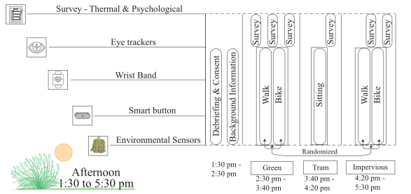
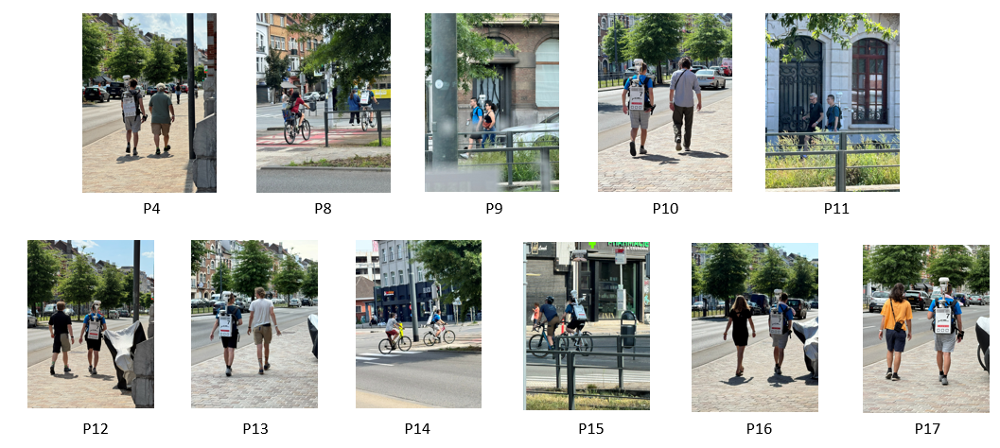
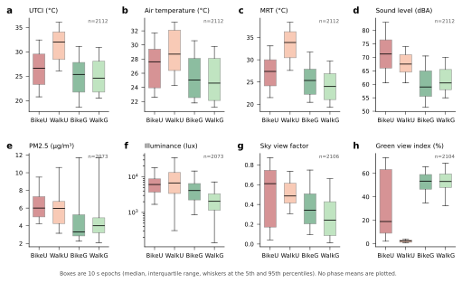
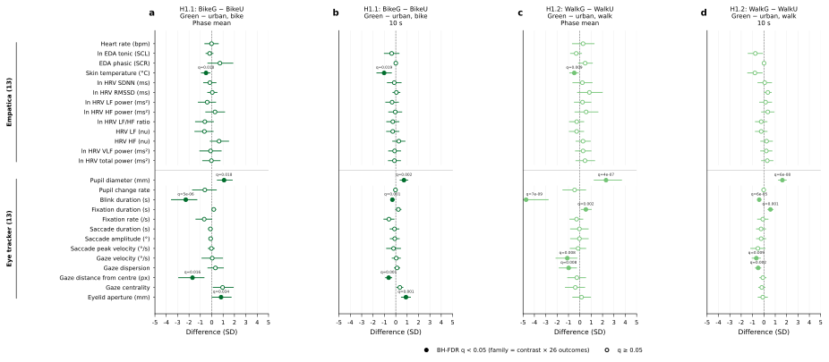
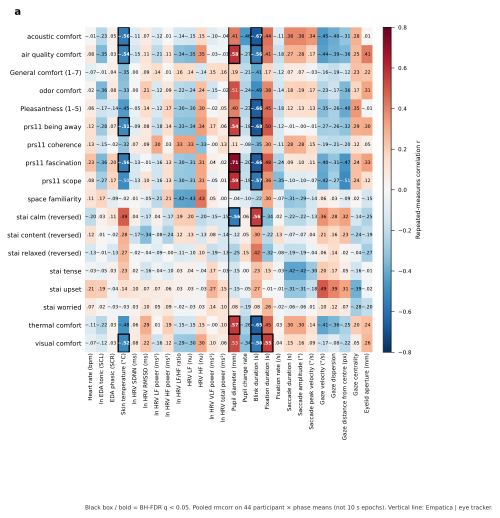
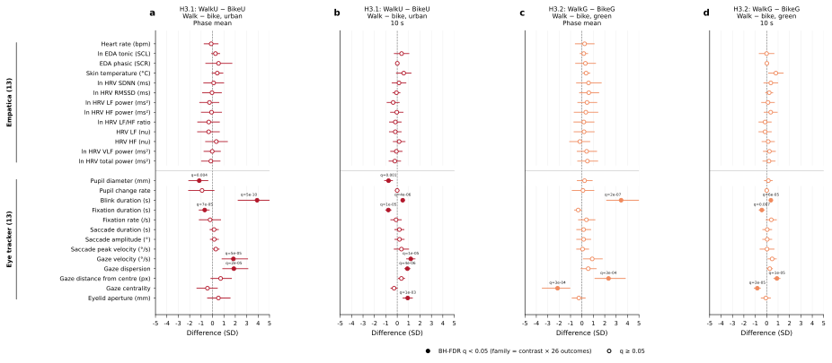
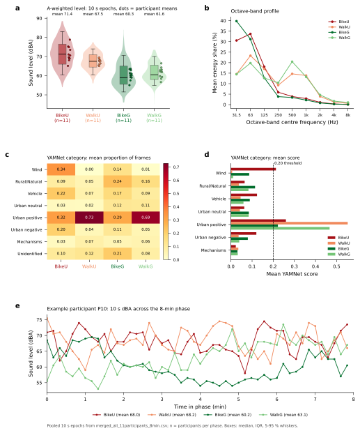
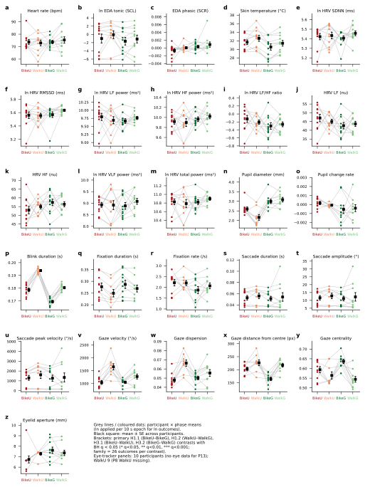

# Psychophysiological comfort during active urban mobility: Environment and activity modulated physiological and perceived responses across diverse urban contexts

Pranav S. Pandya (corresponding author)

[Institution, city, country]

Email: [corresponding author email]

## Highlights

- Green phases showed cooler wrist skin and larger pupils.
- Walking differed from cycling only in eye movements.
- Comfort votes tracked blinks, pupils and skin temperature.
- Noise did not amplify thermal discomfort after correction.
- Exposures were estimated together in additive mixed models.

## Abstract

In this paper we assess route contrasts (H1, H3), unadjusted correlations with votes (H2), physical sensor regressions (Analysis), and the sound effect during thermal discomfort (H4). Eleven adults cycled and walked matched phases in impervious and green corridors in Brussels in summer 2025. Wearable physiology, mobile eye tracking and environmental sensors were synchronized to 10-second epochs and summarised as phase means. Green phases were associated with lower wrist skin temperature and larger pupil diameter. Walking differed from cycling in ocular kinematics. Twenty-one of 468 questionnaire–physiology pairs remained after correction. Those pairs involved blink duration, pupil diameter, skin temperature and fixation duration, not heart rate or tonic electrodermal activity. Noise did not amplify thermal discomfort after correction. The sample is small and the routes were not assigned, so the results describe these summer corridors rather than a general ranking of green versus impervious streets or of walking versus cycling.

Keywords: active mobility; green infrastructure; thermal comfort; wearable sensing; mobile eye tracking; linear mixed models

# 1 Introduction

## 1.1 Background and research gap

Active mobility is increasingly promoted as part of low-carbon and healthy urban transport, but route choice also determines exposure to heat, noise, traffic and visual complexity. Outdoor comfort is adaptive and context-dependent rather than a direct function of meteorological conditions alone (Nikolopoulou et al., 2001).

Naturalistic mobility studies must consider environmental exposure and physical travel demands together. Physiological measures can complement self-report, but they are not direct or unique readouts of comfort: electrodermal activity reflects sympathetic arousal, skin temperature is influenced by thermoregulation and movement, and wrist-derived heart-rate variability requires careful measurement and interpretation (Boucsein et al., 2012; Quigley et al., 2024; Stuyck et al., 2022).

Existing field studies commonly examine walking or cycling separately. Mobile eye tracking is feasible outdoors but remains sensitive to illumination, motion, calibration and scene complexity (Evans et al., 2012; Mahanama et al., 2021). Cycling studies further show that gaze allocation changes with task and road context (Rupi & Krizek, 2019).

Wearable physiological sensing can support thermal-comfort research, but much of the evidence comes from controlled or indoor exposures (Mansi et al., 2022). Cross-domain effects are plausible: daylight can alter thermal perception even under controlled thermal conditions (Chinazzo et al., 2019), illustrating why field responses should not be assigned to a single exposure in isolation.

A central evidence gap is the within-person comparison of walking and cycling across contrasting urban and green route phases while environmental, physiological, eye-tracking and perceived responses are measured together.

This study addresses that gap using repeated phase blocks in one field protocol. The design supports within-participant association estimates across the observed routes; it does not establish that greenery, mode or individual stressors independently caused the responses.

The contribution is the integrated comparison of environment and mobility mode, separation of primary and sensitivity analyses, and joint examination of thermal and acoustic exposure in a naturalistic active-mobility setting.

The study asks whether response profiles differ between green and impervious urban phases, between walking and cycling, whether physiological and perceived responses covary, and whether the thermal association changes with concurrent noise.

The results can inform hypotheses and measurement priorities for larger urban-mobility studies and, cautiously, route designs intended to reduce combined environmental burden.

## 1.2 Hypotheses

We hypothesise that:

1. H1 — Green versus impervious comfort. Participants show better physiological and perceived comfort in green than in impervious areas.
2. H2 — Physiological and perceived concordance. Physiological and perceived responses are concordant.
3. H3 — Cycling versus walking. Psychophysiological comfort is more compromised during cycling than during walking.
4. H4 — Noise and thermal discomfort. Noise and traffic-related sound amplify thermal discomfort.
5. Analysis — Combined exposure. Additive models describe adjusted associations when thermal, acoustic, radiative, pollution, and route-context terms co-occur. This block is not a hypothesis test.

# 2 Methods

Urban-comfort and mobile-exposure papers typically combine design, measurements and analysis in one flow rather than separate “instruments” and “procedure” sections. Measurements are described where they support the analysis grain (here: matched route phases and 10-second epochs). The subsections below follow that convention.

## 2.1 Study design

Figure 1. Experiment campaign timeline.

Figure 2. Sensors worn by the participant.

Figure 3. Route plan for the experiment.

A repeated-measures field campaign was conducted in Brussels, Belgium, from 3 July to 27 August 2025. Each participant completed four core outdoor mobility phases—cycling and walking in impervious urban corridors and in green-park corridors—plus a seated tram phase (descriptive only). Phase labels were BikeU, WalkU, WalkG, BikeG and Tram; tram was excluded from the primary 2 × 2 environment-by-mode contrasts.

The afternoon phase window was chosen based on previous work done by Pandya et al. (2026), where they computed thermal comfort indices - UTCI and PET and both peaked around 2pm to 4pm during summer 2022-24. Field experiment was kept in afternoon period 1:30pm to 5:30pm, to capture the peak thermal discomfort conditions during this field experiement.

Randomization of route order was planned. Participants completed questionnaires before and after each block; wearables and the trailing-researcher uCM backpack were checked at breaks. All streams were time-aligned to UTC. The design targets within-person comparisons of environment and mode under naturalistic active mobility; route location, workload, illumination and co-exposures co-vary with phase, so inferential models estimate associations, not single-stressor causation.

The six state-anxiety items are the STAI-6 short form (Marteau & Bekker, 1992). Answers run from Not at all to Extremely. Calm, relaxed and content are anxiety-absent items and are stored reversed, so a higher modelled score means more state anxiety. Tense, upset and worried are not reversed. The eleven restorativeness items are the PRS-11 (Pasini et al., 2014), answered with the same words. The four subscale means are not reversed, so a higher score means more fascination, being away, coherence or scope. Place pleasantness uses the same anchors, so a higher score means a more pleasant place. Current comfort is the seven-point vote from Very uncomfortable toward more comfort.

### 2.1.1 Participants

Figure 4. Participants on the matched 8-minute segments.

Eighteen volunteers were tested (30 planned under ethics). Eleven with complete multi-sensor coverage on the four core phases were analysed (P4, P8–P17). Inclusion criteria were age 18–60 years, Brussels residence, ability to walk and cycle the study routes, and vision compatible with mobile eye tracking. Ethics application signed 28 May 2025 (approval reference from approved PDF). With n = 11 and four repeated phase cells, post hoc sensitivity (GPower, α = 0.05, power = 0.80, r = 0.50) suggested minimum detectable f ≈ 0.52. Using partial η² = f² / (1 + f²), that f is about 0.21, not 0.11.

The analysed sample comprises eleven participants (three women, eight men) aged 24–58 years (mean 35.2 years, SD 9.5), within the 18–60 year inclusion range. Self-reported height and weight yield BMI 20.5–33.0 kg·m⁻² (mean 23.8 kg·m⁻², SD 3.8): eight meet WHO normal weight (18.5–24.9 kg·m⁻²), two are overweight, and one has obesity. Project case-study labels classify eight as Fit and three as Not Fit and six as Active and five as Inactive (BMI- and daily-walking–based rules applied to the same eleven IDs). Clothing-questionnaire skin tone (Very fair, Fair, Medium, Olive, Brown) is mapped to Fitzpatrick types I–V by ascending shade (I, n = 1; II, n = 6; III, n = 2; IV, n = 1; V, n = 1; no type VI), covering the range where wrist photoplethysmography and optical heart rate on Empatica wearables may perform unevenly across pigmentation (Bent et al., 2020). Seven participants normally wear glasses; four report no vision correction.

Archived mixed models that enter those Fit/Not Fit and Active/Inactive labels as person-level factors are sensitivity analyses only; none of their coefficients survive Benjamini–Hochberg FDR control in the primary hypothesis families reported here.

## 2.2 Data preparation

Micrometeorology and context (uCM, 10 s): air temperature, humidity, mean radiant temperature, global horizontal irradiance, wind, A-weighted sound (dBA), GPS, UTCI and PET. Air quality and light: PM (Atmotube means), lux and colour temperature (LYS means). Scene openness (CamUp / Mapillary pipelines): Holmer annular sky view factor (SVF) for inferential models; tree view factor (TVF) and building view factor (BVF) computed alongside SVF but not co-entered with SVF or GVI in the combined-exposure model (Gong et al., 2018). Greenery: eye-level GVI (gvi_50m). Physiology (Empatica): EDA tonic/phasic, heart rate, HRV, wrist temperature. Vision (eye tracker): pupil, blink, fixation and gaze kinematics; proprietary eyetracker_stress_composite retained in the merge for exploration only. Perception: end-of-phase comfort and environmental-comfort items, STAI-6 item scores, PRS-11 subscale means (18 questionnaire columns in H2/H1–H3 exports).

Streams were synchronized, path-matched and quality-checked, aggregated to 10-second epochs, then—for the phase-mean analyses (H1–H3 and the phase-mean combined-exposure model)—collapsed to participant × phase means on matched eight-minute segments (44 cells). Clearness index (k_t) was computed for solar QC; measured irradiance (ucm_SUN_Gh) entered models, not derived k_t. Transformations followed the locked normalization CSV.

Sound exposure (two streams): Primary loudness is the uCM calibrated A-weighted level ucm_SND_dBA (10 s medians on the backpack stream). Supplementary descriptors from phase WAVs include YAMNet source-type proportions/scores, Welch band energy shares, octave summaries, and spectral centroids (Sound spectrum in field experiment.md). These are not interchangeable with calibrated dBA; low-frequency band fractions can correlate with classifier “wind” labels and with apparent wind on the body during cycling—interpret as type/frequency structure, not as a second loudness standard.

Wind and microphones: Outdoor noise guidance treats high wind as a measurement-condition issue even with windscreens (Federal Highway Administration, n.d.; International Organization for Standardization, 2017; Zuo et al., 2016). A 5 m/s apparent-wind exclusion on ucm_WIND_AWS was implemented as an optional sensitivity for supplementary sound models only (not a decibel correction). Literature (Cooper & Evans, 2015) cautions that a 5 m/s cutoff alone does not guarantee absence of wind-on-microphone artefacts. Windscreen type and microphone placement on the uCM should be stated from field notes in the final manuscript.

## 2.3 Statistical analysis

Primary inference used REML linear mixed models (Pinheiro & Bates, 2000) on participant × phase means to target within-person contrasts and limit pseudo-replication from epoch-level counts (Cnaan et al., 1997; Enders & Tofighi, 2007), with planned contrasts from estimated marginal means (Lenth, 2023) and questionnaire–physiology coupling via repeated-measures correlation (Bakdash & Marusich, 2017). Benjamini–Hochberg FDR (α = 0.05; Benjamini & Hochberg, 1995) was applied within prespecified hypothesis families. Unbalanced repeated-measures field designs follow ambulatory precedent (Rodrigues et al., 2026; Korkmaz et al., 2025).

| Hypothesis | Phaseavg | Timeseries |
| --- | --- | --- |
| H1 | Within one person, does the 8-minute green bout differ from the 8-minute impervious bout on the 26 physiological outcomes? Cycling is BikeG − BikeU. Walking is WalkG − WalkU. | Within one person, does a 10-second epoch in the green corridor differ from a 10-second epoch in the impervious corridor on the 26 physiological outcomes? Cycling is BikeG − BikeU. Walking is WalkG − WalkU. Epochs within a bout are autocorrelated. |
| H2 | Within one person, does a higher end-of-phase questionnaire score go together with a higher or lower phase-mean physiological value? The heatmap cell is the repeated-measures correlation r across the four phases. | The questionnaire was completed at the end of the phase, so it cannot be computed on 10-second epochs. |
| H3 | Within one person, does the 8-minute walking bout differ from the 8-minute cycling bout on the 26 physiological outcomes? Impervious is WalkU − BikeU. Green is WalkG − BikeG. | Within one person, does a 10-second walking epoch differ from a 10-second cycling epoch on the 26 physiological outcomes? Impervious is WalkU − BikeU. Green is WalkG − BikeG. Epochs within a bout are autocorrelated. |
| H4 | On the phase or block used by each source paper, is a higher A-weighted sound level associated with greater thermal discomfort? | No separate 10-second H4 model is fitted. The literature tests use the phase mean, the 5-minute block, or the end-of-phase vote specified by each paper. |

- H1 — Green versus impervious comfort:
- Model: Phase-mean REML LMM: Y ~ PhaseID + (1 | ParticipantID); emmeans contrasts; BH FDR within each contrast over 26 physiological outcomes (H1.1 and H1.2 are separate families, n = 26 each—not one pooled family of 52). Questionnaire contrasts use separate BH families (18 items × contrast). Sensitivity: within-person z-scored (WPZ) repeats the same family structure. Optional 10 s / 60 s AR(1) (H1_H3_timeseries.R) does not include grid_f. In H1_H3_Temporal_AR1_10s.csv, 63 of 546 coefficient rows are flagged rho > 0.95, and the heart-rate phase terms have standard errors in the millions (the same three terms repeated). Do not quote those rows. Phase-mean H1 does not use this file.
- Description & sub-parts: H1.1 BikeG − BikeU (green vs impervious, cycling). H1.2 WalkG − WalkU (green vs impervious, walking). Primary grain: participant × phase means on matched 8 min segments (44 cells); 26 physiological and ocular outcomes. Script: H1_H3_phaseavg.R; exports H1_H3_Contrasts.csv, H1_H3_Temporal_AR1.csv.
- H2 — Physiological and perceived concordance:
- Model: rmcorr; prespecified grid 18 × 26 = 468 pairs; one BH family over the fitted questionnaire–physiology pairs (H2_Concordance.csv). Twenty-one pairs have q < 0.05.
- Description & sub-parts: Phase-mean concordance between comfort, environmental comfort, STAI-6 items, PRS-11 subscales and the same 26 outcomes used in H1. Fitted jointly with H1 in H1_H3_phaseavg.R; export H2_Concordance.csv.

Primary H2 pairs with q < 0.05 (21 of 468). Correlation is the repeated-measures r.

| Questionnaire | Physiology | r | q |
| --- | --- | --- | --- |
| Pleasantness | Blink duration | −0.658 | 0.0071 |
| Thermal comfort | Pupil diameter | 0.569 | 0.038 |
| Thermal comfort | Blink duration | −0.653 | 0.0071 |
| Acoustic comfort | Skin temperature | −0.564 | 0.031 |
| Acoustic comfort | Blink duration | −0.673 | 0.0071 |
| Visual comfort | Skin temperature | −0.517 | 0.043 |
| Visual comfort | Blink duration | −0.559 | 0.038 |
| Visual comfort | Fixation duration | 0.553 | 0.040 |
| Air-quality comfort | Skin temperature | −0.537 | 0.038 |
| Air-quality comfort | Pupil diameter | 0.581 | 0.036 |
| Air-quality comfort | Blink duration | −0.558 | 0.038 |
| STAI calm (reversed) | Pupil diameter | −0.562 | 0.038 |
| STAI calm (reversed) | Blink duration | 0.560 | 0.038 |
| PRS fascination | Skin temperature | −0.559 | 0.031 |
| PRS fascination | Pupil diameter | 0.715 | 0.0043 |
| PRS fascination | Blink duration | −0.665 | 0.0071 |
| PRS being away | Skin temperature | −0.513 | 0.044 |
| PRS being away | Pupil diameter | 0.542 | 0.044 |
| PRS being away | Blink duration | −0.683 | 0.0071 |
| PRS scope | Pupil diameter | 0.592 | 0.031 |
| PRS scope | Blink duration | −0.571 | 0.038 |
- H3 — Cycling versus walking:
- Model: Same phase-mean LMM shell as H1; emmeans; BH FDR within each mode contrast over 26 physiological outcomes (H3.1 and H3.2 separate families, n = 26 each); questionnaire and WPZ families as for H1.
- Description & sub-parts: H3.1 WalkU − BikeU (mode contrast, impervious urban). H3.2 WalkG − BikeG (mode contrast, green). Descriptive (not confirmatory): difference-of-differences (BikeG − BikeU) − (WalkG − WalkU). Exports: H1_H3_Contrasts.csv (Hypothesis = H3); sensitivities as H1.

Primary physiological contrasts with q < 0.05. Estimate is the phase-mean contrast in the modelled units. Within-person z-score repeats are not in this table.

| Hypothesis | Contrast | Outcome | Estimate | q |
| --- | --- | --- | --- | --- |
| H1 | BikeG − BikeU | Skin temperature | −1.124 | 0.018 |
| H1 | BikeG − BikeU | Blink duration (s) | −0.009 | 4.5e-6 |
| H1 | BikeG − BikeU | Gaze distance from centre | −38.14 | 0.016 |
| H1 | BikeG − BikeU | Eyelid aperture | 0.877 | 0.034 |
| H1 | BikeG − BikeU | Pupil diameter | 0.393 | 0.018 |
| H1 | WalkG − WalkU | Skin temperature | −1.159 | 0.0092 |
| H1 | WalkG − WalkU | Blink duration (s) | −0.013 | 6.7e-9 |
| H1 | WalkG − WalkU | Fixation duration (s) | 0.027 | 0.0024 |
| H1 | WalkG − WalkU | Gaze dispersion | −0.011 | 0.0081 |
| H1 | WalkG − WalkU | Gaze velocity | −378.3 | 0.0084 |
| H1 | WalkG − WalkU | Pupil diameter | 0.949 | 3.6e-7 |
| H3 | WalkU − BikeU | Blink duration (s) | 0.015 | 4.9e-10 |
| H3 | WalkU − BikeU | Fixation duration (s) | −0.034 | 7.2e-5 |
| H3 | WalkU − BikeU | Gaze dispersion | 0.019 | 2.0e-5 |
| H3 | WalkU − BikeU | Gaze velocity | 609.0 | 5.1e-5 |
| H3 | WalkU − BikeU | Pupil diameter | −0.465 | 0.0038 |
| H3 | WalkG − BikeG | Blink duration (s) | 0.011 | 1.9e-7 |
| H3 | WalkG − BikeG | Gaze distance from centre | 52.78 | 2.8e-4 |
| H3 | WalkG − BikeG | Gaze centrality | −0.093 | 2.8e-4 |
- H4 — Noise and thermal discomfort:
- Model: Literature-derived tests in H4_sound_literature_test.R (not a preregistered protocol). BH FDR within each paper’s own test × outcome family. Screening rule in METHODS_NOTES.md: four papers included; Kraus excluded from that rule because the source model has no thermal term, while the Leq slope is still fitted and reported separately.
- Description & sub-parts: Moshammer, Song (park-versus-street HRV sensitivity; no dBA term in the source), Jin (the heat × sound ANOVA), Rodrigues (noise-block mixed model). Kraus slope is extra. Heat × noise claims use Jin on ucm_SND_dBA. Jin’s ANOVA has no participant block, matching the source paper’s independent-respondent analysis; that is written on the test label.

Calm, relaxed and content are stored reversed, so a higher score means more state anxiety. Tense, upset and worried are not reversed. PRS subscales, pleasantness and the comfort items are not reversed: a higher score means more of that quality. The reversed items are marked “(reversed)” on Figure 8.

- Not confirmatory H4: Superseded Eq1–7 sensitivity pipelines (Analysis_combined_timeseries.R, Analysis_combined_phaseavg.R; archive names H4_timeseries.R, H4_phaseavg.R) differ by grain in predictors and VIF—exploratory Analysis only (§2.3 item 7), not literature-test H4.
- Analysis — Combined exposure:
- Model: Additive REML LMMs, main effects only (Hamra & Buckley, 2018); not a hypothesis test. Collinearity: VIF = 1/(1 − R²); Fox–Monette block VIF for PhaseSum route block. Screen max VIF < 10 on heart-rate complete cases per fitted grain (Analysis_combined_gvif_summary_both_grains.csv); drop predictors only where that grain fails screening.
- Description & sub-parts: Analysis — timeseries (10 s): Analysis_combined_timeseries.R; one additive LMM per outcome × Eq1–7; BH *q* per fixed term within equation × 26 outcomes (separate families per contrast × outcome set in code.); includes ucm_SUN_Gh and gvi_50m where listed. Eq3 is MRT plus sound, PM2.5, lux, kelvin, green view and the route contrasts (10 s max VIF 1.14; phase-mean max VIF 80.24 on gvi_50m). Because mean radiant temperature is itself a radiation exposure, direct solar irradiance (ucm_SUN_Gh) and sky view factor, a property of the sky, were excluded from Eq3 only, to prevent multicollinearity. Current 10 s equations do not include grid_f. Do not describe them as rank-deficient for that reason. Quote coefficient rows only when the standard error and AR(1) flag are usable. Analysis — phaseavg (phase means): Analysis_combined_phaseavg.R; same Eq1–7 structure on participant × phase means (182 / 182 fitted; many low effective-df coefficient flags—exploratory, not confirmatory); GVI is in Eq3 and omitted from the other phase-mean equations; ucm_SUN_Gh and SVF are omitted from Eq3 only. Eq2 phase spec: ucm_AIR_T_mid, ucm_AIR_RH, ucm_WIND_AWS + SVF + PM2.5/lux/kelvin + PhaseSum (no SND; max VIF 9.29 vs 10 s Eq2 1.88). Shared non-thermal core: sound (10 s only), SVF, PM, lux/kelvin, PhaseSumWalkG/U/BikeG; thermal term rotates (UTCI, air T/RH/wind, MRT, HUMIDEX, PET; Eq6–7 swap PM fraction). Fixing aliasing requires a new estimand (e.g. phase contrasts without phase-specific grid FE, or spatial model without PhaseSum)—not dropping failed coefficients.
H4 paper-by-paper screening (included and excluded) is in documents/H4_Screening_Literature_Guide.md.

H4 tests applied (H4_sound_literature_test.R; adaptations, not replications; heat/noise observed not assigned):

| Source | Test as applied here | Sound term(s) tested |  |
| --- | --- | --- | --- |
| Moshammer et al. (2019) | (a) Phase-level LMM per 8 cardiovascular outcomes: outcome ~ phase Leq per 5 dB + MET (+ air temperature) + (1 \ | Participant); (b) road-vs-park analogue: paired WalkG − WalkU phase-mean contrast, unadjusted and adjusted for Δ air temperature | Per-5 dB Leq slope (2 specifications × 8 outcomes); WalkG − WalkU contrast (2 × 8) |
| Song et al. (2013, 2014) | Two-outcome sensitivity (SDNN, RMSSD) on the temperature-adjusted WalkG − WalkU contrast | Unadjusted paired difference; temperature-adjusted intercept |  |
| Jin et al. (2020) | End-of-phase thermal and environmental comfort ~ dBA bin (≥ 65) × UTCI bin (> 26), participant-blocked ANOVA on 44 cells | dBA main effect; dBA × UTCI interaction |  |
| Rodrigues et al. (2026) | Trip-level mixed model with noise block (max, mean, SD of dBA, z-scored); REML Wald tests + BH-FDR | Each noise term |  |
| Kraus et al. (2013) | Phase-level Leq piecewise slopes at 65 dBA per 5 dB; MET and HR adjustment; outcomes HR, SDNN, LFnu, HFnu, LF/HF | Per 5 dB above and below 65 dBA |  |

FDR: Benjamini–Hochberg within each source’s prespecified sound-term family (not pooled across sources). Raw *p* and *q* in output/statistical_analysis/results/H4_sound_literature_test/.

Benjamini–Hochberg FDR (α = 0.05) was applied within prespecified families for H1–H6 (including separate H6-A and H6-B families and H4 families per literature source). The Analysis block fits additive combined-exposure LMMs (Eq1–7) with VIF screening; BH *q* per fixed term within equation across 26 outcomes (10 s and phase-mean grains separately)—descriptive association modelling, not a confirmatory hypothesis test; 10 s Analysis FDR row counts are not verified inference.

H1/H3 primary physiological FDR (locked, H1_H3_core.R): BH within each contrast over 26 outcomes—two families of n = 26 (H1.1 vs H1.2; H3.1 vs H3.2), not one pooled family of 52. Inline comments that treat “26 × two contrasts” as a single family are inconsistent with this rule. Sensitivity only: pooling all 52 contrast rows into one BH family yields 11 H1 and 9 H3 FDR hits (e.g. WalkG − WalkU fixation duration *q* ≈ 0.045 pooled vs 0.051 under separate families)—does not replace the primary rule.

FDR reporting in §3: Main text uses summary counts plus small example tables for confirmatory H1–H3 (primary physiological families) and the full five-row H2 table. H4, H5, H6 composites, and Analysis coefficient screens are too numerous for main-text tables (full *q* in CSV exports / supplement)—excluding verified epoch-level H1/H3 and Analysis 10 s FDR.

### 2.3.1 Combined-exposure equations and VIF (heart-rate complete cases; Analysis_combined_gvif_summary_both_grains.csv): variance inflation factor VIF = 1/(1 − R²) for each fixed effect regressed on the others (Marquardt, 1970; James et al., 2013); the multi-column PhaseSum route block uses the Fox–Monette block VIF (Fox & Monette, 1992). We follow James et al. (2013) and screen on maximum term (or block) VIF < 10 in the design actually fitted. We report that maximum at each grain in the table below; predictors were dropped only where screening failed for that grain’s fitted model, not globally across grains.

Collinearity is defined relative to which design matrix is fit (James et al., 2013): aggregating to phase means changes *n* and the covariance among exposures and route contrasts, so 10 s and phase-mean specifications may legitimately differ in which covariates enter (e.g. Eq3, which drops direct solar irradiance and sky view factor because mean radiant temperature is already a radiation exposure, has max VIF 80.24 at phase means and 1.14 at 10 s), with VIF computed only on the terms present in each fitted equation—not as proof that one grain is “more correct.”

Fitted specifications (shared non-thermal core unless noted): sound ucm_SND_dBA, morphology SVF, pollution/light atmo_pm2.5_avg, lys_lux_avg, lys_kelvin_avg, route PhaseSumWalkG, PhaseSumWalkU, PhaseSumBikeG. 10 s adds ucm_SUN_Gh and gvi_50m where listed; phase means omit SUN and GVI except that Eq3 keeps green view. Eq3 omits both ucm_SUN_Gh and SVF at both grains.

- Eq1: ucm_UTCI + shared core + (10 s: SUN, GVI).
- Eq2: ucm_AIR_T_mid, ucm_AIR_RH, ucm_WIND_AWS + SVF + PM2.5/lux/kelvin + PhaseSum + (10 s: SND, SUN, GVI; phase: no SND — max VIF 9.29 vs 10 s 1.61).
- Eq3: ucm_MRT + ucm_SND_dBA + atmo_pm2.5_avg + lys_lux_avg + lys_kelvin_avg + gvi_50m + PhaseSum (both grains). Direct solar irradiance (ucm_SUN_Gh) and sky view factor were excluded because mean radiant temperature is a radiation exposure and the two terms are properties of the same radiant field, which would induce multicollinearity. Heart-rate max VIF 1.14 at 10 s (worst term ucm_MRT) and 80.24 at phase means (worst term gvi_50m).
- Eq4: ucm_HUMIDEX + shared core + (10 s: SUN, GVI).
- Eq5: ucm_PET + same non-thermal set as Eq4 + (10 s: SUN, GVI).
- Eq6: as Eq1 with atmo_pm1_avg in place of PM2.5 + (10 s: SUN, GVI).
- Eq7: as Eq1 with atmo_pm10_avg in place of PM2.5 + (10 s: SUN, GVI).

| Eq | Terms | VIF_timeseries | VIF_phaseavg |
| --- | --- | --- | --- |
| 1 | ucm_UTCI + ucm_SND_dBA + ucm_SUN_Gh + SVF + atmo_pm2.5_avg + lys_lux_avg + lys_kelvin_avg + gvi_50m + PhaseSumWalkG + PhaseSumWalkU + PhaseSumBikeG | 2.52 | 7.95 |
| 2 | ucm_AIR_T_mid + ucm_AIR_RH + ucm_WIND_AWS + SVF + atmo_pm2.5_avg + lys_lux_avg + lys_kelvin_avg + PhaseSumWalkG + PhaseSumWalkU + PhaseSumBikeG | 1.88 | 9.29 |
| 3 | ucm_MRT + ucm_SND_dBA + atmo_pm2.5_avg + lys_lux_avg + lys_kelvin_avg + gvi_50m + PhaseSumWalkG + PhaseSumWalkU + PhaseSumBikeG | 1.14 | 80.24 |
| 4 | ucm_HUMIDEX + ucm_SND_dBA + ucm_SUN_Gh + SVF + atmo_pm2.5_avg + lys_lux_avg + lys_kelvin_avg + gvi_50m + PhaseSumWalkG + PhaseSumWalkU + PhaseSumBikeG | 1.41 | 5.52 |
| 5 | ucm_PET + ucm_SND_dBA + ucm_SUN_Gh + SVF + atmo_pm2.5_avg + lys_lux_avg + lys_kelvin_avg + gvi_50m + PhaseSumWalkG + PhaseSumWalkU + PhaseSumBikeG | 2.36 | 6.58 |
| 6 | ucm_UTCI + ucm_SND_dBA + ucm_SUN_Gh + SVF + atmo_pm1_avg + lys_lux_avg + lys_kelvin_avg + gvi_50m + PhaseSumWalkG + PhaseSumWalkU + PhaseSumBikeG | 2.52 | 7.73 |
| 7 | ucm_UTCI + ucm_SND_dBA + ucm_SUN_Gh + SVF + atmo_pm10_avg + lys_lux_avg + lys_kelvin_avg + gvi_50m + PhaseSumWalkG + PhaseSumWalkU + PhaseSumBikeG | 2.52 | 8.28 |

† Terms list 10 s predictors except Eq2 (row = phase-mean Eq2 without SND/SUN/GVI; 10 s Eq2 adds them). VIF columns: max term or PhaseSum-block VIF on heart-rate complete cases for the design in that row.

# 3 Results

## 3.1 Microclimate of the green and impervious routes

Figure 5. Microclimate and co-exposures by phase on 10 s epochs: UTCI, air temperature, mean radiant temperature, sound, PM2.5, illuminance, sky view and green view.

Participant-weighted phase profiles on the merged 10-second dataset: UTCI/PET, sound, radiation, PM and wind across BikeU, WalkU, BikeG, WalkG (Tram descriptive only). These are the measured exposures for the response contrasts in §3.2–§3.6. Precedent for a walking-transect mixed model of PET: Fahy et al. (2025) — local climate zone and solar energy, not land-surface temperature, explained daytime PET in Geneva; open lawns were hotter than shade under trees or compact streets.

## 3.2 H1 — Green versus impervious comfort

Figure 6. H1 green versus impervious contrasts. For each contrast the phase-mean panel is on the left and the 10-second panel is on the right. Every panel uses the same axis, −5 to 5 standard deviations. Filled points and printed q are BH q < 0.05.

Phase-mean models (§2.3.1); estimates from H1_H3_Contrasts.csv (Hypothesis H1). Green phases were associated with lower skin temperature and with larger pupil diameter (pupil is illumination-sensitive).

Table 3.2. Physiological contrasts with q < 0.05. These rows are the filled points in Figure 6. Plotted value is the x-position on the shared −5 to 5 axis: paired standardised mean difference for Phaseavg, and the 10-second z coefficient for Timeseries.

| Method | Contrast | Outcome | Plotted value (SD) | q |
| --- | --- | --- | --- | --- |
| Phaseavg | BikeG − BikeU | Skin temperature | −0.50 | 0.0178 |
| Phaseavg | BikeG − BikeU | Blink duration | −2.29 | 4.55e-06 |
| Phaseavg | BikeG − BikeU | Distance from centre | −1.69 | 0.0159 |
| Phaseavg | BikeG − BikeU | Eyelid aperture | 0.82 | 0.0336 |
| Phaseavg | BikeG − BikeU | Pupil diameter | 1.08 | 0.0178 |
| Phaseavg | WalkG − WalkU | Skin temperature | −0.49 | 0.00916 |
| Phaseavg | WalkG − WalkU | Blink duration | −4.73 | 6.72e-09 |
| Phaseavg | WalkG − WalkU | Fixation duration | 0.53 | 0.00236 |
| Phaseavg | WalkG − WalkU | Gaze dispersion | −0.99 | 0.00810 |
| Phaseavg | WalkG − WalkU | Gaze velocity | −1.10 | 0.00838 |
| Phaseavg | WalkG − WalkU | Pupil diameter | 2.31 | 3.64e-07 |
| Timeseries | BikeG − BikeU | Skin temperature | −1.03 | 0.0187 |
| Timeseries | BikeG − BikeU | Blink duration | −0.30 | 0.00123 |
| Timeseries | BikeG − BikeU | Distance from centre | −0.63 | 0.00123 |
| Timeseries | BikeG − BikeU | Eyelid aperture | 0.90 | 0.00145 |
| Timeseries | BikeG − BikeU | Pupil diameter | 0.72 | 0.00205 |
| Timeseries | WalkG − WalkU | Blink duration | −0.41 | 5.95e-05 |
| Timeseries | WalkG − WalkU | Fixation duration | 0.58 | 0.00108 |
| Timeseries | WalkG − WalkU | Gaze dispersion | −0.51 | 0.00205 |
| Timeseries | WalkG − WalkU | Gaze velocity | −0.67 | 0.00858 |
| Timeseries | WalkG − WalkU | Pupil diameter | 1.63 | 5.94e-08 |

## 3.3 H2 — Physiological and perceived concordance

Figure 8. Repeated-measures correlation between the end-of-phase vote and the phase-mean physiology. Each cell is r. Positive r means that, within a person, a higher vote goes with a higher physiological value. A black box is q < 0.05. Labels marked “(reversed)” are the anxiety-absent STAI items: calm, relaxed and content were reversed so that a higher score means more state anxiety. Heart rate and the electrodermal labels are written vertically along the bottom.

The repeated-measures correlation uses the four phase means of each person. It is not a 10-second correlation, and there is no Timeseries H2. Calm, relaxed and content are the only reversed questionnaire scores in this figure. Tense, upset and worried already point toward more anxiety, so they are not reversed. The PRS subscales, pleasantness and the comfort items are not reversed: a higher score means more fascination, being away, coherence, scope, pleasantness or comfort.

| Item | Reversed in the model | Higher score means |
| --- | --- | --- |
| STAI calm, relaxed, content | Yes | More state anxiety |
| STAI tense, upset, worried | No | More state anxiety |
| PRS fascination, being away, coherence, scope | No | More of that restorative quality |
| Pleasantness and comfort items | No | More pleasant, or more comfort |

Table 3.3. The 21 pairs with q < 0.05. These are the black boxes in Figure 8. Method is Phaseavg for every row.

| Method | Questionnaire | Physiological outcome | r | q |
| --- | --- | --- | --- | --- |
| Phaseavg | Acoustic comfort | Skin temperature | −0.564 | 0.0310 |
| Phaseavg | Acoustic comfort | Blink duration | −0.673 | 0.00711 |
| Phaseavg | Air-quality comfort | Skin temperature | −0.537 | 0.0377 |
| Phaseavg | Air-quality comfort | Blink duration | −0.558 | 0.0377 |
| Phaseavg | Air-quality comfort | Pupil diameter | 0.581 | 0.0359 |
| Phaseavg | Pleasantness | Blink duration | −0.658 | 0.00711 |
| Phaseavg | PRS being away | Skin temperature | −0.513 | 0.0439 |
| Phaseavg | PRS being away | Blink duration | −0.683 | 0.00711 |
| Phaseavg | PRS being away | Pupil diameter | 0.542 | 0.0439 |
| Phaseavg | PRS fascination | Skin temperature | −0.559 | 0.0310 |
| Phaseavg | PRS fascination | Blink duration | −0.665 | 0.00711 |
| Phaseavg | PRS fascination | Pupil diameter | 0.715 | 0.00426 |
| Phaseavg | PRS scope | Blink duration | −0.571 | 0.0377 |
| Phaseavg | PRS scope | Pupil diameter | 0.592 | 0.0310 |
| Phaseavg | STAI calm (reversed) | Blink duration | 0.560 | 0.0377 |
| Phaseavg | STAI calm (reversed) | Pupil diameter | −0.562 | 0.0377 |
| Phaseavg | Thermal comfort | Blink duration | −0.653 | 0.00711 |
| Phaseavg | Thermal comfort | Pupil diameter | 0.569 | 0.0377 |
| Phaseavg | Visual comfort | Skin temperature | −0.517 | 0.0426 |
| Phaseavg | Visual comfort | Blink duration | −0.559 | 0.0377 |
| Phaseavg | Visual comfort | Fixation duration | 0.553 | 0.0396 |

## 3.4 H3 — Cycling versus walking

Figure 7. H3 walking versus cycling contrasts. For each contrast the phase-mean panel is on the left and the 10-second panel is on the right. Every panel uses the same axis, −5 to 5 standard deviations. Filled points and printed q are BH q < 0.05.

Phase-mean contrasts (§2.3 item 3); H1_H3_Contrasts.csv (Hypothesis H3, normalization Primary). Walking versus cycling showed 8 FDR-significant primary physiological contrasts, all ocular. Tonic EDA, fixation rate, and skin temperature did not survive FDR in this family.

Table 3.4. Physiological contrasts with q < 0.05. These rows are the filled points in Figure 7. Plotted value is the x-position on the shared −5 to 5 axis.

| Method | Contrast | Outcome | Plotted value (SD) | q |
| --- | --- | --- | --- | --- |
| Phaseavg | WalkG − BikeG | Blink duration | 3.43 | 1.89e-07 |
| Phaseavg | WalkG − BikeG | Distance from centre | 2.33 | 0.000275 |
| Phaseavg | WalkG − BikeG | Gaze centrality | −2.14 | 0.000275 |
| Phaseavg | WalkU − BikeU | Blink duration | 3.91 | 4.95e-10 |
| Phaseavg | WalkU − BikeU | Fixation duration | −0.68 | 7.20e-05 |
| Phaseavg | WalkU − BikeU | Gaze dispersion | 1.87 | 2.04e-05 |
| Phaseavg | WalkU − BikeU | Gaze velocity | 1.83 | 5.05e-05 |
| Phaseavg | WalkU − BikeU | Pupil diameter | −1.16 | 0.00385 |
| Timeseries | WalkG − BikeG | Blink duration | 0.37 | 6.14e-05 |
| Timeseries | WalkG − BikeG | Distance from centre | 0.90 | 1.07e-05 |
| Timeseries | WalkG − BikeG | Fixation duration | −0.43 | 0.00654 |
| Timeseries | WalkG − BikeG | Gaze centrality | −0.82 | 2.66e-05 |
| Timeseries | WalkU − BikeU | Blink duration | 0.48 | 4.13e-06 |
| Timeseries | WalkU − BikeU | Eyelid aperture | 0.92 | 0.000961 |
| Timeseries | WalkU − BikeU | Fixation duration | −0.78 | 1.07e-05 |
| Timeseries | WalkU − BikeU | Gaze dispersion | 0.89 | 4.13e-06 |
| Timeseries | WalkU − BikeU | Gaze velocity | 1.19 | 1.14e-05 |
| Timeseries | WalkU − BikeU | Pupil diameter | −0.76 | 0.00118 |

## 3.5 H4 — Noise and thermal discomfort

Primary H4 (locked): H4_sound_literature_test.R → output/statistical_analysis/results/H4_sound_literature_test/ only—not archived H4_phaseavg / H4_timeseries Eq1–7 exports.

On primary ucm_SND_dBA, no Jin dBA × UTCI interaction survived FDR (0/2 perception items). Moshammer Leq slopes and Song walk sensitivity had 0 FDR hits. Rodrigues noise block: 1 FDR-adjusted hit (NOISE_max on MIN_Values under their retention rule). Kraus piecewise slopes: 0 FDR hits on five HRV outcomes. Supplementary sound-class substitutions in the same pipeline are exploratory and not interpreted as calibrated loudness.

Full counts: output/statistical_analysis/results/H4_sound_literature_test/SUMMARY_sound_tests_p_and_FDR.csv (filter sound_variable == ucm_SND_dBA (primary) for manuscript claims).

## 3.6 Analysis — Combined exposure

Additive Eq1–7 LMMs at 10 s and at phase means (§2.3 item 7). Current exports: 152 / 2184 coefficient rows with q < 0.05 at 10 s (Analysis_combined_timeseries_hypothesis.csv); 30 / 1846 at phase means (Analysis_combined_phaseavg_Heat_Noise_Exposures.csv). Eq3 is fitted at both grains. Its maximum heart-rate VIF is 1.14 at 10 s and 80.24 at phase means.

# 4 Discussion

## 4.1 H1 — Green versus impervious comfort

Within each travel mode, green-corridor phases were associated with lower wrist skin temperature and larger pupil diameter, together with shorter blink duration. On foot, the green phase also showed longer fixations and lower gaze velocity and dispersion; while cycling, gaze position shifted toward the visual centre and eyelid aperture increased. Eleven of 52 primary physiological contrasts remained after Benjamini–Hochberg correction within each contrast family. Tonic electrodermal activity did not. The skin-temperature contrast is consistent with a lower radiant and convective load under higher sky and vegetation cover, not with a restoration effect (Boucsein et al., 2012). Pupil diameter co-varies with illuminance as well as with arousal (Mahanama et al., 2021), and the two route types differ in both. Hypothesis 1 is therefore supported for peripheral temperature and selected gaze metrics, and is not supported as a general reduction in autonomic strain.

## 4.2 H2 — Physiological and perceived concordance

Twenty-one of 468 repeated-measures correlations remained after correction. The surviving pairs couple end-of-phase pleasantness, environmental comfort, calmness and perceived restorativeness with blink duration, pupil diameter, wrist skin temperature and fixation duration. Heart rate, heart-rate variability and tonic electrodermal activity did not. The questionnaires summarise the completed phase, so a single vote is not expected to track every autonomic channel.

## 4.3 H3 — Cycling versus walking

All eight primary physiological contrasts that survived correction were ocular: gaze velocity and dispersion, blink duration, fixation duration, distance from centre, gaze centrality, and pupil diameter. Wrist skin temperature, tonic electrodermal activity, and fixation rate did not differ between modes after correction. The two modes differ in travel speed, metabolic demand, and the visual demand of monitoring the carriageway (Rupi & Krizek, 2019). The gaze differences are therefore read as mode-specific attentional load, not as a ranking of thermal comfort. Hypothesis 3, that cycling would be more thermally and physiologically compromised than walking, is not established.

## 4.4 H4 — Noise and thermal discomfort

On calibrated A-weighted level, the Jin heat-by-sound interaction was not significant after correction for either comfort item (0/2). The Moshammer equivalent-level slopes, the Song park-versus-street sensitivity, and the Kraus piecewise slopes likewise yielded no corrected associations on that loudness measure. The Rodrigues noise block retained one noise-term association under that study’s retention rule; that term is not a heat-by-noise interaction. Song’s source comparison contains no sound-level term, and the Jin ANOVA omits a participant effect, so its uncorrected *p*-values are anti-conservative for repeated phases. Heat and sound were co-occurring route exposures rather than assigned treatments, which limits the power to detect an interaction of the magnitude reported in outdoor-square and laboratory studies. Hypothesis 4 is not supported. The result is an absence of evidence in this summer field design, not a demonstration that acoustic load is irrelevant to outdoor thermal discomfort.

## 4.5 Analysis — Combined exposure

The additive Eq1–7 models describe co-occurring microclimatic, acoustic, and morphological exposures. They are not a hypothesis test. At the 10 s grain, 152 of 2,184 coefficient rows had q < 0.05; at phase means, 30 of 1,846 did. Eq3 at both grains is mean radiant temperature with sound, PM2.5, illuminance, colour temperature, green view and the route contrasts. Direct solar irradiance (ucm_SUN_Gh) and sky view factor were left out of Eq3 because mean radiant temperature is a radiation exposure and sky view factor is a property of the sky; entering either beside mean radiant temperature would induce multicollinearity. The phase-mean fit still has a maximum variance inflation factor of 80.24 (green view), so those phase-mean Eq3 coefficients are not read as separate effects. The 10 s Eq3 maximum is 1.14. These family counts are not read term by term in the main text.

## 4.6 Limitations

The sample is 11 adults in one city over one summer (3 July to 27 August 2025). Environment type and travel mode are confounded with location, sequence, illuminance, metabolic rate, and co-exposures; randomization of route order was planned and is not verified here as a realised counterbalanced sequence. Wrist temperature and electrodermal activity are sensitive to contact and motion, and apparent wind mixes ambient flow with movement-induced airflow at the microphone. No causal attribution of comfort to green infrastructure is made.

# 5 Conclusion

Phase-mean models of a Brussels summer active-mobility campaign show environment-specific differences in wrist skin temperature and visual attention, and mode-specific differences that are confined to ocular kinematics. Broad concordance between end-of-phase comfort ratings and autonomic physiology was not confirmed (21 of 468 fitted pairs), and no heat-by-noise amplification survived correction in the literature-adapted tests on calibrated A-weighted sound. The findings support context-dependent psychophysiological responses to outdoor microclimate and route type, not a general ranking of green versus impervious corridors or of walking versus cycling. Larger multi-season samples, with exposures that are less collinear than the observed summer routes, are required before combined-exposure interactions can be treated as design evidence.

# Declarations

## Ethics approval and consent

The protocol was submitted for ethics review before the campaign (application signed 28 May 2025). The committee name and approval reference are those on the approved PDF and must be inserted here before submission. Each volunteer gave written informed consent. Eighteen volunteers were tested.

## Funding

This work was supported by the Fonds de la Recherche Scientifique (FNRS) [grant numbers - 1.A.891.23, T.0137.23] and SNSF Weave/Lead Agency funding scheme [grant number - 213995].

## Competing interests

The author declares no competing interests.

## CRediT authorship contribution statement

Pranav S. Pandya: Conceptualization, Methodology, Software, Formal analysis, Investigation, Data curation, Visualization, Writing – original draft. Yen- Shuo Huang: Writing – review & editing, Data curation. Maider Llaguno-Munitxa: Writing – review & editing, Super vision, Methodology, Funding acquisition, Conceptualization. Gabriele Manoli: Writing – review & editing, Funding acuisition. Peter Gallinelli - Technological support.

## Data availability

The wearable, eye-tracking and questionnaire records are not publicly archived because they can identify participants. De-identified data that the ethics approval allows to be shared are available from the corresponding author on reasonable request. The analysis scripts that produced the reported models are in the project repository.

# 6 References

Bakdash, J. Z., & Marusich, L. R. (2017). Repeated measures correlation. Frontiers in Psychology, 8, 456. https://doi.org/10.3389/fpsyg.2017.00456

Benjamini, Y., & Hochberg, Y. (1995). Controlling the false discovery rate: A practical and powerful approach to multiple testing. Journal of the Royal Statistical Society: Series B (Methodological), 57(1), 289–300.

Bent, B., Goldstein, B. A., Kibbe, W. A., & Dunn, J. P. (2020). Investigating sources of inaccuracy in wearable optical heart rate sensors. npj Digital Medicine, 3, 18. https://doi.org/10.1038/s41746-020-0226-6

Boucsein, W., et al. (2012). Publication recommendations for electrodermal measurements. Psychophysiology, 49(8), 1017–1034. https://doi.org/10.1111/j.1469-8986.2012.01384.x

Chinazzo, G., Wienold, J., & Andersen, M. (2019). Daylight affects human thermal perception. Scientific Reports, 9, 13690. https://doi.org/10.1038/s41598-019-48963-y

Cnaan, A., Laird, N. M., & Slasor, P. (1997). Using the general linear mixed model to analyse unbalanced repeated measures and longitudinal data. Statistics in Medicine, 16(20), 2349–2380.

Cooper, J., & Evans, T. (2015). Microphone wind speed limits during wind farm noise measurements. Proceedings of the Australian Acoustical Society Conference, Hunter Valley.

Enders, C. K., & Tofighi, D. (2007). Centering predictor variables in cross-sectional multilevel models: A new look at an old issue. Psychological Methods, 12(2), 121–138. https://doi.org/10.1037/1082-989X.12.2.121

Evans, K. M., Jacobs, R. A., Tarduno, J. A., & Pelz, J. B. (2012). Collecting and analyzing eye-tracking data in outdoor environments. Journal of Eye Movement Research, 5(2), Article 6.

Fahy, J. C., Bachofen, C., Camponovo, R., Gallinelli, P., & Schlaepfer, M. A. (2025). Beyond land surface temperature: Identifying areas of daytime thermal discomfort in cities by combining remote sensing and field measurements. Urban Climate, 61, 102460. https://doi.org/10.1016/j.uclim.2025.102460

Federal Highway Administration. (n.d.). Highway traffic noise. https://www.fhwa.dot.gov/environment/noise/

Fox, J., & Monette, G. (1992). Generalized collinearity diagnostics. Journal of the American Statistical Association, 87(417), 178–183. https://doi.org/10.1080/01621459.1992.10475190

Gong, F.-Y., et al. (2018). Mapping sky, tree, and building view factors of street canyons. Building and Environment, 134, 155–167. https://doi.org/10.1016/j.buildenv.2018.02.042

Hamra, G. B., & Buckley, J. P. (2018). Environmental exposure mixtures: Questions and methods to address them. Current Epidemiology Reports, 5(2), 160–165. https://doi.org/10.1007/s40471-018-0145-0

International Organization for Standardization. (2017). ISO 1996-2:2017. Acoustics — Description, measurement and assessment of environmental noise — Part 2: Determination of sound pressure levels.

James, G., Witten, D., Hastie, T., & Tibshirani, R. (2013). An introduction to statistical learning: With applications in R. Springer.

Jin, Y., Jin, H., & Kang, J. (2020). Combined effects of the thermal-acoustic environment on subjective evaluations in urban squares. Building and Environment, 168, 106517. https://doi.org/10.1016/j.buildenv.2019.106517

Korkmaz, D., Knauth, K., Brands, A., Schmeck, M., Büning, P., & Peters, J. (2025). Ambulatory physiological measures obtained under naturalistic urban mobility conditions have acceptable reliability. Scientific Reports, 15, 28940. https://doi.org/10.1038/s41598-025-13216-8

Kraus, U., Schneider, A., Breitner, S., Hampel, R., Rückerl, R., Pitz, M., Geruschkat, U., Belcredi, P., Radon, K., & Peters, A. (2013). Individual daytime noise exposure during routine activities and heart rate variability in adults: A repeated measures study. Environmental Health Perspectives, 121(5), 607–612. https://doi.org/10.1289/ehp.1205606

Lenth, R. V. (2023). emmeans: Estimated marginal means, aka least-squares means (R package). https://CRAN.R-project.org/package=emmeans

Mahanama, B., et al. (2021). Eye movement and pupil measures: A review. Frontiers in Computer Science, 3, 733531. https://doi.org/10.3389/fcomp.2021.733531

Mansi, S. A., Pigliautile, I., Arnesano, M., & Pisello, A. L. (2022). A novel methodology for human thermal comfort decoding via physiological signals measurement and analysis. Building and Environment, 222, 109385. https://doi.org/10.1016/j.buildenv.2022.109385

Marquardt, D. W. (1970). Generalized inverses, ridge regression, biased linear estimation, and nonlinear estimation. Technometrics, 12(3), 591–612.

Marteau, T. M., & Bekker, H. (1992). The development of a six-item short-form of the state scale of the Spielberger State-Trait Anxiety Inventory (STAI). British Journal of Clinical Psychology, 31(3), 301–306. https://doi.org/10.1111/j.2044-8260.1992.tb00997.x

Moshammer, H., Panholzer, J., Ulbing, L., Udvarhelyi, E., Ebenbauer, B., & Peter, S. (2019). Acute effects of air pollution and noise from road traffic in a panel of young healthy adults. International Journal of Environmental Research and Public Health, 16(5), 788. https://doi.org/10.3390/ijerph16050788

Nikolopoulou, M., Baker, N., & Steemers, K. (2001). Thermal comfort in outdoor urban spaces: Understanding the human parameter. Solar Energy, 70(3), 227–235. https://doi.org/10.1016/S0038-092X(00)00093-1

Pandya, P., Huang, Y.-S., Ritter, C., Bou-Zeid, E. R., Manoli, G., & Llaguno-Munitxa, M. (2026). Environmental comfort and urban biking: Linking ridership to micrometeorological indicators and location characteristics. Sustainable Cities and Society, 151, 108048. https://doi.org/10.1016/j.scs.2026.108048

Pasini, M., Berto, R., Brondino, M., Hall, R., & Ortner, C. (2014). How to measure the restorative quality of environments: The PRS-11. Procedia - Social and Behavioral Sciences, 159, 293–297. https://doi.org/10.1016/j.sbspro.2014.12.375

Pinheiro, J. C., & Bates, D. M. (2000). Mixed-effects models in S and S-PLUS. Springer.

Quigley, K. S., et al. (2024). Publication guidelines for human heart rate and heart rate variability studies in psychophysiology—Part 1. Psychophysiology, 61, e14604. https://doi.org/10.1111/psyp.14604

Rodrigues, A. L., da Conceição, M. S. A., Ramusga, R. A. L., Lima Azevedo, C., & Morgado, P. (2026). The influence of urban context on emotions and bodily responses during walking. Journal of Urban Health, 103, 344–356. https://doi.org/10.1007/s11524-025-01051-1

Rupi, F., & Krizek, K. J. (2019). Visual eye gaze while cycling: Analyzing eye tracking at signalized intersections in urban conditions. Sustainability, 11(21), 6089. https://doi.org/10.3390/su11216089

Song, C., Joung, D., Ikei, H., Igarashi, M., Aga, M., Park, B.-J., Miwa, M., Takagaki, M., & Miyazaki, Y. (2013). Physiological and psychological effects of walking on young males in urban parks in winter. Journal of Physiological Anthropology, 32, 18. http://www.jphysiolanthropol.com/content/32/1/18

Song, C., Ikei, H., Igarashi, M., Miwa, M., Takagaki, M., & Miyazaki, Y. (2014). Physiological and psychological responses of young males during spring-time walks in urban parks. Journal of Physiological Anthropology, 33, 8. http://www.jphysiolanthropol.com/content/33/1/8

Stuyck, H., Dalla Costa, L., Cleeremans, A., & Van den Bussche, E. (2022). Validity of the Empatica E4 wristband to estimate resting-state heart rate variability in a lab-based context. International Journal of Psychophysiology, 182, 105–118. https://doi.org/10.1016/j.ijpsycho.2022.10.003

Zuo, J., Xia, H., Liu, S., & Qiao, Y. (2016). Mapping urban environmental noise using smartphones. Sensors, 16(10), 1692. https://doi.org/10.3390/s16101692

# Supplementary figures

Figure 9. Sound composition along the routes. Calibrated loudness claims use A-weighted level, not these class shares.

Figure 10. Physiological and ocular outcomes by phase.

# Appendix

Table 2.1. Participant background questionnaire from the approved ethics form (Annex 3, Table 1: identity, demographics, residence, physical characteristics, familiarity, living environment, household, mobility and physical activity).

| Category | Questions | Response type |
| --- | --- | --- |
| Identity | 1. What is your name? | Text field |
| Demographics | 2. What is your age? | Text field |
| Demographics | 3. What is your gender? | Multiple choice: Male/ Female/ Prefer not to say |
| Demographics | 4. What is your nationality or country of origin? | Text field |
| Residence | 5. Where do you live in Brussels? | Text field |
| Residence | 6. How long have you been living in Brussels? | Text field |
| Physical characteristics | 7. What is your laterality? (Are you left or right-handed?) | Binary choice: Left / Right |
| Physical characteristics | 8. What is your current body weight? In Kg. | Text field |
| Physical characteristics | 9. What is your height? In cm. | Text field |
| Physical characteristics | 10. What are you currently wearing? Please describe your outfit as precisely as possible including the color (e.g., short-sleeved shirt, jeans, sandals, light jacket, etc.). | Text field |
| Physical characteristics | 11. What do you normally use for vision correction? | Multiple choice: Normal vision/ Wear glasses/ Wear contact lens / Uncorrected vision impairment/ Prefer not to say |
| Familiarity | 12. How well do you know the streets and surroundings where the experiment is in Brussels? | Linear scale 1–10: Not at all familiar (1) / Extremely familiar (10) |
| Living environment | 13. What is your type of residence? | Binary choice: City / Suburban environment |
| Household | 14. Do you have children? | Multiple choice: Yes / No |
| Mobility | 15. How do you commute to work? | Multiple choice: Walk/ Bike/ Train/ Metro/ Tram |
| Physical activity | 16. Is there any sport or physical activity you practice regularly? Name it. Else write no. | Text field |
| Physical activity | 17. How frequently do you bike? | Multiple choice: Daily/ Few times per week/ Few times per month/ Rarely/ Never |
| Physical activity | 18. On average how much do you walk every day? | Multiple choice: <15 min/ 15 to 30 min/ 30 min to 1 hour/ 1 to 2 hours/ > 2 hours |

Table 2.2. Experimental-campaign questionnaire from the approved ethics form (Annex 3, Table 2: comfort sensation, thermal sensation, environmental stressor, STAI items, PRS items and place pleasantness).

| Item | Question | Response format | Source framework |
| --- | --- | --- | --- |
| 1 | How comfortable do you feel right now? | Very uncomfortable / Uncomfortable / Slightly uncomfortable / Neutral / Slightly comfortable / Comfortable / Very comfortable | Comfort Sensation Vote |
| 2 | Please describe your thermal sensation | Cold / Cool / Slightly cool / Neutral / Slightly warm / Warm / Hot | Thermal Sensation Vote |
| 3 | Which environmental factor is most affecting you right now? | □ Temperature □ Lighting □ Noise □ Air Quality □ Crowding | Environmental Stressor |
| 4 | I feel calm | Not at all / A little / Moderately / Quite a lot / Extremely | STAI |
| 5 | I feel tense | Not at all / A little / Moderately / Quite a lot / Extremely | STAI |
| 6 | I feel upset | Not at all / A little / Moderately / Quite a lot / Extremely | STAI |
| 7 | I feel relaxed | Not at all / A little / Moderately / Quite a lot / Extremely | STAI |
| 8 | I feel content | Not at all / A little / Moderately / Quite a lot / Extremely | STAI |
| 9 | I feel worried | Not at all / A little / Moderately / Quite a lot / Extremely | STAI |
| 10 | Places like that are fascinating | Not at all / A little / Moderately / Quite a lot / Extremely | PRS |
| 11 | In places like this my attention is drawn to many interesting things | Not at all / A little / Moderately / Quite a lot / Extremely | PRS |
| 12 | In places like this it is hard to be bored | Not at all / A little / Moderately / Quite a lot / Extremely | PRS |
| 13 | Places like that are a refuge from nuisances | Not at all / A little / Moderately / Quite a lot / Extremely | PRS |
| 14 | To get away from things that usually demand my attention I like to go to places like this | Not at all / A little / Moderately / Quite a lot / Extremely | PRS |
| 15 | To stop thinking about the things that I must get done I like to go to places like this | Not at all / A little / Moderately / Quite a lot / Extremely | PRS |
| 16 | There is a clear order in the physical arrangement of places like this | Not at all / A little / Moderately / Quite a lot / Extremely | PRS |
| 17 | In places like this it is easy to see how things are organised | Not at all / A little / Moderately / Quite a lot / Extremely | PRS |
| 18 | In places like this everything seems to have its proper place | Not at all / A little / Moderately / Quite a lot / Extremely | PRS |
| 19 | That place is large enough to allow exploration in many directions | Not at all / A little / Moderately / Quite a lot / Extremely | PRS |
| 20 | In places like that there are few boundaries to limit my possibility for moving about | Not at all / A little / Moderately / Quite a lot / Extremely | PRS |
| 21 | How pleasant do you feel in this place? | Not at all / A little / Moderately / Quite a lot / Extremely | Greenness |
