# Psychophysiological comfort during walking and cycling: Physiological responses and perceived comfort on green and impervious urban routes

## Highlights

- Participants had lower skin temperatures and larger pupils on green routes.
- Comfort ratings were associated with blink duration, pupil diameter and skin temperature.
- Ten European sources provide context for the sound analyses; local applications are source-informed adaptations rather than exact replications.
- Higher thermal exposure was associated with higher wrist skin temperature and electrodermal activity; higher sound levels were associated with lower acoustic comfort, pleasantness and restoration.
- Thermal and acoustic comfort ratings were correlated across participants, but no test established that sound becomes more harmful as thermal conditions worsen.
- Additive mixed models assessed physiological associations with environmental exposures considered together.

## Abstract

Previous research shows that outdoor thermal comfort depends on both microclimate and psychological context. However, how perceived comfort aligns with physiological and visual responses during walking and cycling across contrasting urban environments remains unclear. This study integrates environmental monitoring, wearable physiology, mobile eye tracking and questionnaires to examine these relationships during active urban mobility.

Eleven adults completed eight-minute walking and cycling bouts in green and impervious corridors in Brussels during summer 2025. Synchronized ten-second observations were analysed using phase-average and time-series mixed models and repeated-measures correlations, with analysis-specific Benjamini–Hochberg false-discovery-rate correction for H1–H3 and H5. H4 uses a two-exposure mixed model on bout-mean comfort votes, with nominal p-values and no false-discovery-rate correction.

Compared with impervious routes, green routes were associated with wrist skin temperatures 1.12 °C lower during cycling and 1.16 °C lower during walking, alongside thermal-comfort ratings 0.64 and 1.09 points higher on the green corridor in the cycling and walking contrasts, respectively, on a five-point scale. Pupil diameter was larger in both modes. Walking–cycling contrasts passing correction involved eye measures and, on the green route, pleasantness and restorativeness ratings. Twenty-one of 468 questionnaire–physiology associations survived correction, involving skin temperature, pupil diameter, blinks and fixation duration. For H4, the test is the 22 walking bouts, matching the European outdoor-walk sources. In `Y ~ dBA_z + UTCI_z + (1 | participant)`, sound was associated with thermal comfort (β = −0.564, p = 0.031). UTCI on that same vote, after dBA, was not (p = 0.838). Thermal and acoustic comfort correlated at ρ = 0.713; that coupling is context, not H4. H4 is not supported. Urban walking bouts were warmer than green walking bouts for every participant.

The findings show that route-related differences in perceived comfort coincide with specific physiological and visual responses. They support integrated assessment of thermal conditions, light and acoustic character when evaluating walking and cycling environments.

Keywords: active mobility; green infrastructure; thermal comfort; wearable sensing; mobile eye tracking; linear mixed models

# 1 Introduction

## 1.1 Background and research gap

Walking and cycling are promoted as healthy, low-carbon forms of urban transport. However, people using these modes are exposed involuntarily to heat, noise, traffic and complex visual surroundings. Outdoor comfort depends on both the person and the environment, rather than air temperature alone (Nikolopoulou et al., 2001). Often times an individual transitioning from one mode and environment to another has very little control over the environment, let alone the perception of environment. The mode of commute can change in short durations but it can leave a lasting impact on cumulative environmental and psycho-physiological comfort of individuals.

Previous outdoor comfort studies have examined walking and cycling separately. Park walks have been linked to physiological and psychological responses (Song et al., 2013, 2014), and urban walks to emotions and bodily responses (Rodrigues et al., 2026). Cycling comfort has been linked to micrometeorology and location (Pandya et al., 2026), and cycling gaze to the road task (Rupi & Krizek, 2019). A person’s movement/activity itself changes outdoor thermal comfort (Lin et al., 2022).

There are also gaps in measurement processes used for capturing environment, physiological and psychological data. Much of the evidence for thermal and physiological comfort comes from stationary or indoor exposures (Mansi et al., 2022). Electrodermal activity tracks sympathetic arousal, wrist skin temperature tracks local heat exchange, and wrist heart-rate variability is sensitive to motion and contact (Boucsein et al., 2012; Quigley et al., 2024; Stuyck et al., 2022). Mobile eye tracking is feasible outdoors and is sensitive to illumination, motion, calibration and scene complexity (Evans et al., 2012; Mahanama et al., 2021). Daylight can shift thermal perception when the thermal conditions themselves are held fixed (Chinazzo et al., 2019). In urban nature, vision and sound act together with the thermal setting (Zheng et al., 2024). People walking or cycling are therefore exposed to several environmental conditions at the same time.

A study that compares walking and cycling in the same participants, on both green routes and urban routes dominated by paved and built surfaces, could address this gap by measuring environmental conditions, physiology, gaze and perceived comfort together.

This study makes that comparison in Brussels in summer 2025. Each participant walks and cycles matched bouts in an impervious corridor, from Etterbeek toward Montgomery, and in a green corridor, the Bois de la Cambre. Physiological measurements, mobile eye-tracking data, microclimate measurements collected by a following researcher and short questionnaires are synchronised. The comparisons are green versus impervious, walking versus cycling, the relationship between physiological measurements and questionnaire ratings, and the associations of measured thermal exposure and sound level with reported comfort. A complementary analysis assesses thermal conditions, sound, radiation and air pollution together.

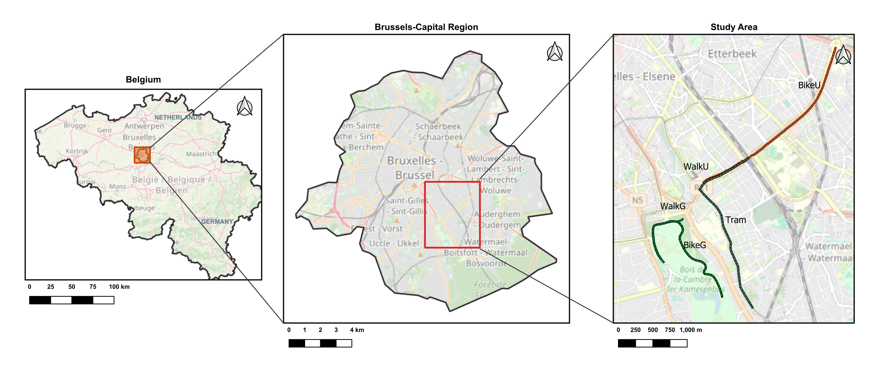

Figure 1. Study area.

## 1.2 Hypotheses

The study addresses four hypotheses (H1–H4). H5 denotes a complementary analysis of environmental exposures considered together.

1. H1: Participants will show better physiological and perceived comfort in green than in impervious areas.
2. H2: Physiological and perceived responses will be concordant (i.e., they correlate in direction).
3. H3: Psychophysiological comfort will be more compromised during cycling than during walking.
4. H4: The presence of noise will increase thermal discomfort.
5. H5: Additive models describe adjusted associations of co-occurring thermal, acoustic, radiative, pollution, and route-context terms with physiological responses.

# 2 Methods

The following sections describe the study design, measurements and statistical analysis.

## 2.1 Study design

A repeated-measures field campaign was conducted in Brussels, Belgium, from 3 July to 27 August 2025 (Figure 2). Each participant completed four core outdoor mobility phases—cycling and walking in an impervious corridor, from Etterbeek toward Montgomery, and in a green corridor, the Bois de la Cambre—plus a seated tram journey between the two locations (Figure 3). Phase labels were BikeU, WalkU, WalkG, BikeG and Tram.

The afternoon window is based on Pandya et al. (2026), in which UTCI and PET peaked between 14:00 and 16:00 in the summers of 2022–2024. Sessions ran from 13:30 to 17:30, the block shown on the same timeline (Figure 2). This schedule followed the ethics protocol and allowed consent and sensor fitting to be completed before the afternoon peak in the comfort indices.

Randomization of route order was planned. Participants completed questionnaires before and after each block. The participant wore the wristband, the eye-tracking glasses, and the light and air-quality loggers, and the trailing researcher carried the microclimate backpack (Figure 4); both were checked at breaks. H1 and H3 are within-person comparisons of environment and of mode under naturalistic active mobility; route location, workload, illumination and co-exposures co-vary with phase, so inferential models estimate associations, not single-stressor causation.

State anxiety is the STAI-6 short form (Marteau & Bekker, 1992). Perceived restorativeness is the PRS-11 (Pasini et al., 2014). Comfort, pleasantness and familiarity are on the same end-of-phase form. The word anchors, the numeric scores and the phase assignment are in §2.2.5.

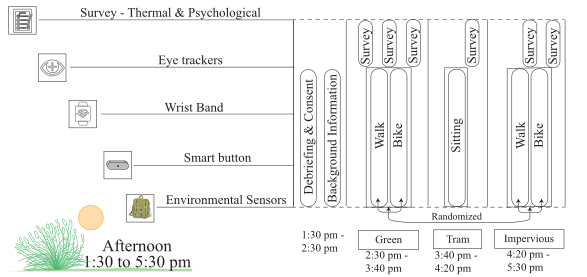

Figure 2. Experiment campaign timeline.

Figure 3. Route plan for the experiment.

Figure 4. Sensors worn by the participant.

### 2.1.1 Participants

Eighteen volunteers took part; the ethics protocol had planned for 30. The analysis included eleven participants with usable recordings across the four core phases (P4, P8–P17); outcome-specific missingness reduced the number contributing to some tests. Figure 5 shows data coverage for these eleven participants during the matched 8-minute segments used in the phase-mean models. Inclusion criteria were age 18–60 years, ability to walk and cycle the study routes, and vision compatible with mobile eye tracking. The IPSY ethics committee approved the study on 13 June 2025. For a two-sided paired comparison with 11 complete pairs, 80% power at an unadjusted α = 0.05 requires a standardised paired effect of approximately d_z = 0.94. This sensitivity calculation is not the power of every mixed-model coefficient or an FDR-adjusted test.

The analysed sample comprises eleven participants (three women, eight men) aged 24–58 years (mean 35.2 years, SD 9.5), within the 18–60 year inclusion range. Self-reported height and weight yield BMI 20.5–33.0 kg·m⁻² (mean 23.8 kg·m⁻², SD 3.8): eight meet WHO normal weight (18.5–24.9 kg·m⁻²), two are overweight, and one has obesity. Descriptive case-study groups comprise eight participants with normal-range BMI and three in other BMI categories, and six in the higher daily-walking-duration group and five in the lower group. BMI grouping is not a measurement of physical fitness. Self-reported skin-tone categories were very fair (n = 1), fair (n = 6), medium (n = 2), olive (n = 1) and brown (n = 1). These shade categories were not treated as Fitzpatrick phototypes, which require sun-reactivity information (Fitzpatrick, 1988). Skin pigmentation is relevant to optical wearable measurement performance (Bent et al., 2020). Seven participants normally wear glasses; four report no vision correction. These descriptive BMI and activity groups are not entered in the primary models.

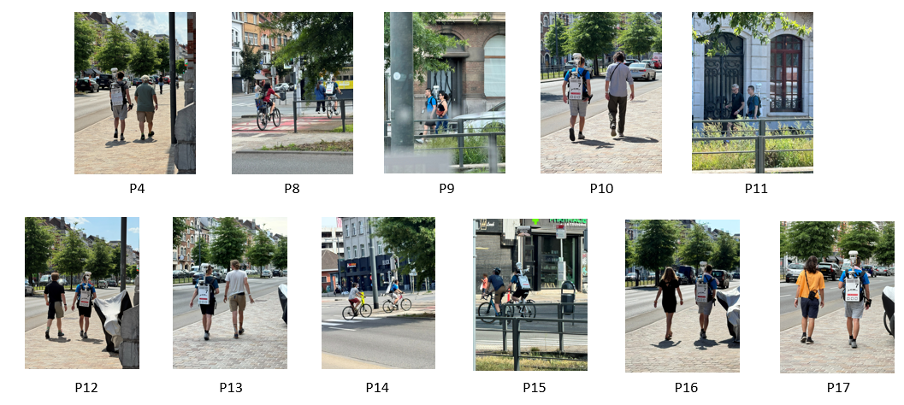

Figure 5. Participants on the matched 8-minute segments.

## 2.2 Data compilation

Sensor data are summarised at 10-second intervals. The UCM backpack records microclimate, position and sound data at one-second intervals. Appendix Table 1 lists the measurements and derived variables from each source, with units in brackets.

Units are shown where they are specified in the source data. All sensor records are aligned to a common 10-second timeline. Session timestamps are converted from UTC to Brussels local time by adding two hours. Phase start times are rounded down and end times are rounded up to the nearest 10 seconds. The clock runs from the first phase start to the last phase end of the session, including the indoor period and the gaps. Time between phases is labelled as rest and excluded from the planned comparisons. Missing samples are left missing. No value is interpolated or carried into the next bin, except the last sky-view value of a bout, which is copied from the previous row when the gap is exactly 10 s. The phase-mean models use the first eight minutes of each route phase, which is 48 ten-second epoch starts from 0 through 470 s, covering [0, 480 s), for the eleven analysed participants (44 participant × phase cells). Indoor and rest rows are not cut to eight minutes.

### 2.2.1 Empatica

Empatica measures wrist skin temperature, electrodermal activity, pulse rate, heart-rate variability, acceleration and metabolic equivalent.

### 2.2.2 UCM backpack

The UCM backpack measures air temperature, humidity, solar radiation, wind, mean radiant temperature, UTCI, PET, position and A-weighted sound level. It also measures sky view, tree view and building view, and the share of wind, nature, vehicle and man-made sound (Figure 6).

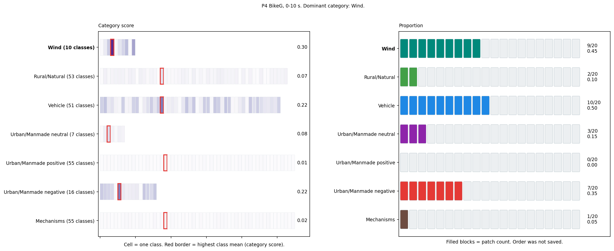

Figure 6. Type score and type proportion in one 10 s epoch.

### 2.2.3 Atmotube and LYS

Atmotube measures particulate matter. LYS measures illuminance and colour temperature.

### 2.2.4 Eye tracker

The eye tracker measures pupil diameter, eyelid aperture, blinks, fixations, saccades and gaze.

### 2.2.5 Questionnaire

At the end of each phase, participants complete a questionnaire on comfort, pleasantness, familiarity, state anxiety and how restorative they find the environment. A higher comfort, pleasantness or restorativeness score means more of that quality. Calm, relaxed and content are reversed, so a higher score means more state anxiety.

### 2.2.6 GVI

Mapillary images are used to estimate the visible greenery along each route.

## 2.3 Testing of Hypothesis

Phase-mean contrasts use REML linear mixed models (Pinheiro & Bates, 2000) on the participant × phase means, so that the comparison is within person and the 10-second counts are not treated as independent observations (Cnaan et al., 1997; Enders & Tofighi, 2007). Planned contrasts are estimated marginal means (Lenth, 2023). Relationships between questionnaire ratings and physiological measurements are assessed using repeated-measures correlation (Bakdash & Marusich, 2017). Benjamini–Hochberg correction (α = 0.05; Benjamini & Hochberg, 1995) is applied within the specified H1–H3 and H5 families; H4 nominal analyses are distinguished below. The repeated-measures field design follows ambulatory precedent (Rodrigues et al., 2026; Korkmaz et al., 2025).

Table 2. Analysis questions and temporal resolutions.

| Hypothesis | Phaseavg | Time series |
| ---------- | --- | --- |
| H1 | Within one person, does the 8-minute green bout differ from the 8-minute impervious bout on the 26 physiological outcomes? Cycling is BikeG − BikeU. Walking is WalkG − WalkU. | Within one person, does a 10-second epoch in the green corridor differ from a 10-second epoch in the impervious corridor on the 26 physiological outcomes? Cycling is BikeG − BikeU. Walking is WalkG − WalkU. Epochs within a bout are autocorrelated. |
| H2 | Within one person, does a higher end-of-phase questionnaire score go together with a higher or lower phase-mean physiological value? The statistic is the repeated-measures correlation across the four phases. | The questionnaire is completed at the end of the phase, so it is not computed on 10-second epochs. |
| H3 | Within one person, does the 8-minute walking bout differ from the 8-minute cycling bout on the 26 physiological outcomes? Impervious is WalkU − BikeU. Green is WalkG − BikeG. | Within one person, does a 10-second walking epoch differ from a 10-second cycling epoch on the 26 physiological outcomes? Impervious is WalkU − BikeU. Green is WalkG − BikeG. Epochs within a bout are autocorrelated. |
| H4 | The presence of noise will increase thermal discomfort. The test is `Y ~ dBA_z + UTCI_z + (1 \| participant)` on bout-mean thermal, acoustic and overall comfort for the 22 walking bouts. Both slopes on the same vote must be p < 0.05 in the predicted direction. | No epoch-level H4 comfort model: one questionnaire response is available per bout. |

### Hypothesis 1

H1, green versus urban.

Y_ij = β_0 + Phase_ij + u_i + ε_ij, (1)
where i is the participant, j is the phase, u_i is the participant intercept, and Phase is the bout. The two contrasts are cycling (BikeG − BikeU) and walking (WalkG − WalkU). Each contrast is its own Benjamini–Hochberg family of 26 physiological outcomes. Questionnaire items use their own families. A sensitivity analysis repeats the contrasts on outcomes standardised within person.

### Hypothesis 2

H2, physiological and perceived concordance, is the repeated-measures correlation (Bakdash & Marusich, 2017), fitted on the phase means as

vote_ij = α_i + β physiology_ij + ε_ij. (2)
Each person has a separate intercept and the slope is shared. That slope is the change in rating points for a 1-unit increase in the physiological measure. From its t statistic,

r = sign(t) × √(t² / (t² + ν)), (3)
where ν is the residual degrees of freedom. The interval for r is the Fisher-z interval of Bakdash & Marusich (2017). A pair is estimated when it has at least 20 complete means from at least 8 participants. The grid is 18 questionnaire scores by 26 physiological outcomes, and those pairs form one family. The rating is collected at the end of the phase, so this correlation is not computed on 10-second epochs.

### Hypothesis 3

H3, cycling versus walking, uses equation (1). The two contrasts are impervious (WalkU − BikeU) and green (WalkG − BikeG), and each is its own family of 26 outcomes. Questionnaire items use their own families, as in H1.

On the 10-second epochs, H1 and H3 use the same contrasts on the within-person standardised outcome,

Y_ijt = β_0 + Phase_ijt + u_i + ε_ijt, (4)
where t is the epoch and the errors within a bout follow a first-order autoregressive correlation.

### Hypothesis 4

Outdoor European studies that measured heat and sound do not estimate a sound × heat product on discomfort. They use additive or separate heat and noise models on walking (Cureau et al., 2022; Rodrigues et al., 2026; Grapas et al., 2026; Peng et al., 2025; Baquero Larriva & Higueras García, 2019). H4 follows that European walk design.

H4: The presence of noise will increase thermal discomfort. The test is

Y_ij ∼ dBA_z + UTCI_z + (1|participant), (5)

on bout-mean thermal, acoustic and overall comfort. dBA is the energy-mean A-weighted level of each bout and UTCI its mean; both are z-scored across the 22 walking bouts. Cycling is not an H4 extension. Tram is not in H4. The predicted sign for both slopes is negative (higher exposure, lower comfort). Support requires both coefficients on the same comfort vote at nominal p < 0.05. No false-discovery-rate correction is applied to H4.

None of the European sources is equation (5) on a comfort vote. Peng et al. (2025) fit five separate one-predictor models (`TSV ~ LAeq`; `TSV ~ ASV`; `ASV ~ UTCI`; `ASV ~ LAeq`; `ASV ~ TSV`), not `TSV ~ LAeq + UTCI`. Cureau et al. (2022) predict overall comfort from thermal, visual and acoustic ratings, not from UTCI and dBA. The Cureau rating-on-rating analogue is reported as context; it is not H4.

Table. Unique Brussels equations for the European methods. Citations [1]–[5] are Grapas 2026; Cureau 2022; Rodrigues 2026; Peng 2025; Baquero 2019. Two citations in one cell are the same equation, not two tests. Full *p* tables are in `H4_report.md`.

| Eq | Equation | Citations | H4? |
| --- | --- | --- | --- |
| A | `Y = b0 + b1 dBA_z + b2 UTCI_z + (1\|participant)` | this study | **Yes**, if Y is a comfort vote |
| B | `Y = b0 + b1 X + (1\|participant)` (five separate X) | [4] | No |
| C | `Y = b0 + b1 Noise_max_z + b2 Noise_sd_z + (1\|participant)` | [3] | No |
| D | `Y = b0 + b1 Temp_max_z + b2 Temp_mean_z + (1\|participant)` | [3] | No |
| E | `delay = b0 + b1 dBA_z + (1\|participant)` | [1] | No |
| F | `delay = b0 + b1 UTCI_z + (1\|participant)` | [1] | No |
| H | Wilcoxon signed-rank on `d = Y_urban − Y_green` | [2] | No (H1) |
| J | Pearson r(overall, environment) | [5] | No |
| K | `overall = b0 + b1 Ta_z + b2 RH_z + b3 dBA_z + b4 wind_z + (1\|participant)` | [5] | No |
| M | Fisher exact, vote × vote, per phase | [2] | No |
| N | multinomial overall from thermal+visual+acoustic ratings | [2] | No |
| O | `overall = b0 + b1 thermal + b2 acoustic + (1\|participant)` | [2] | No |

Pigliautile (2021), Cureau (2023), Kraus (2013), Ueberham (2019), Korpilo (2024), Moshammer (2019), Grapas Rome (2026) and Chiucchiù (2026, NEXT.ROOM indoor chamber) are excluded. Newcastle 2020 and Zouad & Baron 2026 were read and not ported.

Urban was warmer than green for all 11 walking participants and 10 of 11 cycling participants (P10's BikeU was 0.38 °C cooler than BikeG; by UTCI, 9 of 11), and louder for all 11 in both modes. Heat and sound therefore rise with the same route. All 11 participants completed all four phases, so each person contributes two bouts per mode.

### H5 — Combined-exposure analysis

The combined-exposure analysis fits seven additive mixed models, at 10 seconds and at phase means (Hamra & Buckley, 2018). It is a complementary analysis of adjusted exposure associations, separate from H1–H4. Each equation has the form

Y = β_0 + Thermal + co-exposures + route contrasts + u_i + ε, (6)
where u_i is the participant intercept. The thermal predictor varies across the seven equations (UTCI, air temperature with humidity and wind, mean radiant temperature, HUMIDEX, PET, then UTCI again with PM1 or PM10 in place of PM2.5). The co-exposures are A-weighted sound, sky view, PM2.5, illuminance and colour temperature. The 10-second equations also include solar irradiance and green view, except the mean-radiant-temperature equation, which omits direct solar irradiance and sky view because mean radiant temperature is already the radiation term. Green view is retained in that equation. The phase-mean form of the air-temperature equation omits sound. A term is screened by

VIF = 1 / (1 − R²), (7)
with the Fox–Monette factor for the route block (Marquardt, 1970; Fox & Monette, 1992; James et al., 2013). The factor is reported with the fitted specification. Specifications with a maximum variance inflation factor above 10 are flagged for substantial collinearity; their individual exposure coefficients are interpreted cautiously. For each exposure specification and predictor, BH correction is applied across the 26 physiological outcomes; phase contrasts use separate families. Exposure predictors are participant-centred at phase means or bout-centred at ten seconds and divided by their pooled centred standard deviation. Exposure coefficients are therefore per one standard-deviation increase, on the modelled outcome scale.

Descriptive pooled associations use Pearson’s coefficient,

r = covariance(x, y) / (s_x s_y). (8)
Pooling combines within- and between-participant variation. These descriptive coefficients are distinct from the participant-adjusted H2 correlations. The multimodal evidence map displays the four planned H1/H3 contrasts and the 468 H2 pairs as separate panels, using their saved estimates and BH families; it does not estimate a mediation pathway or a new pooled significance network.

- Specification 1 uses UTCI, sound, sky view, PM2.5, illuminance, colour temperature and the route contrasts. The 10-second form also includes solar irradiance and green view. The phase-mean form leaves those two out.
- Specification 2 replaces the UTCI in specification 1 with air temperature, humidity and wind.
- Specification 3 replaces the UTCI in specification 1 with mean radiant temperature, and leaves out the solar irradiance and sky view.
- Specification 4 replaces the UTCI in specification 1 with HUMIDEX.
- Specification 5 replaces the UTCI in specification 1 with PET.
- Specification 6 replaces the PM2.5 in specification 1 with PM1.
- Specification 7 replaces the PM2.5 in specification 1 with PM10.

Table 3. Maximum variance inflation factors by exposure specification and time resolution.

| Specification | Thermal predictor; particulate variant | Time series | Phase average |
| --- | --- | --- | --- |
| 1 | UTCI; PM2.5 | 2.52 | 7.95 |
| 2 | Air temperature, humidity and wind; PM2.5 | 1.88 | 9.29 |
| 3 | Mean radiant temperature; PM2.5 | 1.14 | 80.24 |
| 4 | HUMIDEX; PM2.5 | 1.41 | 5.52 |
| 5 | PET; PM2.5 | 2.36 | 6.58 |
| 6 | UTCI; PM1 | 2.52 | 7.73 |
| 7 | UTCI; PM10 | 2.52 | 8.28 |

Other predictors follow the time-resolution-specific definitions above; in particular, phase-average specification 2 omits sound, whereas its ten-second counterpart includes it.

# 3 Results

## 3.1 Microclimate of the green and impervious routes

Figure 7 compares the 10-second rows across the four core phases for UTCI, air temperature, mean radiant temperature, sound, PM2.5, illuminance, sky view and green view. The green routes were generally cooler, quieter and less exposed to sunlight than the impervious routes. For these exposures, the median of the eleven participants’ phase medians was lower on the green routes. UTCI was 25.1 °C during green cycling and 23.8 °C during green walking, against 27.0 °C and 32.0 °C. Sound was 59.5 and 61.5 dB(A), against 71.8 and 67.8 dB(A). Solar irradiance was 123 and 57 W m⁻², against 162 and 686 W m⁻². Figure 8 gives the same sound exposure as a count of 10-second rows in level bands, providing a separate summary of sound exposure.

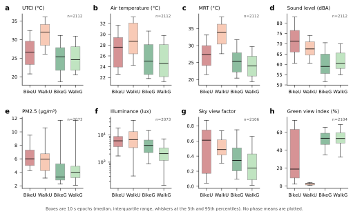

Figure 7. Microclimate and co-exposures by phase.

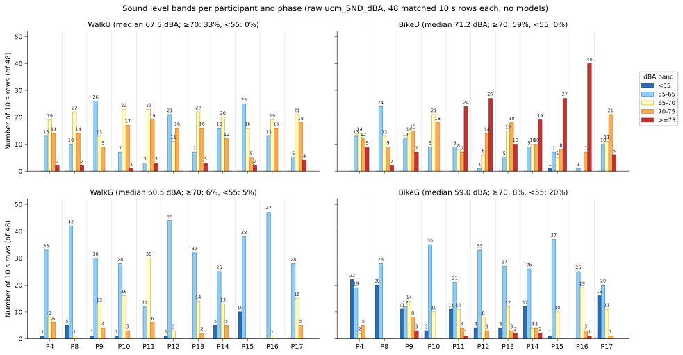

Figure 8. A-weighted sound level by participant and phase.

## 3.2 H1 — Green versus impervious comfort

Phase-mean models (§2.3). Figure 9 shows each green-minus-impervious comparison twice, the phase-mean estimate on the left and the 10-second estimate on the right, on one axis from −5 to 5 standard deviations. A filled point, with its q printed, is a contrast that passed correction. Green phases were associated with lower skin temperature and with larger pupil diameter (pupil is illumination-sensitive), and the other filled points are the eye-movement contrasts in Table 4. Eighteen comparisons of end-of-phase ratings remained significant after correction for multiple testing, using test families separate from those in §3.3. Thermal comfort was 0.64 points higher during green cycling and 1.09 points higher during green walking. The other significant rating differences indicated greater comfort or restorativeness on the green route, and reversed calm was 0.91 points lower on both modes.

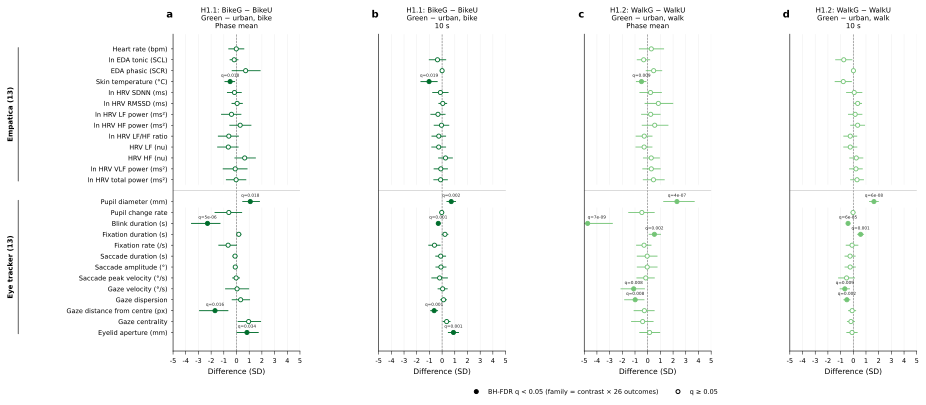

Figure 9. H1 green versus impervious contrasts.

Table 4. Physiological contrasts with q < 0.05. These rows are the filled points in Figure 9. The estimate column is the phase-mean model estimate in the outcome’s own units. The 10-second model is fitted on standardised outcomes, so those rows are in SD units.

| Method | Contrast | Outcome | Estimate | q |
| --- | --- | --- | --- | --- |
| Phaseavg | BikeG − BikeU | Skin temperature | −1.12 °C | 0.0178 |
| Phaseavg | BikeG − BikeU | Blink duration | −0.0092 s | 4.55e-06 |
| Phaseavg | BikeG − BikeU | Distance from centre | −38.1 px | 0.0159 |
| Phaseavg | BikeG − BikeU | Eyelid aperture | 0.877 mm | 0.0336 |
| Phaseavg | BikeG − BikeU | Pupil diameter | 0.393 mm | 0.0178 |
| Phaseavg | WalkG − WalkU | Skin temperature | −1.16 °C | 0.00916 |
| Phaseavg | WalkG − WalkU | Blink duration | −0.0133 s | 6.72e-09 |
| Phaseavg | WalkG − WalkU | Fixation duration | 0.0266 s | 0.00236 |
| Phaseavg | WalkG − WalkU | Gaze dispersion | −0.0111 (dimensionless) | 0.00810 |
| Phaseavg | WalkG − WalkU | Gaze velocity | −378 px s⁻¹ | 0.00838 |
| Phaseavg | WalkG − WalkU | Pupil diameter | 0.949 mm | 3.64e-07 |
| Time series | BikeG − BikeU | Skin temperature | −1.03 SD | 0.0187 |
| Time series | BikeG − BikeU | Blink duration | −0.30 SD | 0.00123 |
| Time series | BikeG − BikeU | Distance from centre | −0.63 SD | 0.00123 |
| Time series | BikeG − BikeU | Eyelid aperture | 0.90 SD | 0.00145 |
| Time series | BikeG − BikeU | Pupil diameter | 0.72 SD | 0.00205 |
| Time series | WalkG − WalkU | Blink duration | −0.41 SD | 5.95e-05 |
| Time series | WalkG − WalkU | Fixation duration | 0.58 SD | 0.00108 |
| Time series | WalkG − WalkU | Gaze dispersion | −0.51 SD | 0.00205 |
| Time series | WalkG − WalkU | Gaze velocity | −0.67 SD | 0.00858 |
| Time series | WalkG − WalkU | Pupil diameter | 1.63 SD | 5.94e-08 |

## 3.3 H2 — Relationships between physiological responses and perceived comfort

The repeated-measures correlation uses the four phase means of each person (Figure 10). Each cell is the correlation of one end-of-phase rating with one phase-mean physiological measure. A positive r means that, within a person, a higher rating is associated with a higher physiological value, and a black box is q < 0.05. Significant correlations involved skin temperature, pupil diameter, blink duration and fixation duration. No correlations involving heart rate or tonic electrodermal activity remained significant after correction. H2 uses phase averages because questionnaire ratings are collected once per phase. Calm, relaxed and content are the only reversed questionnaire scores in this figure. Tense, upset and worried already point toward more anxiety, so they are not reversed. The PRS subscales, pleasantness and the comfort items are not reversed: a higher score means more fascination, being away, coherence, scope, pleasantness or comfort.

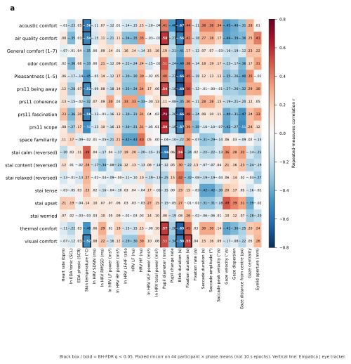

Figure 10. Repeated-measures correlation between the end-of-phase rating and the phase-mean physiology.

Table 5. The 21 pairs with q < 0.05. These are the black boxes in Figure 10. r and q are the fitted repeated-measures correlation and its Benjamini–Hochberg value (Bakdash & Marusich, 2017). The rating-change column for skin temperature and pupil diameter is the exported slope per 1 °C and per 1 mm. For blink duration the exported slope is per 1 s; the cell is that slope multiplied by 0.01, which is the rating change for a 0.01 s increase. For fixation duration the cell is the exported per-1 s slope multiplied by 0.1. r and q are not affected by that multiplication. H2 was not assessed at 10-second intervals.

| Method | Questionnaire | Physiological outcome | Rating change | r | q |
| --- | --- | --- | --- | --- | --- |
| Phaseavg | Acoustic comfort | Skin temperature | −0.54 points per 1 °C | −0.564 | 0.0310 |
| Phaseavg | Acoustic comfort | Blink duration | −0.67 points per 0.01 s | −0.673 | 0.00711 |
| Phaseavg | Air-quality comfort | Skin temperature | −0.51 points per 1 °C | −0.537 | 0.0377 |
| Phaseavg | Air-quality comfort | Blink duration | −0.54 points per 0.01 s | −0.558 | 0.0377 |
| Phaseavg | Air-quality comfort | Pupil diameter | +1.15 points per 1 mm | 0.581 | 0.0359 |
| Phaseavg | Pleasantness | Blink duration | −0.68 points per 0.01 s | −0.658 | 0.00711 |
| Phaseavg | PRS being away | Skin temperature | −0.58 points per 1 °C | −0.513 | 0.0439 |
| Phaseavg | PRS being away | Blink duration | −0.85 points per 0.01 s | −0.683 | 0.00711 |
| Phaseavg | PRS being away | Pupil diameter | +1.39 points per 1 mm | 0.542 | 0.0439 |
| Phaseavg | PRS fascination | Skin temperature | −0.46 points per 1 °C | −0.559 | 0.0310 |
| Phaseavg | PRS fascination | Blink duration | −0.59 points per 0.01 s | −0.665 | 0.00711 |
| Phaseavg | PRS fascination | Pupil diameter | +1.31 points per 1 mm | 0.715 | 0.00426 |
| Phaseavg | PRS scope | Blink duration | −0.63 points per 0.01 s | −0.571 | 0.0377 |
| Phaseavg | PRS scope | Pupil diameter | +1.33 points per 1 mm | 0.592 | 0.0310 |
| Phaseavg | STAI calm (reversed) | Blink duration | +0.42 points per 0.01 s | 0.560 | 0.0377 |
| Phaseavg | STAI calm (reversed) | Pupil diameter | −0.88 points per 1 mm | −0.562 | 0.0377 |
| Phaseavg | Thermal comfort | Blink duration | −0.41 points per 0.01 s | −0.653 | 0.00711 |
| Phaseavg | Thermal comfort | Pupil diameter | +0.74 points per 1 mm | 0.569 | 0.0377 |
| Phaseavg | Visual comfort | Skin temperature | −0.38 points per 1 °C | −0.517 | 0.0426 |
| Phaseavg | Visual comfort | Blink duration | −0.44 points per 0.01 s | −0.559 | 0.0377 |
| Phaseavg | Visual comfort | Fixation duration | +1.96 points per 0.1 s | 0.553 | 0.0396 |

## 3.4 H3 — Cycling versus walking

Phase-mean contrasts (§2.3). Figure 11 uses the same two-panel layout as Figure 9, and a filled point is q < 0.05. Walking versus cycling showed 8 FDR-significant primary physiological contrasts, all in eye movements: blinks, fixations, gaze and pupil. Tonic electrodermal activity, fixation rate and skin temperature did not survive correction, and are therefore shown as open points. Three questionnaire comparisons remained significant, all on the green corridor and separate from §3.3: pleasantness was 1.09 points lower, fascination 0.79 points lower and being away 0.97 points lower while walking than while cycling.

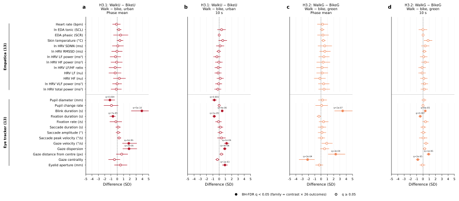

Figure 11. H3 walking versus cycling contrasts.

Table 6. Physiological contrasts with q < 0.05. These rows are the filled points in Figure 11. The estimate column is the phase-mean model estimate in the outcome’s own units. The 10-second rows are in SD units.

| Method | Contrast | Outcome | Estimate | q |
| --- | --- | --- | --- | --- |
| Phaseavg | WalkG − BikeG | Blink duration | 0.0110 s | 1.89e-07 |
| Phaseavg | WalkG − BikeG | Distance from centre | 52.8 px | 0.000275 |
| Phaseavg | WalkG − BikeG | Gaze centrality | −0.0928 (dimensionless) | 0.000275 |
| Phaseavg | WalkU − BikeU | Blink duration | 0.0151 s | 4.95e-10 |
| Phaseavg | WalkU − BikeU | Fixation duration | −0.0343 s | 7.20e-05 |
| Phaseavg | WalkU − BikeU | Gaze dispersion | 0.0189 (dimensionless) | 2.04e-05 |
| Phaseavg | WalkU − BikeU | Gaze velocity | 609 px s⁻¹ | 5.05e-05 |
| Phaseavg | WalkU − BikeU | Pupil diameter | −0.465 mm | 0.00385 |
| Time series | WalkG − BikeG | Blink duration | 0.37 SD | 6.14e-05 |
| Time series | WalkG − BikeG | Distance from centre | 0.90 SD | 1.07e-05 |
| Time series | WalkG − BikeG | Fixation duration | −0.43 SD | 0.00654 |
| Time series | WalkG − BikeG | Gaze centrality | −0.82 SD | 2.66e-05 |
| Time series | WalkU − BikeU | Blink duration | 0.48 SD | 4.13e-06 |
| Time series | WalkU − BikeU | Eyelid aperture | 0.92 SD | 0.000961 |
| Time series | WalkU − BikeU | Fixation duration | −0.78 SD | 1.07e-05 |
| Time series | WalkU − BikeU | Gaze dispersion | 0.89 SD | 4.13e-06 |
| Time series | WalkU − BikeU | Gaze velocity | 1.19 SD | 1.14e-05 |
| Time series | WalkU − BikeU | Pupil diameter | −0.76 SD | 0.00118 |

## 3.5 H4 — The presence of noise will increase thermal discomfort

Analyses used bout means from 11 participants (22 walking bouts). Equation (5) is the H4 test.

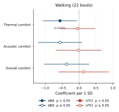

H4 coefficients. `Y ~ dBA_z + UTCI_z + (1 | participant)` on bout-mean walking comfort. Filled points are nominal *p* < 0.05; bars are 95% intervals. Support requires both slopes on the same vote.

Table 7. Additive two-exposure mixed model `Y ~ dBA_z + UTCI_z + (1 | participant)` on bout-mean comfort. Support for H4 requires both slopes on the same vote, predicted sign, *p* < 0.05. The points are those in `H4_coefficients`.

| Scope | Outcome | dBA β (*p*) | UTCI β (*p*) | Both exposures? |
| --- | --- | ---: | ---: | --- |
| Walk | thermal_comfort | **−0.564 (0.031)** | −0.049 (0.838) | no |
| Walk | acoustic_comfort | −0.564 (0.081) | −0.012 (0.968) | no |
| Walk | overall_comfort | −0.367 (0.245) | 0.133 (0.699) | no |

**Context, not H4.** Spearman thermal_comfort ~ acoustic_comfort on 11 person-means: ρ = 0.713 (*p* = 0.014). The Cureau analogue `overall_comfort ~ thermal_comfort + acoustic_comfort + (1 | participant)` was not significant (acoustic vote *p* = 0.088; thermal vote *p* = 0.491). Coupled ratings do not substitute for both measured exposures on the same vote.

**H4 outcome.** H4 is not supported. Sound is not a null: dBA is associated with thermal comfort on walking. UTCI on that same vote, after dBA, is not.

## 3.6 H5 — Combined exposure

Additive models at 10 s and at phase means (§2.3). Of 2,184 ten-second coefficients, 152 have q < 0.05; of 1,846 phase-mean coefficients, 30 do. The mean-radiant-temperature specification, combined-exposure model 3, has a maximum variance inflation factor of 1.14 at 10 s and 80.24 at phase means.

Of the 30 phase-mean and 152 ten-second coefficients with q < 0.05, 16 and 126, respectively, compare an individual phase with the average of all four phases. The following tables summarise the other 14 and 26 exposure associations; phase-indicator coefficients are omitted from this summary. Each slope estimates an association while adjusting for the other variables in the model. None of these exposure associations remains significant after false-discovery-rate correction at both time scales. Four of the 14 phase-mean rows are model 3. That phase-mean fit has a maximum variance inflation factor of 80.24. Severe collinearity in the phase-mean mean-radiant-temperature model limits attribution of its associations to individual predictors. The ten phase-mean slopes that remain are higher heart-rate variability with higher UTCI or air temperature, and higher gaze velocity with air temperature. The 26 ten-second slopes are ocular, mostly pupil diameter and pupil change rate with sky view factor or solar radiation.

Table 8. Phase-average exposure coefficients with q < 0.05. Estimates are per one-SD increase in the participant-centred exposure, on the modelled outcome scale; natural-log outcomes are not in native HRV units.

| Specification | Outcome | Predictor | Estimate | q |
| --- | --- | --- | --- | --- |
| 1 | HRV total power | UTCI | 0.3355 | 0.04484 |
| 1 | HRV VLF | UTCI | 0.5933 | 0.04484 |
| 2 | HRV HF | Air temperature | 0.274 | 0.0407 |
| 2 | HRV LF | Air temperature | 0.4018 | 0.04855 |
| 2 | HRV total power | Air temperature | 0.3526 | 0.03928 |
| 2 | HRV VLF | Air temperature | 0.5656 | 0.04855 |
| 2 | HRV SDNN | Air temperature | 0.1604 | 0.04921 |
| 2 | Gaze velocity | Air temperature | 320.6 | 0.03928 |
| 3 | HRV HF | Mean radiant temperature | 0.4026 | 0.02872 |
| 3 | HRV LF | Mean radiant temperature | 0.5841 | 0.02872 |
| 3 | HRV total power | Mean radiant temperature | 0.5198 | 0.03956 |
| 3 | HRV SDNN | Mean radiant temperature | 0.2268 | 0.03956 |
| 7 | HRV total power | UTCI | 0.3378 | 0.04953 |
| 7 | HRV VLF | UTCI | 0.6043 | 0.04953 |

Table 9. Twenty-six ten-second exposure slopes with q < 0.05, per one-SD increase in the bout-centred exposure on the modelled outcome scale.

| Specification | Outcome | Predictor | Estimate | q |
| --- | --- | --- | --- | --- |
| 1 | Pupil change rate | Sky view factor | -0.002212 | 0.02702 |
| 1 | Pupil diameter | Sky view factor | -0.05292 | 0.02939 |
| 2 | Fixation duration (s) | Solar radiation | -0.00776 | 0.02658 |
| 2 | Pupil change rate | Sky view factor | -0.002213 | 0.01716 |
| 2 | Pupil change rate | Air temperature | 0.004486 | 0.001037 |
| 2 | Pupil diameter | Sky view factor | -0.05492 | 0.01716 |
| 2 | Pupil diameter | Solar radiation | -0.0757 | 0.02187 |
| 3 | Fixation duration (s) | Mean radiant temperature | -0.006009 | 0.04385 |
| 3 | Pupil diameter | Mean radiant temperature | -0.08943 | 0.0002146 |
| 4 | Fixation duration (s) | Solar radiation | -0.007048 | 0.02821 |
| 4 | Pupil change rate | Sky view factor | -0.001954 | 0.04 |
| 4 | Pupil change rate | Humidex | 0.002731 | 0.01141 |
| 4 | Pupil diameter | Sky view factor | -0.05503 | 0.03378 |
| 4 | Pupil diameter | Solar radiation | -0.07723 | 0.0177 |
| 5 | Fixation duration (s) | Solar radiation | -0.00755 | 0.02937 |
| 5 | Fixation rate | Green view | 0.02716 | 0.04942 |
| 5 | Pupil change rate | Sky view factor | -0.002144 | 0.01847 |
| 5 | Pupil change rate | Green view | -0.001921 | 0.04942 |
| 5 | Pupil diameter | Sky view factor | -0.05493 | 0.01847 |
| 5 | Pupil diameter | Solar radiation | -0.0769 | 0.01871 |
| 6 | Pupil change rate | Sky view factor | -0.002203 | 0.03041 |
| 6 | Pupil change rate | Solar radiation | -0.003402 | 0.04979 |
| 6 | Pupil diameter | Sky view factor | -0.05286 | 0.03056 |
| 6 | Pupil diameter | Solar radiation | -0.06062 | 0.04979 |
| 7 | Pupil change rate | Sky view factor | -0.002217 | 0.02528 |
| 7 | Pupil diameter | Sky view factor | -0.05288 | 0.02957 |

# 4 Discussion

## 4.1 H1 — Green versus impervious comfort

Wrist skin temperature was 1.12 °C lower during green cycling than during impervious urban cycling, and 1.16 °C lower during green walking than during impervious urban walking. Thermal comfort was 0.64 points higher during green cycling and 1.09 points higher during green walking. The cycling difference in wrist temperature was also present in the ten-second model. The walking difference was not. No differences in heart rate, heart-rate variability or tonic electrodermal activity remained significant after correction. Lower wrist skin temperature is consistent with vegetation reducing radiant and convective heat exposure (Nikolopoulou et al., 2001; Fahy et al., 2025).

Pupil diameter was 0.393 mm larger during green cycling and 0.949 mm larger during green walking. Pupil size varies with illuminance and with arousal (Mahanama et al., 2022), and the urban and green corridors differ in both the light and the scene. The green-versus-impervious difference is more than twice as large while walking (0.949 mm) as while cycling (0.393 mm). On the impervious corridor, the pupil was 0.465 mm smaller while walking than while cycling (§4.3).

Blinks were 0.0092 s shorter during green cycling and 0.0133 s shorter during green walking. During green cycling, gaze was 38.1 px closer to the centre of the scene and the eyelid aperture was 0.877 mm larger. During green walking, fixations were 0.0266 s longer, gaze dispersion was 0.0111 lower on its recorded scale, and gaze velocity was 378 px s⁻¹ lower. Shorter blinks on both modes, and longer fixations with a slower gaze on foot, suggest that participants looked at the green corridor differently.

## 4.2 H2 — Relationships between physiological responses and perceived comfort

Higher wrist skin temperature was associated with lower end-of-phase ratings. Per 1 °C, acoustic comfort was 0.54 points lower, air-quality comfort 0.51 points lower, visual comfort 0.38 points lower, being away 0.58 points lower and fascination 0.46 points lower. The five slopes lie between about 0.4 and 0.6 points per degree. For context, applying these slopes to the approximately 1.1 °C route difference in §4.1 corresponds to roughly half a rating point; this is an association, not an estimated causal effect. Heart rate, heart-rate variability and tonic electrodermal activity were not significantly associated with the same ratings. In this study, end-of-phase ratings were more closely associated with wrist skin temperature than with cardiac or electrodermal measurements. The questionnaire is one score for the whole phase, so it summarises the bout rather than the fluctuations inside it.

A 1 mm larger pupil was associated with higher ratings: air-quality comfort by 1.15 points, thermal comfort by 0.74 points, being away by 1.39 points, fascination by 1.31 points and scope by 1.33 points. The reversed calm score was 0.88 points lower. That item is scored so that a higher value means more state anxiety, and the larger pupil was associated with a lower value. Pupil diameter also tracks light (Mahanama et al., 2022), and green and impervious corridors differ in illuminance.

A 0.01 s longer blink was associated with lower ratings: acoustic comfort by 0.67 points, air-quality comfort by 0.54 points, pleasantness by 0.68 points, thermal comfort by 0.41 points, visual comfort by 0.44 points, being away by 0.85 points, fascination by 0.59 points and scope by 0.63 points. Reversed calm was 0.42 points higher. A 0.1 s longer fixation was associated with visual comfort 1.96 points higher. Longer blinks and higher wrist skin temperature were associated with lower comfort ratings. Larger pupils and longer fixations were associated with higher visual comfort. These findings suggest distinct relationships between perceived comfort, eye movements and pupil size. There is no ten-second version of this test, because the rating is taken once, at the end of the phase.

## 4.3 H3 — Cycling versus walking

Walking and cycling differed in eye movements, and the size of the difference depended on the corridor. During green walking, compared with green cycling, blinks were 0.0110 s longer and gaze was 52.8 px farther from the centre of the scene. Gaze centrality was 0.0928 lower. Fixation duration on the green corridor differed only in the ten-second model, where it was 0.43 standard deviations shorter while walking. During impervious walking, compared with impervious cycling, blinks were 0.0151 s longer, fixations were 0.0343 s shorter, gaze dispersion was 0.0189 higher, gaze velocity was 609 px s⁻¹ higher, and the pupil was 0.465 mm smaller. Eyelid aperture on the impervious corridor differed only in the ten-second model, where it was 0.92 standard deviations larger while walking.

Estimated wrist temperature was 0.91 °C higher during impervious walking than impervious cycling, and 0.88 °C higher during green walking than green cycling. Neither contrast passed correction. On the green corridor, pleasantness was 1.09 points lower, fascination 0.79 points lower and being away 0.97 points lower while walking. No differences in heart rate, heart-rate variability or tonic electrodermal activity between the two modes remained significant after correction. The two modes differ in speed and in how much of the carriageway has to be watched (Rupi & Krizek, 2019).

## 4.4 H4 — The presence of noise will increase thermal discomfort

H4 follows the European outdoor walk specification, not a sound × heat product. Sound is not a null. dBA is associated with thermal comfort on walking (β = −0.564, *p* = 0.031). H4 is not supported, because UTCI does not show on that same vote once dBA is in the model (*p* = 0.838). Coupled ratings are in the table (ρ = 0.713); they are context, not H4.

Cureau et al. (2022) modelled overall comfort from ratings. Peng et al. (2025) fitted separate TSV/ASV models; heat → ASV was the miss. Neither is the Brussels two-exposure equation.

Walk medians of participant medians: UTCI 23.8 °C green vs 32.0 °C urban; sound 61.5 vs 67.8 dB(A). Heat and sound rise with the same route. Eleven people, two eight-minute walking bouts, one rating per bout. That limits how far heat and sound can be pulled apart. More work needs a larger sample and a design that does not tie heat and sound to the same route. Sound composition also varies at similar dBA (Figure 12).

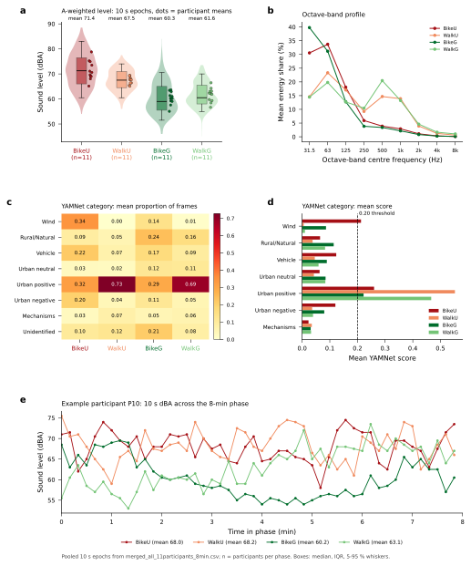

Figure 12. Sound composition along the routes.

## 4.5 H5 — Combined exposure

The seven additive models are a complementary analysis of adjusted exposure associations, separate from H1–H4. In the phase-mean models, higher UTCI or air temperature was associated with higher heart-rate variability, and gaze velocity was 320.6 px s⁻¹ higher per one-SD increase in participant-centred air temperature. In the ten-second models, the slopes that remained were mostly a smaller pupil, and a slower change in pupil diameter, when sky view or solar radiation was higher. Direct solar irradiance and sky view were left out of the mean-radiant-temperature specification because that temperature already represents radiation. The phase-mean fit of that specification has a maximum variance inflation factor of 80.24, on green view. Severe collinearity limits attribution of its associations to individual predictors. The ten-second fit of the same specification has a maximum of 1.14.

## 4.6 Multimodal evidence map

The evidence map brings together the four planned environment/mode contrasts and H2 within-person concordance without interpreting them as a causal chain. It shows all tested physiological outcomes, including nonsignificant results, with separate scales for paired standardised differences and repeated-measures correlations. Selected native-unit estimates and 95% intervals illustrate uncertainty. The environmental, physiological and psychological domains organise separate analyses; no mediation model is fitted.

Figure 13. Multimodal evidence map of primary phase-average H1/H3 contrasts and H2 within-person concordance. Outlined coloured dots indicate BH q < 0.05; grey dots indicate tested nonsignificant results. Effect scales and correction families are separate. The domains organise measured variables without establishing temporal ordering or mediation.

## 4.7 Limitations

The sample is 11 adults in one city over one summer (3 July to 27 August 2025). With 11 participants and two bouts per mode, one rating per bout, heat and sound cannot be pulled far apart because they rise with the same route. Environment type and travel mode are confounded with location, illuminance, metabolic rate, and co-exposures. Wrist temperature and electrodermal activity are sensitive to contact and motion. Because environmental characteristics co-varied across routes, the observed associations cannot isolate the causal contribution of green infrastructure.

# 5 Conclusion

Participants had lower wrist skin temperatures, larger pupils and higher thermal comfort ratings on green routes. Walking and cycling differed in eye movements, and on the green route in pleasantness, fascination and being away. Wrist temperature was higher while walking on both corridors, and neither contrast passed correction. End-of-phase ratings tracked blinks, pupil diameter and skin temperature in 21 of 468 pairs. Sound level was associated with thermal comfort while walking; UTCI on that same vote, after sound, was not. H4 is therefore not supported.

# Declarations

## Ethics approval and consent

The IPSY ethics committee approved the study on 13 June 2025 (reference Project2025-49). Each volunteer gave written informed consent. Eighteen volunteers were tested.

## Funding

This work was supported by the Fonds de la Recherche Scientifique (FNRS) [grant numbers - 1.A.891.23, T.0137.23] and SNSF Weave/Lead Agency funding scheme [grant number - 213995].

## Competing interests

The author declares no competing interests.

## CRediT authorship contribution statement

Pranav S. Pandya: Conceptualization, Methodology, Software, Formal analysis, Investigation, Data curation, Visualization, Writing – original draft. Yen-Shuo Huang: Writing – review & editing, Data curation. Maider Llaguno-Munitxa: Writing – review & editing, Supervision, Methodology, Funding acquisition, Conceptualization. Gabriele Manoli: Writing – review & editing, Funding acquisition. Peter Gallinelli - Technological support.

## Data availability

The wearable, eye-tracking and questionnaire records are not publicly archived because they can identify participants. De-identified data that the ethics approval allows to be shared are available from the corresponding author on reasonable request. The analysis scripts that produced the reported models are in the project repository.

# 6 References

Bakdash, J. Z., & Marusich, L. R. (2017). Repeated measures correlation. Frontiers in Psychology, 8, 456. https://doi.org/10.3389/fpsyg.2017.00456

Baquero Larriva, M. T., & Higueras García, E. (2019). Factores ambientales que influyen en el uso del espacio público para las personas mayores en Madrid. Urbano, 22(40), 108–126. https://doi.org/10.22320/07183607.2019.22.40.06

Benjamini, Y., & Hochberg, Y. (1995). Controlling the false discovery rate: A practical and powerful approach to multiple testing. Journal of the Royal Statistical Society: Series B (Methodological), 57(1), 289–300.

Bent, B., Goldstein, B. A., Kibbe, W. A., & Dunn, J. P. (2020). Investigating sources of inaccuracy in wearable optical heart rate sensors. npj Digital Medicine, 3, 18. https://doi.org/10.1038/s41746-020-0226-6

Boucsein, W., et al. (2012). Publication recommendations for electrodermal measurements. Psychophysiology, 49(8), 1017–1034. https://doi.org/10.1111/j.1469-8986.2012.01384.x

Chen, L.-C., Zhu, Y., Papandreou, G., Schroff, F., & Adam, H. (2018). Encoder-decoder with atrous separable convolution for semantic image segmentation. In Proceedings of the European Conference on Computer Vision (pp. 833–851).

Chinazzo, G., Wienold, J., & Andersen, M. (2019). Daylight affects human thermal perception. Scientific Reports, 9, 13690. https://doi.org/10.1038/s41598-019-48963-y

Cnaan, A., Laird, N. M., & Slasor, P. (1997). Using the general linear mixed model to analyse unbalanced repeated measures and longitudinal data. Statistics in Medicine, 16(20), 2349–2380.

Cureau, R. J., Pigliautile, I., Kousis, I., & Pisello, A. L. (2022). Multi-domain human-oriented approach to evaluate human comfort in outdoor environments. International Journal of Biometeorology, 66, 2033–2045. https://doi.org/10.1007/s00484-022-02338-7

Cooper, J., & Evans, T. (2015). Microphone wind speed limits during wind farm noise measurements. Proceedings of the Australian Acoustical Society Conference, Hunter Valley.

Di, G., Li, Z., Zhang, B., & Shi, Y. (2018). Adjustment on subjective annoyance of low frequency noise by adding additional sound. International Journal of Environmental Research and Public Health, 15(3), 474. https://doi.org/10.3390/ijerph15030474

Duffie, J. A., & Beckman, W. A. (2013). Solar engineering of thermal processes (4th ed.). Wiley.

Empatica. (2024). Empatica Health Monitoring Platform: Data access (PRS-0000205, Rev. 17.0). Empatica Inc.

Enders, C. K., & Tofighi, D. (2007). Centering predictor variables in cross-sectional multilevel models: A new look at an old issue. Psychological Methods, 12(2), 121–138. https://doi.org/10.1037/1082-989X.12.2.121

Evans, K. M., Jacobs, R. A., Tarduno, J. A., & Pelz, J. B. (2012). Collecting and analyzing eye-tracking data in outdoor environments. Journal of Eye Movement Research, 5(2), Article 6.

Fahy, J. C., Bachofen, C., Camponovo, R., Gallinelli, P., & Schlaepfer, M. A. (2025). Beyond land surface temperature: Identifying areas of daytime thermal discomfort in cities by combining remote sensing and field measurements. Urban Climate, 61, 102460. https://doi.org/10.1016/j.uclim.2025.102460

Federal Highway Administration. (n.d.). Highway traffic noise. https://www.fhwa.dot.gov/environment/noise/

Fitzpatrick, T. B. (1988). The validity and practicality of sun-reactive skin types I through VI. Archives of Dermatology, 124(6), 869–871. https://doi.org/10.1001/archderm.1988.01670060015008

Fox, J., & Monette, G. (1992). Generalized collinearity diagnostics. Journal of the American Statistical Association, 87(417), 178–183. https://doi.org/10.1080/01621459.1992.10475190

Gemmeke, J. F., Ellis, D. P. W., Freedman, D., Jansen, A., Lawrence, W., Moore, R. C., Plakal, M., & Ritter, M. (2017). Audio Set: An ontology and human-labeled dataset for audio events. Proceedings of the IEEE International Conference on Acoustics, Speech and Signal Processing, 776–780. https://doi.org/10.1109/ICASSP.2017.7952261

Gong, F.-Y., et al. (2018). Mapping sky, tree, and building view factors of street canyons. Building and Environment, 134, 155–167. https://doi.org/10.1016/j.buildenv.2018.02.042

Grapas, C., Llaguno-Munitxa, M., Pisello, A. L., & Irajpour, A. (2026). Urban chronotypes as climate vulnerability indicators: Safety-modulated bioclimatic responses and adaptive behavior across diurnal urban contexts. Urban Climate, 67, 102906. https://doi.org/10.1016/j.uclim.2026.102906

Hamra, G. B., & Buckley, J. P. (2018). Environmental exposure mixtures: Questions and methods to address them. Current Epidemiology Reports, 5(2), 160–165. https://doi.org/10.1007/s40471-018-0145-0

Holmer, B. (1992). A simple operative method for determination of sky view factors in complex urban canyons from fisheye photographs. Meteorologische Zeitschrift, 1, 236–239.

Hershey, S., Chaudhuri, S., Ellis, D. P. W., Gemmeke, J. F., Jansen, A., Moore, R. C., Plakal, M., Platt, D., Saurous, R. A., Seybold, B., Slaney, M., Weiss, R. J., & Wilson, K. (2017). CNN architectures for large-scale audio classification. Proceedings of the IEEE International Conference on Acoustics, Speech and Signal Processing, 131–135. https://doi.org/10.1109/ICASSP.2017.7952132

International Organization for Standardization. (2017). ISO 1996-2:2017. Acoustics — Description, measurement and assessment of environmental noise — Part 2: Determination of sound pressure levels.

James, G., Witten, D., Hastie, T., & Tibshirani, R. (2013). An introduction to statistical learning: With applications in R. Springer.

Korkmaz, D., Knauth, K., Brands, A., Schmeck, M., Büning, P., & Peters, J. (2025). Ambulatory physiological measures obtained under naturalistic urban mobility conditions have acceptable reliability. Scientific Reports, 15, 28940. https://doi.org/10.1038/s41598-025-13216-8

Lenth, R. V. (2023). emmeans: Estimated marginal means, aka least-squares means (R package). https://CRAN.R-project.org/package=emmeans

Lin, Y., Jin, Y., & Jin, H. (2022). Effects of different exercise types on outdoor thermal comfort in a severe cold city. Journal of Thermal Biology, 109, 103330. https://doi.org/10.1016/j.jtherbio.2022.103330

Mahanama, B., et al. (2022). Eye movement and pupil measures: A review. Frontiers in Computer Science, 3, 733531. https://doi.org/10.3389/fcomp.2021.733531

Mansi, S. A., Pigliautile, I., Arnesano, M., & Pisello, A. L. (2022). A novel methodology for human thermal comfort decoding via physiological signals measurement and analysis. Building and Environment, 222, 109385. https://doi.org/10.1016/j.buildenv.2022.109385

Marquardt, D. W. (1970). Generalized inverses, ridge regression, biased linear estimation, and nonlinear estimation. Technometrics, 12(3), 591–612.

Marteau, T. M., & Bekker, H. (1992). The development of a six-item short-form of the state scale of the Spielberger State-Trait Anxiety Inventory (STAI). British Journal of Clinical Psychology, 31(3), 301–306. https://doi.org/10.1111/j.2044-8260.1992.tb00997.x

Nikolopoulou, M., Baker, N., & Steemers, K. (2001). Thermal comfort in outdoor urban spaces: Understanding the human parameter. Solar Energy, 70(3), 227–235. https://doi.org/10.1016/S0038-092X(00)00093-1

Pandya, P., Huang, Y.-S., Ritter, C., Bou-Zeid, E. R., Manoli, G., & Llaguno-Munitxa, M. (2026). Environmental comfort and urban biking: Linking ridership to micrometeorological indicators and location characteristics. Sustainable Cities and Society, 151, 108048. https://doi.org/10.1016/j.scs.2026.108048

Pasini, M., Berto, R., Brondino, M., Hall, R., & Ortner, C. (2014). How to measure the restorative quality of environments: The PRS-11. Procedia - Social and Behavioral Sciences, 159, 293–297. https://doi.org/10.1016/j.sbspro.2014.12.375

Peng, Z., Lugten, M., Wuite, G., Luo, W., & Santucci, D. (2025). Coping with urban heat and noise: a case study at Schiphol Airport. 12th International Conference on Urban Climate (ICUC-12), abstract ICUC12-816. https://doi.org/10.5194/icuc12-816

Pinheiro, J. C., & Bates, D. M. (2000). Mixed-effects models in S and S-PLUS. Springer.

Quigley, K. S., et al. (2024). Publication guidelines for human heart rate and heart rate variability studies in psychophysiology—Part 1. Psychophysiology, 61, e14604. https://doi.org/10.1111/psyp.14604

Rodrigues, A. L., da Conceição, M. S. A., Ramusga, R. A. L., Lima Azevedo, C., & Morgado, P. (2026). The influence of urban context on emotions and bodily responses during walking. Journal of Urban Health, 103, 344–356. https://doi.org/10.1007/s11524-025-01051-1

Rupi, F., & Krizek, K. J. (2019). Visual eye gaze while cycling: Analyzing eye tracking at signalized intersections in urban conditions. Sustainability, 11(21), 6089. https://doi.org/10.3390/su11216089

Song, C., Joung, D., Ikei, H., Igarashi, M., Aga, M., Park, B.-J., Miwa, M., Takagaki, M., & Miyazaki, Y. (2013). Physiological and psychological effects of walking on young males in urban parks in winter. Journal of Physiological Anthropology, 32, 18. http://www.jphysiolanthropol.com/content/32/1/18

Song, C., Ikei, H., Igarashi, M., Miwa, M., Takagaki, M., & Miyazaki, Y. (2014). Physiological and psychological responses of young males during spring-time walks in urban parks. Journal of Physiological Anthropology, 33, 8. http://www.jphysiolanthropol.com/content/33/1/8

Stuyck, H., Dalla Costa, L., Cleeremans, A., & Van den Bussche, E. (2022). Validity of the Empatica E4 wristband to estimate resting-state heart rate variability in a lab-based context. International Journal of Psychophysiology, 182, 105–118. https://doi.org/10.1016/j.ijpsycho.2022.10.003

Task Force of the European Society of Cardiology and the North American Society of Pacing and Electrophysiology. (1996). Heart rate variability: Standards of measurement, physiological interpretation and clinical use. Circulation, 93(5), 1043–1065. https://doi.org/10.1161/01.CIR.93.5.1043

Welch, P. D. (1967). The use of fast Fourier transform for the estimation of power spectra: A method based on time averaging over short, modified periodograms. IEEE Transactions on Audio and Electroacoustics, 15(2), 70–73. https://doi.org/10.1109/TAU.1967.1161901

Zheng, H., Luo, M., Wang, Y., & Wei, Y. (2024). Multi-sensory interaction and spatial perception in urban microgreen spaces: A focus on vision, auditory, and olfaction. Sustainability, 16, 8809. https://doi.org/10.3390/su16208809

Zhou, B., Zhao, H., Puig, X., Fidler, S., Barriuso, A., & Torralba, A. (2017). Scene parsing through ADE20K dataset. In Proceedings of the IEEE Conference on Computer Vision and Pattern Recognition (pp. 633–641).

Zuo, J., Xia, H., Liu, S., & Qiao, Y. (2016). Mapping urban environmental noise using smartphones. Sensors, 16(10), 1692. https://doi.org/10.3390/s16101692

# Appendix

The scores entered in the models use the administered wording and anchors in §2.2.5. Tables 10 and 11 are the approved protocol forms (Annex 3). Table 1 lists the sensor parameters compiled for the analysis.

Table 10. Participant background questionnaire from the approved ethics form (Annex 3, Table 1: identity, demographics, residence, physical characteristics, familiarity, living environment, household, mobility and physical activity).

| Category | Questions | Response type |
| --- | --- | --- |
| Identity | 1. What is your name? | Text field |
| Demographics | 2. What is your age? | Text field |
| Demographics | 3. What is your gender? | Multiple choice: Male/ Female/ Prefer not to say |
| Demographics | 4. What is your nationality or country of origin? | Text field |
| Residence | 5. Where do you live in Brussels? | Text field |
| Residence | 6. How long have you been living in Brussels? | Text field |
| Physical characteristics | 7. What is your laterality? (Are you left or right-handed?) | Binary choice: Left / Right |
| Physical characteristics | 8. What is your current body weight? In Kg. | Text field |
| Physical characteristics | 9. What is your height? In cm. | Text field |
| Physical characteristics | 10. What are you currently wearing? Please describe your outfit as precisely as possible including the color (e.g., short-sleeved shirt, jeans, sandals, light jacket, etc.). | Text field |
| Physical characteristics | 11. What do you normally use for vision correction? | Multiple choice: Normal vision/ Wear glasses/ Wear contact lens / Uncorrected vision impairment/ Prefer not to say |
| Familiarity | 12. How well do you know the streets and surroundings where the experiment is in Brussels? | Linear scale 1–10: Not at all familiar (1) / Extremely familiar (10) |
| Living environment | 13. What is your type of residence? | Binary choice: City / Suburban environment |
| Household | 14. Do you have children? | Multiple choice: Yes / No |
| Mobility | 15. How do you commute to work? | Multiple choice: Walk/ Bike/ Train/ Metro/ Tram |
| Physical activity | 16. Is there any sport or physical activity you practice regularly? Name it. Else write no. | Text field |
| Physical activity | 17. How frequently do you bike? | Multiple choice: Daily/ Few times per week/ Few times per month/ Rarely/ Never |
| Physical activity | 18. On average how much do you walk every day? | Multiple choice: <15 min/ 15 to 30 min/ 30 min to 1 hour/ 1 to 2 hours/ > 2 hours |

Table 11. Experimental campaign questionnaire (`Recurring questionnaire.csv`): **7-point overall comfort** (“How comfortable do you feel right now?”) and a **5-point comfort grid** for Thermal, Acoustic, Visual, Air, and Odors (Comfortable → Extremely uncomfortable). Scoring: `05_questionnaire_build.py`; literature-test mapping: `H4_papers_screened_final.md` §2 (local thermal-comfort adaptations use this row; thermal sensation is not interchangeable with thermal comfort).

| Item | Question | Response format | Source framework |
| --- | --- | --- | --- |
| 1 | How comfortable do you feel right now? | Very uncomfortable / Uncomfortable / Slightly uncomfortable / Neutral / Slightly comfortable / Comfortable / Very comfortable | Comfort Sensation Vote |
| 2 | Please describe your thermal sensation | Cold / Cool / Slightly cool / Neutral / Slightly warm / Warm / Hot | Thermal Sensation Vote |
| 3 | Which environmental factor is most affecting you right now? | □ Temperature □ Lighting □ Noise □ Air Quality □ Crowding | Environmental Stressor |
| 4 | I feel calm | Not at all / A little / Moderately / Quite a lot / Extremely | STAI |
| 5 | I feel tense | Not at all / A little / Moderately / Quite a lot / Extremely | STAI |
| 6 | I feel upset | Not at all / A little / Moderately / Quite a lot / Extremely | STAI |
| 7 | I feel relaxed | Not at all / A little / Moderately / Quite a lot / Extremely | STAI |
| 8 | I feel content | Not at all / A little / Moderately / Quite a lot / Extremely | STAI |
| 9 | I feel worried | Not at all / A little / Moderately / Quite a lot / Extremely | STAI |
| 10 | Places like that are fascinating | Not at all / A little / Moderately / Quite a lot / Extremely | PRS |
| 11 | In places like this my attention is drawn to many interesting things | Not at all / A little / Moderately / Quite a lot / Extremely | PRS |
| 12 | In places like this it is hard to be bored | Not at all / A little / Moderately / Quite a lot / Extremely | PRS |
| 13 | Places like that are a refuge from nuisances | Not at all / A little / Moderately / Quite a lot / Extremely | PRS |
| 14 | To get away from things that usually demand my attention I like to go to places like this | Not at all / A little / Moderately / Quite a lot / Extremely | PRS |
| 15 | To stop thinking about the things that I must get done I like to go to places like this | Not at all / A little / Moderately / Quite a lot / Extremely | PRS |
| 16 | There is a clear order in the physical arrangement of places like this | Not at all / A little / Moderately / Quite a lot / Extremely | PRS |
| 17 | In places like this it is easy to see how things are organised | Not at all / A little / Moderately / Quite a lot / Extremely | PRS |
| 18 | In places like this everything seems to have its proper place | Not at all / A little / Moderately / Quite a lot / Extremely | PRS |
| 19 | That place is large enough to allow exploration in many directions | Not at all / A little / Moderately / Quite a lot / Extremely | PRS |
| 20 | In places like that there are few boundaries to limit my possibility for moving about | Not at all / A little / Moderately / Quite a lot / Extremely | PRS |
| 21 | How pleasant do you feel in this place? | Not at all / A little / Moderately / Quite a lot / Extremely | Greenness |

Table 1. Parameters compiled from each sensor.

| Empatica Embrace Plus | UCM backpack | Sound Spectrum | Sky view factor | Atmotube | LYS | Eye tracker | Questionnaire | Mapillary |
| --- | --- | --- | --- | --- | --- | --- | --- | --- |
| Pulse rate (beats min⁻¹) | Latitude (°) | Power share, 20–200 Hz (fraction) | Sky share (%) | PM1 (µg m⁻³) | Illuminance (lx) | Pupil diameter (mm) | Current comfort (1–7) | Green view (%) |
| Heart rate, same series stored again (beats min⁻¹) | Longitude (°) | Power share, 200–2000 Hz (fraction) | Tree share (%) | PM2.5 (µg m⁻³) | Colour temperature (K) | Pupil change rate (mm s⁻¹) | Familiarity with the place (1–5) | Tree share of the panorama (%) |
| Metabolic equivalent (MET) | Altitude (m) | Power share, 2000–20000 Hz (fraction) | Plant share (%) | PM10 (µg m⁻³) | Melanopic equivalent daylight illuminance | Blink duration (s) | Pleasantness (1–5) | Grass share of the panorama (%) |
| Skin conductance, raw (µS) | Horizontal dilution of precision | Power share, octave band 31.5 Hz (fraction) | Grass share (%) | Humidity (%) | Movement | Fixation duration (s) | Thermal comfort (1–5) | Plant share of the panorama (%) |
| Skin conductance, tonic (µS) | GPS heading (°) | Power share, octave band 63 Hz (fraction) | Building share (%) | Temperature (°C) | Blue, green and red channels | Fixation rate (s⁻¹) | Acoustic comfort (1–5) |  |
| Skin conductance, phasic (µS) | Magnetic heading (°) | Power share, octave band 125 Hz (fraction) | Wall share (%) |  | Red, green, blue and infrared colour record | Saccade duration (s) | Visual comfort (1–5) |  |
| Skin temperature (°C) | Receiver fix flag (code) | Power share, octave band 250 Hz (fraction) | Ceiling share (%) |  | Illuminance label (label) | Saccade amplitude (°) | Air-quality comfort (1–5) |  |
| Acceleration, x (g) | Count of valid speed samples (count) | Power share, octave band 500 Hz (fraction) | Vegetation share (%) |  |  | Saccade peak velocity (px s⁻¹) | Odour comfort (1–5) |  |
| Acceleration, y (g) | Speed (km h⁻¹) | Power share, octave band 1000 Hz (fraction) | Built-up share (%) |  |  | Gaze velocity (px s⁻¹) | Calm, reversed (1–5) |  |
| Acceleration, z (g) | Air temperature (°C) | Power share, octave band 2000 Hz (fraction) | Sky view factor |  |  | Gaze dispersion | Tense (1–5) |  |
| Acceleration magnitude (g) | Relative humidity (%) | Power share, octave band 4000 Hz (fraction) | Tree view factor |  |  | Distance from the centre (px) | Upset (1–5) |  |
| RMSSD (ms) | Absolute humidity (g m⁻³) | Power share, octave band 8000 Hz (fraction) | Building view factor |  |  | Gaze centrality | Relaxed, reversed (1–5) |  |
| SDNN (ms) | Air temperature, mast bottom (°C) | Peak frequency (Hz) |  |  |  | Eyelid aperture (mm) | Content, reversed (1–5) |  |
| Low-frequency power (ms²) | Air temperature, mast middle (°C) | Power-weighted mean frequency (Hz) |  |  |  | Stress composite | Worried (1–5) |  |
| High-frequency power (ms²) | Air temperature, mast top (°C) | Frequency below 85% of power (Hz) |  |  |  |  | Fascination (1–5) |  |
| Very-low-frequency power (ms²) | Global horizontal irradiance (W m⁻²) | Wind type score (score) |  |  |  |  | Being away (1–5) |  |
| Total power (ms²) | Solar altitude (°) | Rural or natural type score (score) |  |  |  |  | Coherence (1–5) |  |
| Low-frequency / high-frequency ratio | Solar azimuth (°) | Vehicle type score (score) |  |  |  |  | Scope (1–5) |  |
| Normalised low frequency (%) | Recorded factor fp | Neutral man-made type score (score) |  |  |  |  | Height (m) |  |
| Normalised high frequency (%) | Extraterrestrial irradiance (W m⁻²) | Pleasant man-made type score (score) |  |  |  |  | Weight (kg) |  |
|  | Clearness index | Unpleasant man-made type score (score) |  |  |  |  | Body mass index (kg m⁻²) |  |
|  | A-weighted sound level (dB(A)) | Mechanisms type score (score) |  |  |  |  |  |  |
|  | Apparent wind speed (m s⁻¹) | Wind proportion (fraction) |  |  |  |  |  |  |
|  | Apparent wind angle (°) | Rural or natural proportion (fraction) |  |  |  |  |  |  |
|  | True wind speed (m s⁻¹) | Vehicle proportion (fraction) |  |  |  |  |  |  |
|  | True wind direction (°) | Neutral man-made proportion (fraction) |  |  |  |  |  |  |
|  | Mean radiant temperature (°C) | Pleasant man-made proportion (fraction) |  |  |  |  |  |  |
|  | Operative temperature (°C) | Unpleasant man-made proportion (fraction) |  |  |  |  |  |  |
|  | HUMIDEX (index) | Mechanisms proportion (fraction) |  |  |  |  |  |  |
|  | UTCI (°C) | Unidentified proportion (fraction) |  |  |  |  |  |  |
|  | PET (°C) |  |  |  |  |  |  |  |
