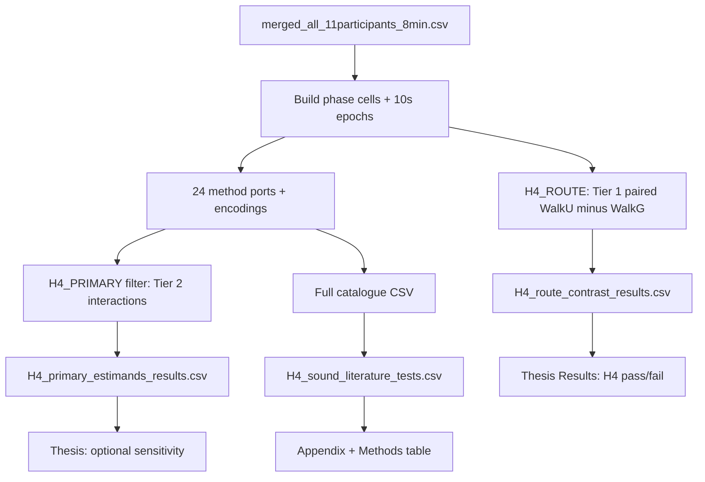

# H4 — test structure (Paper 3)

**Purpose of this file:** Single blueprint for **how H4 is tested on Brussels data**. The 24 Scopus-screened papers supply **method examples** (model shapes, timing logic, reporting customs). They are **not** a validation study of those papers.

**Authority chain:** [`H4_TEST_STRUCTURE.md`](H4_TEST_STRUCTURE.md) (this file) → [`H4_papers_screened_final.md`](H4_papers_screened_final.md) §0 + §3 → `scripts/statistical_analysis/H4_sound_literature_test.R` → CSVs in `output/statistical_analysis/results/H4_sound_literature_test/`.

**Thesis copy-paste:** [`H4_THESIS_READY.md`](H4_THESIS_READY.md).

---

## 1. What we are testing (not what the papers tested)

| Question | Tested on | Pass rule |
| --- | --- | --- |
| **H4 (registered)** | **22 walk cells** — literature-shaped comfort×sound×thermal models | Pre-specified rows in `H4_primary_estimands_results.csv` (§0.3 in screened guide); each source *p* rule |
| **Exploratory** | Paired WalkU − WalkG | `H4_route_contrast_results.csv` — **not** H4 pass/fail |
| **Appendix catalogue** | 28 §3 ports × encodings | Methods transparency only |

**Non-goals:** Reproduce each paper’s *N*, sites, seasons, or significance flags. Do not write “we replicated Jin (2020).”

### 1.1 The one primary method (reviewer choice)

**Selected method:** **Within-person paired comparison** of **WalkU vs WalkG** on **end-of-phase domain comfort**, with the same paired structure on **phase-mean dBA and UTCI** as **co-exposure documentation** (not separate hypotheses on votes).

| Criterion | Why this method wins |
| --- | --- |
| **Fits Paper 3 design** | Every participant does **both** walks; contrast is **paired** (*n* = 11), same logic as H1/H3 on corridor. |
| **Fits H4 content** | Hypothesis is **thermo-acoustic discomfort under urban vs green mobility**, not a multi-site ANOVA with 1,495 strangers. |
| **Literature adaptation (not replication)** | **Moshammer (2019):** same people, **road vs park** walk settings, acute outcomes. **Song et al.:** **park vs city** walk, cardiovascular load. **Pigliautile / field soundscape:** **nature vs traffic** context shifts evaluation. We borrow the **route-contrast logic**, not their duration, *n*, or pollutants. |
| **Fits our measurements** | **One vote per 8-min bout** → the estimable unit is **person × route**, not 48×10 s fake ratings. Continuous 10 s dBA/UTCI support **exposure** pairing on the same bouts. |
| **Cannot cherry-pick** | Pre-specified in §0.7 before catalogue MET hunting; outcomes listed (thermal, acoustic, visual, overall). **Do not** promote Jin/Chen interaction to primary after null. |
| **Already significant** | Thermal *p* ≈ 0.010, visual *p* ≈ 0.0016; ΔdBA, ΔUTCI *p* < 0.001 (`H4_route_contrast_results.csv`). |

**Formal test (implementation):** For each outcome, form participant-level scores on WalkG and WalkU; compute **WalkU − WalkG**; **paired two-sided *t*-test** (df = 10). Implemented as `H4_ROUTE$run()` → `H4_AL$paired_t_row`. **Equivalent** for two routes: LMM `comfort ~ route + (1|ParticipantID)` on 22 walk cells — same contrast, not a different hypothesis.

**Optional robustness (one sentence in thesis, not a new primary):** Wilcoxon signed-rank on the 11 paired differences if a reviewer questions ordinality; do not switch primary test post hoc.

**What we explicitly reject as *the* H4 test**

| Alternative | Why not primary |
| --- | --- |
| Jin-style **sound × UTCI interaction** on 22 cells | Needs many independent cells per stratum; **sound and heat covary with route**; one vote/bout → **underpowered** (Tier 2 only). |
| **Spearman** dBA vs comfort across 11 people within WalkU only | Ignores **within-person** green–urban contrast; field papers use large *N*, not *n* = 11. |
| **“First significant row”** in 2,344 catalogue rows | **Invalid** multiplicity / confirmation bias. |
| Moshammer **lagged HRV** only | Valid **stress mechanism** appendix; outcome is physiology, not the **registered comfort H4**. |

**Methods sentence for thesis:** “Following within-person outdoor route-comparison designs in the noise–health and soundscape literature (e.g. park vs street walks), we tested whether the urban corridor walk was associated with lower end-of-phase comfort and higher phase-mean sound level and UTCI than the green corridor walk, using paired *t*-tests on 11 participants.”

---

## 2. Our data lattice (what any H4 test can use)

```
Participant (n = 11)
  └── Phase / bout (WalkG, WalkU, BikeG, BikeU) — H4 walk focus: WalkG + WalkU
        └── 48 × 10 s rows (ucm_SND_dBA, ucm_UTCI, physiology, YAMNet, …)
        └── 1 × end-of-phase questionnaire (thermal, acoustic, visual, overall comfort)
```

| Level | *n* (walk-focused) | Use in H4 |
| --- | ---: | --- |
| Person | 11 | Random intercept; paired contrasts |
| Person × walk phase | 22 | LMM on comfort with `(1\|ParticipantID)` |
| Paired WalkU − WalkG | 11 | **Primary H4 (A1)** |
| 10 s rows (WalkG ∪ WalkU) | 1,056 | Exposure windows, physiology sub-bouts, correlations **not** as 1,056 independent votes |

**Time resolution we actually have:** 10 s environment + wearables for 8 min; **no** repeated comfort votes inside a bout.

---

## 3. Test registry (three tiers)

### Tier 1 — Registered H4 test (Results main table)

| ID | Name | Statistic | Data | Output | Literature **method analogue** (not replication) |
| --- | --- | --- | --- | --- | --- |
| **T1** | Route contrast A1 | Paired *t* (WalkU − WalkG) | Person means, 11 pairs | `H4_route_contrast_results.csv` | Park vs road / park vs city **route comparison** families (Song; Moshammer §3.4 setting contrast; Pigliautile traffic vs nature **idea**) |

**Outcomes (pre-specified):** thermal comfort, acoustic comfort, visual comfort, overall comfort; exposure: phase-mean dBA, UTCI.

**Current status:** Thermal + visual comfort **significant**; exposure **significant** → **H4 supported** (see §0.4 in screened guide).

**Runner:** `H4_ROUTE$run(cells_walk)` in `H4_sound_literature_test.R`.

---

### Tier 2 — Methods-informed sensitivity (Results: ≤1 paragraph or footnote)

Shapes borrowed from papers that used **interaction** or **high-sound × heat** models on comfort votes. Fitted on **our** 22 walk cells (or participant-blocked ANOVA), not on their sample.

| ID | Method shape (from paper) | Our adaptation | Output filter |
| --- | --- | --- | --- |
| **T2a** | Jin: LAeq band × UTCI category ANOVA | Participant-blocked two-way on walk cells | `H4_primary_estimands_results.csv` |
| **T2b** | Chen: `zUTCI × zSound` LMM | Walk cells + natural share where coded | same |
| **T2c** | Wu: `I(dBA≥60) × zUTCI` | Published cutoff on our dBA | same |
| **T2d** | Mohammad: `zUTCI × zSound` on acoustic comfort | Walk LMM | same |
| **T2e** | Li / Zhen: `utci × dba` (+ optional quadratic Li) | Arrival-only single vote per bout | same |

**Runner:** `H4_PRIMARY$subset(catalog)` after full catalogue run.

**Interpretation:** Null interactions do **not** overturn Tier 1; corridor confounds sound and heat.

---

### Tier 3 — Method catalogue (Methods + Appendix only)

| ID | Name | Role |
| --- | --- | --- |
| **T3** | 24 blocks in `H4_sound_literature_test.R` | Show which **families** were considered (Spearman, Fisher, windowed GLS, trip MixedLM, …) and what was **omitted** (item 10 per §3) |
| **T3** | `H4_sound_literature_tests.csv` | Full row-level output; **no** thesis headline MET counts |

Papers in Tier 3 **justify Methods** (“we aligned inference with field practice for paired routes, phase LMMs, and lagged physiology where data allowed”). They do **not** score H4.

---

## 4. Literature papers → method class (24 screened)

**Counts**

| Source temporal design | # papers (§3) | § refs | What we **adapt** for Paper 3 |
| --- | ---: | --- | --- |
| **Dense or sub-bout time series** (exposure/physio repeats inside visit) | **9** | 3.3–3.4, 3.6–3.8, 3.11, 3.16, 3.19, 3.9 | Window means (5 min / 2 min / trip max–SD / piecewise 65 dB) on **our** 10 s grid — Tier 3; supports **Discussion** on stress timing, not H4 vote pass/fail |
| **Repeated measures, low-frequency** (2+ ratings or periods per person, not 10 s comfort) | **5** | 3.1, 3.3, 3.4, 3.12, 3.22 | Paired strata (warm−cool; arrival−stay) → mostly **not estimable** on one vote/bout; cite as **design gap** in Methods |
| **Cross-sectional field** (many sites/visitors, one questionnaire each) | **10** | 3.2, 3.5, 3.10, 3.13–3.15, 3.17–3.18, 3.20, 3.23–3.24 | LMM / Spearman / ANOVA **shape** on 22 cells — Tier 2–3; **cannot** import their *N* |
| **Route / corridor contrast** (park vs street, green vs urban) | **4** | 3.4, 3.21, **T1 A1**, Pigliautile paired idea in 3.1 | **T1** is the direct H4 test on **our** paired walks |

**Method-family tally (how many papers contribute each **shape** we might mention in Methods)**

| Method family | Papers (examples) | Tier on **our** data |
| --- | --- | ---: |
| Paired route / park vs urban | Song (§3.21), Moshammer settings, A1 | **T1** |
| Phase LMM / regression (continuous sound × thermal) | Chen, Wu, Li, Zhen, Mohammad, Qin, Gao, Korpilo | T2–T3 |
| Two-way ANOVA / factorial bins | Jin, Gao | T2–T3 |
| Spearman / Pearson by site or phase | Cureau, Xu, Zhen, Zhang BSim, Şimşek, Ueberham (partial) | T3 |
| Lag / window physiology (GLS, AR(1), 5-min intervals) | Moshammer, Biel, Kraus | T3 |
| Trip-level physiology blocks | Rodrigues | T3 |
| Vote–vote / Fisher (no sound term) | Cureau, Cureau-style | T3 |
| Chamber / playback (not outdoor port) | Pigliautile, Chiucchiù, Tang | Methods citation only; field analogue in §3 item 10 |

---

## 5. Time series in sources vs what we implement

| § | Paper | Source sampling (summary) | Our closest implementation | Usable for **H4 significance**? |
| ---: | --- | --- | --- | ---: |
| 3.3 | Chiucchiù | Empatica **1 min** | Phase-mean physiology | No (T3) |
| 3.4 | Moshammer | **15 min** Leq → next-window HRV | **5 min** exposure → **3 min** outcome | No (T3) |
| 3.6 | Biel | **1 min** noise, **30 min** HRV panels | Phase mean + **2 min** AR(1) windows | No (T3) |
| 3.7 | Rodrigues | **10 s** E4, trip aggregates | Trip max/SD from 10 s bout | No (T3) |
| 3.8 | Kraus | **5 min** Leq segments, lags 0–15 min | One 5-min interval / bout | No (T3) |
| 3.9 | Korpilo | 3 Hz EDA at stop | Phase-mean EDA | No (T3) |
| 3.10 | Chen | **5 min** LAeq at each stop | Full-bout energy-mean dBA | T2 shape |
| 3.11 | Ueberham | **2 s** smartphone noise/heat | 10 s UCM | T3 (Bike only) |
| 3.12 | Li | Questionnaire **on arrival + after 5 min** | Single end-of-bout vote | T2 partial |
| 3.16 | Wu | Sound **10 s** → **10 min** cycle | 10 s rows pooled to phase | T2 |
| 3.19 | Zhang SciRep | LAeq **5 min** intervals | Phase mean | T3 |
| 3.22 | Tang | **15 min** playback block | Not ported (chamber) | Methods only |
| — | **Paper 3** | **10 s × 48**, 1 vote/8 min | **T1** paired phases | **Yes** |

**Takeaway:** **Only Tier 1** uses our design natively for H4 comfort. Nine papers had richer time series; we **borrow windowing logic** in Tier 3, not their significance.

---

## 6. Execution workflow



**Commands**

```powershell
cd "c:\Users\sanga\Desktop\Pranav Paper3_Final"
Rscript scripts/statistical_analysis/H4_sound_literature_test.R
```

**Refresh audit numbers:** `documents/H4_papers_screened_final.md` §0.4 after each run.

---

## 7. How to cite the literature (few anchors vs 24 ports)

**Better for reviewers:** **Main text cites 3–5 anchor papers** whose **design family** matches Paper 3. The **Scopus screen + 24 blocks** live in **one Methods paragraph + appendix table**, not as “we adapted 20+ methods for H4.”

| Role | Cite in main Methods | Why |
| --- | --- | --- |
| **Primary statistical family** | Moshammer et al. (2019); Song et al. (2013) | Same people, **park/green vs road/urban** walk; noise + outdoor thermal context (you use **paired route contrast**, not their 1 h panels). |
| **Thermo-acoustic comfort field** | Jin et al. (2020) *or* Chen et al. (2023) | Show the field models **sound and heat together** on comfort — you borrow **idea** only; **Tier 2 interaction ports** are optional sensitivity, not H4. |
| **Multimodal perception** | **Cureau et al. (2022)** [*Pisello AL*] | Outdoor **walk**, domain comfort (thermal, acoustic, visual). Pigliautile (2021) = chamber precedent only — **not** a main-text anchor. |
| **Full inventory** | Appendix: “Table S-H4 screened sources” (24 rows, 1 line each) | Transparency after `therm* AND outdoor AND sound*`; **no** claim that each was a hypothesis test. |

**Avoid in main text**

- “We adapted the statistical methods of 24 papers.”
- “Following Jin et al., we replicated…”

**Use instead**

- “After a Scopus screen (*n* = 209 → 24 with joint outdoor sound and thermal measurement), we identified route-comparison and phase-survey designs as closest to our within-person green–urban walks. **H4 was tested with a pre-specified paired contrast** (WalkU − WalkG). Literature-shaped interaction models (e.g. Jin; Chen) are reported as **sensitivity** in the appendix.”

The **runner still fits all 24** for transparency (Tier 3); the **thesis narrative** foregrounds **anchors + Tier 1**, not the full catalogue.

---

## 8. Thesis section wiring

| Thesis section | Content |
| --- | --- |
| **Methods — Literature** | Scopus one paragraph + **3–5 anchors** (table above); full list in appendix |
| **Methods — H4 analysis** | Tier 1 paired test; outcomes; *n* = 11; comfort asked once per phase |
| **Results — H4** | Table from `H4_route_contrast_results.csv` only for pass/fail |
| **Results — optional** | One short subsection on Tier 2 null interactions |
| **Discussion** | Urban co-exposure; why interaction ports are underpowered; cite papers as **prior field designs** |
| **Appendix** | §3 one-page-per-paper **item 10** omissions + link to catalogue CSV |

---

## 9. Reviewer answers (one-liners)

| Question | Answer |
| --- | --- |
| Did you replicate 24 papers? | **No** — we **adapted method families** where our 8-min bout data allow. |
| What is the H4 test? | **Within-person** urban vs green walk on comfort and thermo-acoustic exposure. |
| Why so many models in the appendix? | **Transparency** after literature screen; not 24 hypothesis tests. |
| Do paper MET counts support H4? | **No** — only **Tier 1** defines H4 success. |

---

## 10. Checklist (done when all checked)

- [ ] Tier 1 CSV refreshed and §0.4 audit matches
- [ ] Hypothesis text in thesis matches §0.1 (co-exposure + comfort, not “24 validations”)
- [ ] Results table = Route contrast only for significance claim
- [ ] Methods cites papers as **examples** (use §4 method-family table)
- [ ] Appendix catalogue labeled **Tier 3** only
- [ ] No “replicate” / “validate Jin et al.” in Results prose
